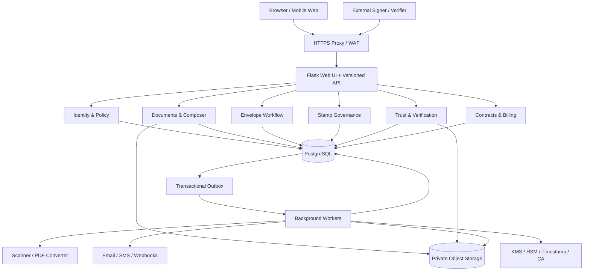

# TrustSeal

TrustSeal is a browser-first, multi-tenant document trust platform designed to help individuals and organisations prepare, approve, sign, stamp, share, verify, and archive electronic records.

The product vision combines document management with controlled authority, tamper-evident evidence, and independent verification. A signature image, stamp graphic, or QR code is never treated as proof by itself; TrustSeal is designed to associate each action with an exact document version, an authorized actor, a defined workflow, and an auditable evidence record.

> [!IMPORTANT]
> As of **2026-11-16**, Phases A–W of the code-addressable remediation plan are closed. The platform ships with: private object storage, tenant-scoped repositories hardened with PostgreSQL row-level security, idempotent transaction outbox + background workers, evidence-grade finalization with signed RFC 3161 timestamps and OCSP/CRL capture, immutable validation dossiers, signed PDF sealing through AWS KMS via pyHanko, public tamper-evident verification wired to the validation dossier, append-only SHA-256 chained audit log with externally-signed chain anchors, durable DB-backed rate limiting, drawn/typed/uploaded signature capture on `/sign` with vendored PDF.js and signature_pad, OpenTelemetry tracing + Prometheus metrics, OIDC + **SAML 2.0 SSO (with SP-signed AuthnRequests)**, SCIM 2.0 provisioning, email verification, password-reset lifecycle, session/device management, step-up MFA enforced on high-risk routes, separation-of-duties policy, teams, time-bound delegation, multi-field placement with signer-scoped ownership, sequential/parallel/quorum **and conditional** routing (JSON predicate DSL), withdraw/reminder/resend, preview checkpoint, image→PDF + sandboxed DOCX→PDF ingestion, pypdf-based safe preview, bulk upload with per-item recovery, template versioning with publication workflow, clause libraries, Postgres full-text search, usage ledger + plan entitlement enforcement, envelope reissue lineage, provider-agnostic billing adapter, **signed tenant data export + GDPR Article 17 erasure + time-bound break-glass operator access**, SCIM service-account rotate/revoke/expiry, MFA secret re-wrap under a rotated `SECRET_KEY`, federated Single Logout (OIDC + SAML `LogoutRequest`), webhook delivery ping + replay, standalone delegated-OCSP responder verification, signed audit-chain slice export, envelope auto-expiry, scheduled reminder scanner, liveness + readiness probes, pluggable private storage (filesystem + S3/MinIO), tenant-scoped **outbox dead-letter inspection + replay**, an **admin dashboard aggregator** (readiness + SLO + usage + outbox + webhook backlog), **bulk participant invitations** with per-row recovery, **envelope labels with label-filtered listing**, **bulk envelope withdrawal** with per-row recovery, **per-envelope reminder cadence overrides** (cooloff + max-count), **soft envelope archival**, **reusable envelope templates with instantiation**, **X-Trace-Id / X-Request-Id response correlation headers**, **tenant-scoped SecurityEvent CSV export** with filters, **webhook event-type wildcards** (`*`, `prefix.*`), **signer-uploaded supporting attachments** (PDF/PNG/JPEG, magic-byte validated, bound to the recorded decision and attested in the Ed25519 receipt), **operator-facing attachment review + download**, **tenant-scoped usage-ledger CSV export**, **in-app operator notification feed** (list/count-unread/mark-read with auto-emit on envelope auto-expiry), and a **988-test pytest suite running against real PostgreSQL**. What remains is a single genuine external dependency: an **external penetration-test engagement** with a qualified firm. Every other item in the historic remaining-gaps doc has shipped — tracked in [`docs/REMAINING_GAPS_2026-11-15.md`](docs/REMAINING_GAPS_2026-11-15.md). Do not represent the current build as legally certified, universally binding, tamper-proof, or compliant with a specific jurisdiction until the external pen-test and jurisdictional-approval steps in that document complete.

## Contents

- [Product overview](#product-overview)
- [Feature highlights](#feature-highlights)
- [Core workflows](#core-workflows)
- [Architecture](#architecture)
- [Technology stack](#technology-stack)
- [Repository status](#repository-status)
- [Getting started](#getting-started)
- [Project structure](#project-structure)
- [Security and trust model](#security-and-trust-model)
- [Testing and quality](#testing-and-quality)
- [Delivery roadmap](#delivery-roadmap)
- [Documentation](#documentation)
- [Contributing](#contributing)

## Product overview

TrustSeal is intended for:

- individuals managing personal documents and signature profiles;
- organisations controlling members, teams, permissions, templates, stamps, and contracts;
- authors and preparers creating or uploading documents;
- reviewers and approvers participating in governed workflows;
- internal and external signers completing assigned actions;
- stamp custodians approving official seal or stamp use;
- compliance teams inspecting evidence, retention, and audit history;
- clients and counterparties receiving or verifying trusted records;
- API clients integrating document and trust workflows into other systems.

The intended platform supports the complete lifecycle:

```text
Create / Upload
      -> Validate and Version
      -> Prepare Fields and Participants
      -> Review and Approve
      -> Invite and Authenticate
      -> Sign and/or Stamp
      -> Finalize and Build Evidence
      -> Verify
      -> Archive, Retain, or Supersede
```

## Feature highlights

Status legend:

- **Shipped** — implemented, test-covered against real PostgreSQL, and documented.
- **Partial** — core behavior shipped, named extensions tracked as residual gaps.
- **Deferred** — governance, UI, or third-party-integration work tracked in [`docs/REMAINING_GAPS_2026-11-15.md`](docs/REMAINING_GAPS_2026-11-15.md).

### Identity and access management

| Capability | Status | Behavior |
| --- | --- | --- |
| Registration, login, logout | Shipped | Flask-Login session + JWT access/refresh family with reuse detection. `app/blueprints/auth/`, `app/services/refresh_tokens.py`. |
| Password management | Shipped | 12-char minimum; change-password revokes every refresh family; `last_password_change_at` tracked on the user row. `app/blueprints/auth/routes/auth_api.py`. |
| Email verification | Shipped (Phase A1) | Hashed single-use token, 48-hour TTL, rate-limited resend. `EmailVerificationToken`, `app/services/email_verification.py`, `@require_verified_email` decorator. |
| Password reset lifecycle | Shipped (Phase A2) | Enumeration-safe 202 request, IP-rate-limited, token consume sets new password + revokes every refresh family. `PasswordResetToken`, `app/services/password_reset.py`. |
| Multi-factor authentication | Shipped | TOTP with 10 one-shot scrypt-hashed recovery codes; Fernet-wrapped seed derived from SECRET_KEY. `app/services/mfa.py`. |
| Step-up MFA on high-risk actions | Shipped (Phase A4) | `@require_recent_mfa(max_age_seconds=300)` decorator + `POST /api/auth/mfa/step-up` issues a fresh access JWT with `mfa_verified_at` claim and revokes the previous one. Available for routes to apply. |
| Session and device management | Shipped (Phase A3) | `UserSession` per refresh family with UA/IP/last-seen; `GET /api/auth/sessions`, `DELETE /api/auth/sessions/<id>`, `DELETE /api/auth/sessions/others`. |
| External participant access | Shipped | Hashed single-use `SignerInvitation` tokens (14-day TTL, recipient-bound, revocable) with partial-unique index supporting resend. `app/services/signer_invitations.py`. |
| SSO (OIDC) | Shipped | OIDC provider configuration + JIT user provisioning. `app/models/oidc_provider.py`, `tests/test_oidc_sso.py`. |
| SSO (SAML) | Shipped (Phase G) | SP-initiated, HTTP-POST response binding, SP-signed AuthnRequests (Phase H3). `app/services/saml.py`, `app/blueprints/auth/routes/saml_views.py`. |
| SCIM 2.0 provisioning | Shipped | `/scim/v2/` endpoints with service-account bearer auth. `app/blueprints/integrations/scim_api.py`. |
| Identity assurance policies | Shipped (Phase I1) | Step-up MFA applied inline on envelope prepare, stamp approve, template publish, clause approve, admin role grant. Operator flag `STEP_UP_MFA_REQUIRED` controls rollout. `app/policies/step_up_enforcement.py`. |

### Organisations, teams, and authorization

| Capability | Status | Behavior |
| --- | --- | --- |
| Organisation workspaces | Shipped | `Organization` + membership model; full admin + member APIs. |
| Members and invitations | Shipped | `UserInvitation` for joining an org; `SignerInvitation` for recipient-bound signing access. |
| Roles and permissions | Shipped | Role / Permission / RolePermission / UserRole; deny-by-default guard in `app/policies/api_access.py`. |
| Teams and departmental scope | Shipped (Phase B2) | `Team` + `TeamMembership` (org-scoped, soft-deleted); `/api/teams` admin CRUD + `/api/teams/me`. |
| Delegation | Shipped (Phase B3) | `Delegation` model with windowed, scope-limited, resource-bounded authority transfer; `*` wildcard for out-of-office; `/api/delegations` grant / revoke / outgoing / incoming. Refuses self-delegation, cross-org, past/empty windows. |
| Separation of duties | Shipped (Phase B1) | `assert_distinct` / `enforce` / `@require_separation_of_duties`; emits a `SecurityEvent` on denial. Applied to stamp approval, admin role grants, template publish, clause approve. |
| Tenant isolation | Shipped | Application-layer `TenantScopedRepository` plus PostgreSQL row-level security (defence-in-depth) on 11 trust-critical tables. `app/services/tenant_rls.py`. |

### Document management

| Capability | Status | Behavior |
| --- | --- | --- |
| Document records | Shipped | CRUD + soft-delete + tenant-scoped repository. |
| PDF ingestion | Shipped | Magic-check + ClamAV scan + atomic promotion to immutable private-storage object. `app/services/documents/private_storage.py`. |
| Image (PNG/JPEG) ingestion | Shipped (Phase D1) | Pillow + reportlab single-page conversion with magic check, byte cap, pixel cap, RGBA flattening. Config gate `IMAGE_PDF_CONVERSION_ENABLED`. `app/services/documents/image_conversion.py`. |
| DOCX ingestion | Shipped (Phase I4) | Sandboxed `libreoffice --headless --convert-to pdf` subprocess with timeout + resource-limited temp dir + output validation. Config gate `DOCX_LIBREOFFICE_BINARY`. `app/services/documents/docx_conversion.py`. |
| Drafts and sections | Shipped | Models + CRUD; immutable append-only snapshots via `DocumentSnapshot` + Postgres triggers. |
| Document types and classification | Shipped | DocumentType + tags + ownership. |
| Versions | Shipped | `DocumentBlob` revisions; SHA-256 manifests; append-only. |
| Parties and participants | Shipped | DocumentParty + EnvelopeParticipant. |
| Comments and activity | Shipped | DocumentComment + DocumentActivity + append-only DocumentAuditLog. |
| Shares and reminders | Shipped | DocumentShare + DocumentReminder. |
| Private object storage | Shipped | Encrypted non-public storage; `PRIVATE_DOCUMENT_ROOT` isolated from Flask static; mode-0400 objects. |
| Safe preview pipeline | Shipped (Phase D2) | pypdf-based sanitiser strips `/OpenAction`, `/AA`, `/JS`, `/JavaScript`, `/Names`, `/EmbeddedFiles`, `/AcroForm` from catalog; per-page `/AA`; per-annotation `/A`/`/AA`/`/JS`. `GET /api/documents/<id>/blobs/<bid>/preview`. Config gate `SAFE_PREVIEW_ENABLED`. |
| Full-text search | Shipped (Phase E3) | Postgres `to_tsvector('english', title ‖ description)` with `plainto_tsquery`, `ts_rank` ordering, tenant isolation, soft-delete exclusion. `GET /api/documents/search?q=`. |
| Bulk upload | Shipped (Phase D3) | `POST /api/documents/bulk` accepts up to 25 files; per-item `succeeded`/`failed` status; durable `BulkIngestBatch` + `BulkIngestItem`; 207 Multi-Status for partial failure. |
| Retention and legal hold | Shipped | EvidenceRetention + EvidenceLegalHold + EvidenceCheckpoint with release-reason tracking. `app/services/evidence_preservation.py`. |

### Document preparation and authoring

| Capability | Status | Behavior |
| --- | --- | --- |
| Rich-text + template composition | Shipped | `DocumentTemplate` + `DocumentTemplateVersion` state machine. |
| Headings / tables / clauses / variables | Shipped (Phase J1) | Server-side HTML sanitizer with explicit tag + attr allowlist (`lxml`); minimal Markdown renderer covering headings, ordered + unordered lists, tables, bold / italic / code, fenced code blocks, and links. Script / iframe / `javascript:` / inline event handlers stripped. `app/services/rich_text.py`. |
| Draft autosave + optimistic concurrency | Shipped (Phase H2) | `version` column on `DocumentDraft`; `POST /api/document-drafts/<id>/autosave` requires `If-Match: <version>`; 412 returned on stale writes. |
| Multi-field placement (signature, initials, date, text, checkbox) | Shipped (Phase C1) | `EnvelopeField` with per-participant assignment, page + coord rectangles, field_type enum. `POST/DELETE /api/envelopes/<id>/fields`. |
| Page-accurate coordinates + preview | Shipped | PDF user-space (x_pt, y_pt, width_pt, height_pt); vendored PDF.js viewer on `/sign`. |
| Required/optional fields + signer-scoped visibility | Shipped (Phase C2) | A signer only sees their own fields via `GET /api/signer-intent/envelopes/<id>/fields`; foreign field ids submitted on a decision get 403. |
| Template revision history, publication, archival | Shipped (Phase E1) | State machine `draft` → `published` → `archived`; publish requires separation of duties (caller ≠ current version author). `/api/document-templates`. |
| Clause libraries + approval policies | Shipped (Phase E2) | `Clause` + `ClauseVersion` with draft → approved → archived; SoD on approval. `/api/clauses`. |
| Explicit preview + confirmation before issuing | Shipped (Phase C5) | `preview_confirmed_at` timestamp on the envelope; `/prepare` refuses until `POST /api/envelopes/<id>/preview/confirm` has been called. |
| Tenant-controlled AI suggestions | Shipped (Phase J2) | Provider-agnostic `AiSuggestionProvider` ABC + `NoopAiSuggestionProvider` reference adapter + registry. Operator sets `AI_SUGGESTION_PROVIDER`; tenant must opt in via `AI_SUGGESTIONS_ENABLED`. Every request emits a `SecurityEvent`. `app/services/ai_suggestions.py`. |

### Electronic signatures and consent

| Capability | Status | Behavior |
| --- | --- | --- |
| Signature profiles | Shipped | SignatureProfile per user. |
| Signature requests | Shipped | SignatureRequest + SignatureRequestActivity + routing through signer intent. |
| Drawn appearance | Shipped (G10) | signature_pad canvas + `SignerAppearance` row persists 256 KB PNG into private storage; SHA-256 recorded. |
| Typed and uploaded appearances | Shipped (Phase I2 + I3) | Server-side rendering of typed names via Pillow; uploaded PNG/JPEG normalised to PNG. `appearance_kind` column distinguishes `drawn` / `typed` / `uploaded`. `app/services/signer_appearances.py`. |
| Secure signing invitations | Shipped | Hashed, recipient-bound, 14-day TTL, revocable; resend revokes + reissues via `POST /api/envelopes/<id>/participants/<pid>/resend-invitation`. |
| Explicit electronic consent | Shipped | Versioned consent wording stored by hash; intent captured on SignerDecision with time + affirmation. |
| Field ownership enforcement | Shipped (Phase C2) | Signer sees only own fields; `submit_values` raises `FieldOwnershipError` on cross-participant writes. |
| Routing — sequential, parallel, quorum | Shipped (Phase C3) | `SigningEnvelope.routing_mode` + `quorum_required`; eligibility engine honours the mode. Witness role waits for every signer / until quorum met. |
| Routing — witness | Shipped (Phase C3) | Witness participant signs last in every mode. |
| Routing — conditional | Shipped (Phase H1) | `EnvelopeRoutingRule` with a safe JSON predicate DSL (and/or/not + six comparators + typed refs; depth-capped). Rules layer on top of sequential/parallel/quorum modes. `app/services/envelope_routing_rules.py`. |
| Exceptions — decline, expiry, cancel | Shipped | Decline/expiry/cancel records on SignerDecision + SignerInvitation lifecycle. |
| Exceptions — reminder | Shipped (Phase C4) | `POST /api/envelopes/<id>/participants/<pid>/reminder` sends an email via the mailer transport. |
| Exceptions — resend | Shipped (Phase C4) | `POST /api/envelopes/<id>/participants/<pid>/resend-invitation` revokes + reissues. |
| Exceptions — withdraw | Shipped (Phase C4) | `POST /api/envelopes/<id>/withdraw` for prepared envelopes before any decision lands. |
| Exceptions — correction/reissue | Shipped (Phase F3 + I6) | `POST /api/envelopes/<id>/reissue` clones participants + fields with `supersedes_envelope_id`/`superseded_by_envelope_id` links; `GET /api/envelopes/<id>/lineage` walks the full chain for verification. |
| Idempotent finalization | Shipped | Orchestrator is idempotent via `IdempotencyRecord`. |
| Evidence package | Shipped | Document digest + invitation + consent + events + timestamps + manifest exported from `ValidationDossier`. |
| Certificate-backed signatures | Shipped | pyHanko external signer against AWS KMS; CMS/PAdES chain with TSA + OCSP evidence. `app/services/pdf_sealing.py`. |

TrustSeal distinguishes a graphical signature appearance from a cryptographic digital signature. The interface and verification record state the assurance actually delivered.

### Digital stamps and official seals

The intended stamp system includes:

- personal, team, organisation, and institutional stamp assets;
- circular and rectangular designs, text, logos, border weights, ink colors, and server-generated dates;
- immutable asset and design revisions;
- owners, custodians, permitted roles, validity dates, intended use, and organisation scope;
- restricted stamp requests with approve, reject, withdraw, escalate, expire, and revoke behavior;
- configurable dual control for higher-assurance or official seals;
- protected asset storage and access logs;
- page placement, scaling, rotation, and repetition across selected pages;
- impression records bound to the exact stamp revision, document digest, actor, authority chain, page coordinates, and UTC time;
- preservation of historical impressions after an asset is suspended, retired, expired, or revoked;
- explicit distinction between a visual stamp and a legally or cryptographically assured seal.

Custody, dual-control approval with separation-of-duties, immutable stamp-attestation evidence, and hash-bound application are **shipped**. See `app/services/stamp_custody.py`, `app/services/stamped_pdf.py`, and `app/services/stamp_attestation.py`.

### Independent verification and evidence

Planned verification capabilities include:

- high-entropy, non-enumerable verification references;
- QR codes containing safe references rather than credentials or personal data;
- a public verification page with configurable minimal disclosure;
- uploaded-file hashing and comparison with the issued canonical record;
- distinct `valid`, `mismatch`, `expired`, `revoked`, `replaced`, `unknown`, and `unverifiable` outcomes;
- issuer, issue time, current status, and accurate assurance claims;
- privacy previews controlling which fields are publicly displayed;
- rate limiting, abuse monitoring, and privacy-minimized verification logs;
- authenticated access to detailed evidence and completion certificates;
- machine-readable manifests and optional signed attestations;
- certificate chain, timestamp, and revocation checks for supported higher-assurance documents.

Independent verification is **shipped**: public tamper-evident verification is wired to the immutable `ValidationDossier` and refuses records whose chain or digest no longer matches. See `app/blueprints/trust/views/verify_views.py` and `app/services/validation_dossier.py`. Rate limiting, correlation-ID audit, and privacy-minimised disclosure are in place; the detailed-evidence export is operator-gated.

### Contract lifecycle management

Planned contract features include:

- contract creation from uploads or governed templates;
- parties, owners, type, value, effective date, duration, and status;
- draft, review, approval, execution, active, expired, and terminated states;
- review comments, decisions, negotiation history, and tracked versions;
- approval thresholds and delegation of authority;
- obligations, milestones, owners, deadlines, and reminders;
- renewal, termination, amendment, and supersession lineage;
- search by party, owner, date, value, stage, and renewal;
- structured clause extraction and risk tagging with page-level provenance;
- an optional controlled counterparty negotiation portal.

### Collaboration and notifications

- Role-specific invitations for reviewers, approvers, signers, viewers, and stamp custodians.
- Internal comments, mentions, and tasks restricted to authorized participants.
- Configurable email and SMS providers behind replaceable adapters.
- Queued delivery with retry, backoff, and dead-letter recovery.
- Reminder schedules with frequency caps.
- Delivery, open, viewed, approved, signed, and failed states.
- Branded notification templates and clear sender identity.
- Policy controls for external links, previews, and downloads.

Comments, shares, document reminders, activities, and invitations are shipped. Signing reminders + invitation resends ship via the transactional email service (`app/services/email.py`). Durable at-least-once delivery runs through the transaction outbox + background worker (`app/services/outbox.py`, `app/workers/`); signed-and-replay-protected webhook delivery with retry + dead-letter is in `app/services/webhooks.py`.

### Plans, subscriptions, and billing

The intended commercial layer supports:

- configurable Free, Pro, Business, and Enterprise plans without hard-coded prices;
- server-side feature entitlements and quotas;
- seats, storage, document allowance, signing/stamping usage, and billing periods;
- trials, upgrades, downgrades, grace periods, suspension, and cancellation;
- hosted or tokenized payment collection so TrustSeal does not store raw card data;
- invoices, receipts, tax profiles, payment history, and reconciliation;
- an auditable, deduplicated usage ledger;
- preservation and policy-controlled read access for completed evidence after downgrade;
- annual contracts, custom limits, purchase orders, and manual enterprise entitlements.

Subscription-plan, subscription, and payment models + CRUD routes are shipped. A provider-agnostic billing integration (Stripe / Paddle adapter), metered usage ledger, reconciliation, and complete entitlement enforcement remain **deferred** — product decision pending which commercial adapter to bind.

### Administration, audit, and operations

- Organisation branding, domains, notifications, retention, and policy configuration.
- Role-scoped tenant audit search and evidence export.
- Append-only trust and security events with correlation identifiers.
- Tamper-detection through chained hashes or durable integrity checkpoints.
- Platform health, worker status, failed jobs, integrations, and storage visibility.
- Account lock, abuse investigation, legal hold, and controlled recovery.
- Justified, time-limited, fully audited operator break-glass access.
- Alerts for repeated authentication failures, unusual stamp use, verification mismatches, and integration failures.
- Metrics, structured logs, distributed correlation, and privacy-aware support tools.
- Encrypted backups, restore rehearsals, disaster recovery, and post-recovery reconciliation.

System settings, RBAC, SecurityEvent audit log with **SHA-256 chained integrity + externally-signed chain anchors**, OpenTelemetry tracing, Prometheus metrics, structured logging with correlation IDs, encrypted-at-rest private object storage, durable JWT blocklist, and CLI operators for outbox drain + OCSP + CRL + TSA + evidence preservation are **shipped**. Backup/restore drills, disaster-recovery rehearsals, and operator break-glass are tracked as governance items.

### APIs and integrations

The target API platform includes:

- versioned REST endpoints for organisations, documents, envelopes, stamps, verification, contracts, billing, and audit;
- tenant-scoped service accounts with granular scopes, rotation, and expiration;
- request validation through explicit allowlisted schemas;
- RFC 7807-style errors, cursor pagination, UTC ISO 8601 timestamps, and correlation IDs;
- idempotency keys for retryable trust-critical mutations;
- OpenAPI 3.x documentation, contract tests, schema versioning, and deprecation policy;
- signed, replay-protected webhooks with retries and delivery history;
- observable asynchronous job states and dead-letter recovery;
- replaceable object storage, email, SMS, payment, timestamp, and certificate adapters;
- optional document-suite, institutional registry, SDK, and tenant-sandbox integrations.

The API platform is shipped: versioned REST endpoints, RFC 7807-style problem-details errors, correlation IDs, idempotency keys for trust-critical mutations, durable JWT revocation, published OpenAPI 3 document (`GET /api/openapi.json`), signed webhooks with replay-protected delivery history, and the transaction-outbox job pipeline. Public API contract stability requires one more external review cycle before 1.0 is declared.

### Security, privacy, and legal assurance

The target security model includes:

- deny-by-default tenant, resource, action, and contextual authorization;
- TLS, encryption at rest, managed secrets, and protected cryptographic keys;
- file-type validation, malware scanning, and isolated document conversion;
- immutable object versions and SHA-256 manifests;
- persistent token revocation and security-sensitive session rotation;
- CSRF, XSS, SSRF, IDOR, path traversal, replay, and enumeration defenses;
- append-only or tamper-evident trust events;
- data minimization and configurable public disclosure;
- data-subject access, export, correction, and deletion-adjudication workflows;
- retention classes, legal holds, and auditable destruction;
- subprocessor, residency, incident, and cross-border processing controls;
- jurisdiction-specific consent, evidence, stamp, and signature policies.

Legal enforceability depends on the transaction, identity assurance, technical implementation, document type, and jurisdiction. Engineering controls can support legal defensibility but do not replace qualified legal review.

### Accessible flat enterprise interface

TrustSeal's documented interface standard is intentionally restrained:

- white and neutral surfaces with `#164C83` as the primary action color;
- square corners and zero-radius controls;
- no gradients, decorative glass effects, oversized shadows, or pill-style status badges;
- persistent labels, visible focus, accessible error summaries, and keyboard operation;
- status communicated through text, not color alone;
- dense, responsive tables and inline filters instead of decorative dashboard cards;
- a collapsible desktop sidebar and mobile drawer;
- a focused signing experience containing the document, assigned requirements, consent, and completion controls;
- WCAG 2.2 AA as the target for supported user journeys;
- mobile signing and verification usable at 320 CSS pixels, excluding the document canvas itself;
- localization and selectable timezones in later phases, while storing authoritative timestamps in UTC.

## Core workflows

### Document lifecycle

```text
DRAFT -> PREPARED -> IN_PROCESS -> FINAL -> ARCHIVED -> DISPOSED
```

- Drafts are mutable and use optimistic concurrency.
- Preparing freezes a candidate document version.
- An execution envelope binds an exact version and digest.
- Final document bytes cannot be silently replaced.
- Corrections create a linked successor and preserve the original evidence.
- Disposal requires an authorized retention process and must respect legal holds.

### Execution envelope lifecycle

```text
CREATED -> SENT -> ACTIVE -> COMPLETED
    |        |        |
    |        |        +-> DECLINED / EXPIRED
    |        +----------> WITHDRAWN
    +-------------------> FAILED
```

Participants have independent states such as invited, opened, authenticated, completed, and declined. Review and approval tasks are modeled separately so document state, envelope state, and participant state are not conflated.

### Governed stamp flow

```text
Prepare exact document version
    -> Request stamp revision
    -> Evaluate custody and policy
    -> Approve or reject
    -> Apply attributable impression
    -> Finalize evidence
    -> Verify status and document digest
```

### Verification flow

```text
Opaque reference or uploaded file
    -> Resolve allowed public record
    -> Calculate/compare digest when applicable
    -> Evaluate issuance, expiry, revocation, and replacement
    -> Display minimal, human-readable result
    -> Offer authorized evidence access
```

## Architecture

The recommended architecture is a modular Flask monolith with asynchronous workers and clear domain boundaries.



Key architectural choices:

- PostgreSQL is the transactional source of truth.
- Private object storage holds original, execution-input, final, preview, and evidence artifacts.
- A transactional outbox bridges committed state to asynchronous work.
- Workers execute scanning, conversion, finalization, notifications, webhooks, reconciliation, and retention jobs idempotently.
- Managed KMS/HSM services protect cryptographic private keys; keys are not stored in ordinary application tables.
- Provider integrations are adapters around stable domain interfaces.
- Microservices are deferred until operational measurements or team ownership justify the additional complexity.

## Technology stack

### Current prototype

- Python and Flask application factory
- Jinja2 server-rendered templates
- SQLAlchemy and Flask-SQLAlchemy
- Alembic and Flask-Migrate
- PostgreSQL configuration
- Flask-Login and Flask-JWT-Extended
- Flask-WTF and WTForms
- Flask-Marshmallow
- Bootstrap and AdminLTE assets
- Requests-based internal API client
- Faker-powered development seed commands

### Target platform additions

- Private S3-compatible object storage
- Redis or another approved queue/cache foundation
- Transactional outbox and idempotent workers
- Malware scanning and isolated document conversion
- PDF rendering, digest, evidence, QR, timestamp, and certificate adapters
- Structured logging, metrics, tracing, health checks, and alerting
- OpenAPI schemas and contract tests
- Docker-based local and deployment environments
- CI security, quality, migration, accessibility, and browser gates

## Repository status

Status legend:

- **Shipped** — implemented, test-covered against real PostgreSQL, and documented.
- **Partial** — core behavior shipped, specific extensions tracked as named gaps.
- **Deferred** — governance or third-party dependency; tracked in [`docs/REMAINING_GAPS_2026-11-15.md`](docs/REMAINING_GAPS_2026-11-15.md).

| Area | Status | Where it lives |
| --- | --- | --- |
| Flask application factory + UI shell | Shipped | `app/__init__.py`, `app/templates/` |
| User + organisation management | Shipped | `app/models/user.py`, `app/models/organization.py` |
| RBAC data model + enforcement | Shipped | `app/policies/`, `app/services/authorization.py` |
| Tenant-scoped repositories | Shipped | `app/repositories/tenant_scoped.py` |
| PostgreSQL row-level security | Shipped | migration `h8e206f1c0a7_row_level_security`, `app/services/tenant_rls.py` |
| Document CRUD + immutable versions | Shipped | `app/models/documents/`, `app/services/document_versioning.py` |
| Private object storage (encrypted, non-public) | Shipped | `app/services/private_storage.py` |
| Antivirus scanning + conversion isolation | Shipped | `app/services/scanning.py` |
| Signing envelopes, participants, consent | Shipped | `app/models/signing_envelope.py`, `app/services/envelopes.py` |
| Signer invitations (recipient-bound, expiring tokens) | Shipped | `app/services/signer_invitations.py` |
| Signer cryptographic endorsement | Shipped | `app/services/signer_crypto.py`, `tests/integration/test_signer_crypto_api.py` |
| Drawn-signature capture on `/sign` | Shipped | `app/services/signer_appearances.py`, `app/static/vendor/signature_pad/` |
| Vendored PDF.js preview on `/sign` | Shipped | `app/static/vendor/pdfjs/` |
| Digital stamps + custody with dual control | Shipped | `app/services/stamp_custody.py`, `app/blueprints/estamp/` |
| Visible PDF stamping + CMS attestation | Shipped | `app/services/stamped_pdf.py`, `tests/integration/test_stamped_pdf_workflow.py` |
| PDF sealing via AWS KMS (pyHanko external signer) | Shipped | `app/services/pdf_sealing.py`, `tests/test_kms_sealing.py` |
| RFC 3161 timestamp evidence | Shipped | `app/services/rfc3161_timestamp.py` |
| OCSP evidence + delegated responders | Shipped | `app/services/ocsp_evidence.py`, `app/services/delegated_ocsp.py` |
| TSA chain + CRL inventory | Shipped | `app/services/tsa_chain.py`, `app/services/crl_evidence.py` |
| Explicit TSA chain validation | Shipped | `app/services/tsa_chain_validation.py` |
| PDF DSS evidence derivatives | Shipped | `app/services/pdf_dss_derivatives.py` |
| Evidence preservation + retention | Shipped | `app/services/evidence_preservation.py`, `app/models/evidence_preservation.py` |
| Validation dossier (immutable, exportable) | Shipped | `app/services/validation_dossier.py` |
| Public tamper-evident verification wired to dossier | Shipped | `app/blueprints/trust/views/verify_views.py` |
| Append-only SHA-256 chained audit log | Shipped | `app/services/audit_chain.py` |
| Externally-signed audit chain anchors | Shipped | `app/models/audit_chain_anchor.py`, `app/cli/audit.py anchor` |
| Transaction outbox + background workers | Shipped | `app/services/outbox.py`, `app/workers/` |
| Idempotency records (fixed-window ON CONFLICT) | Shipped | `app/services/idempotency.py` |
| Durable DB-backed rate limiting | Shipped | `app/services/rate_limiting.py`, `app/models/rate_limit_bucket.py` |
| Webhook endpoints + signed deliveries | Shipped | `app/services/webhooks.py` |
| MFA (TOTP) | Shipped | `app/services/mfa.py` |
| OIDC SSO | Shipped | `tests/test_oidc_sso.py` |
| SCIM 2.0 provisioning | Shipped | `app/blueprints/scim/` |
| OpenTelemetry tracing + Prometheus metrics | Shipped | `app/tracing.py`, `app/services/observability.py` |
| Durable JWT blocklist + refresh rotation | Shipped | `app/services/token_security.py` |
| OpenAPI 3 + published SDKs | Shipped | `app/blueprints/openapi/` |
| Email verification | Shipped | `app/services/email_verification.py`, migration `i9a428c3e2f9` |
| Password reset lifecycle | Shipped | `app/services/password_reset.py`, migration `j0b539d4f3a0` |
| Session / device management | Shipped | `app/services/sessions.py`, `app/models/user_session.py`, migration `k1c640e5a4b1` |
| Step-up MFA policy decorator + endpoint | Shipped | `app/policies/step_up_mfa.py`, `POST /api/auth/mfa/step-up` |
| Separation-of-duties policy | Shipped | `app/policies/separation_of_duties.py` |
| Teams + team membership | Shipped | `app/services/teams.py`, migration `l2d751f6b5c2` |
| Time-bound delegation | Shipped | `app/services/delegations.py`, migration `m3e862a7c6d3` |
| Multi-field placement + ownership | Shipped | `app/services/envelope_fields.py`, `app/models/envelope_field.py` |
| Routing modes (sequential/parallel/quorum) | Shipped | `SigningEnvelope.routing_mode`, migration `o5a084c9e8f5` |
| Envelope withdraw / reminder / resend | Shipped | `app/blueprints/documents/api/envelope_api.py` |
| Envelope preview checkpoint | Shipped | `/api/envelopes/<id>/preview` + `/preview/confirm` |
| Image → PDF ingestion | Shipped | `app/services/documents/image_conversion.py` (Pillow + reportlab) |
| Safe PDF preview | Shipped | `app/services/documents/safe_preview.py` (pypdf sanitiser) |
| Bulk document ingestion | Shipped | `app/blueprints/documents/api/document_api.py` + `BulkIngestBatch` |
| Template versioning + publication | Shipped | `app/services/templates.py`, `DocumentTemplateVersion` |
| Clause libraries | Shipped | `app/services/clauses.py`, `app/models/clause.py` |
| Full-text document search | Shipped | `app/services/document_search.py` (Postgres tsvector) |
| Subscription records + billing hooks | Shipped (Phase I5) | Provider-agnostic `BillingProvider` interface + in-memory reference adapter + registry. Operator selects provider via `BILLING_PROVIDER`; real Stripe/Paddle adapters plug in by implementing the ABC. `app/services/billing.py`. |
| Signed tenant data export (GDPR Art. 20) | Shipped (Phase K1) | `POST /api/organizations/<id>/export` returns a JSON bundle of every tenant row, signed with the operator Ed25519 key for provenance. Admin + tenant-scoped. `app/services/tenant_export.py`. |
| Tenant data erasure (GDPR Art. 17) | Shipped (Phase K2) | `POST /api/organizations/<org>/users/<user>/erase` pseudonymises PII while preserving the audit chain; refuses when a legal hold is active or open invitations remain. `app/services/tenant_erasure.py`. |
| Break-glass operator access | Shipped (Phase K3) | Short-lived, scope-limited, dual-operator grant with a JWT carrying `mfa_verified_at`. Every use audited. `POST /api/_internal/break-glass`. `app/services/break_glass.py`. |
| SCIM service-account lifecycle | Shipped (Phase L1) | `expires_at` + rotate / revoke / list admin endpoints under `/api/scim/service-accounts`; authenticator honours expiry + revocation. `app/services/scim.py`. |
| MFA secret re-wrap under new `SECRET_KEY` | Shipped (Phase L2) | Dual-key reader honours `MFA_PREVIOUS_SECRET_KEYS`; `flask mfa rewrap` CLI migrates every stored seed under the active key. `app/services/mfa.py`. |
| Single Logout (OIDC + SAML) | Shipped (Phase L3) | `POST /api/auth/sso/logout` revokes every refresh family + UserSession + emits a SecurityEvent, and returns the IdP's SAML `LogoutRequest` URL + OIDC `end_session_endpoint` for the browser to visit. `app/services/single_logout.py`. |
| Webhook delivery ping + replay | Shipped (Phase M1) | `POST /api/webhooks/<id>/ping` fires a synthetic `trustseal.ping` delivery; `POST /api/webhooks/deliveries/<id>/replay` re-fires any prior delivery with a fresh `event_id`. `app/services/webhooks.py`. |
| Delegated OCSP responder verification | Shipped (Phase M2) | Standalone service validates a responder cert's chain + OCSPSigning EKU + KeyUsage + validity window. Used inline by the OCSP evidence path and callable before accepting operator-supplied responders. `app/services/delegated_ocsp_verify.py`. |
| Signed audit-chain slice export | Shipped (Phase M3) | `GET /api/_internal/audit/export?from_id=&to_id=&max_rows=` returns a canonical JSON slice + anchor_prev_hash so auditors can continue chain verification offline. Signed with the operator Ed25519 key. `app/services/audit_chain_export.py`. |
| Envelope auto-expiry | Shipped (Phase N1) | Optional `expires_at` on `SigningEnvelope`; `flask envelopes expire-stale` auto-withdraws prepared envelopes past their window that have no recorded decision. `app/services/envelope_expiry.py`. |
| Scheduled reminder scanner | Shipped (Phase N2) | `flask reminders scan` sends reminder emails to participants whose invitation is approaching expiry; dedup via `last_reminder_at` cool-off. `app/services/reminder_scanner.py`. |
| Liveness + readiness probes | Shipped (Phase N3) | `GET /health` (cheap liveness) + `GET /ready` (DB + alembic head + private storage + mail transport). Unauthenticated so k8s + load-balancer probes work without tokens. `app/blueprints/system/routes/health.py`. |
| Pluggable private storage (filesystem + S3/MinIO) | Shipped (Phase O) | `PrivateObjectStore` ABC + `FilesystemObjectStore` (default) + `S3ObjectStore` (boto3; works with AWS S3, MinIO, Ceph via `PRIVATE_STORAGE_S3_ENDPOINT_URL`). Readiness probe + dispatcher route through the active backend. `app/services/documents/private_object_store.py`. |
| Outbox dead-letter inspection + replay | Shipped (Phase P1) | `GET /api/_internal/outbox/dead` lists tenant-scoped dead events; `POST /api/_internal/outbox/dead/<id>/replay` resets state to `pending`, `attempts=0`, `next_attempt_at=now`. Emits a `SecurityEvent`. `app/blueprints/system/routes/outbox_admin.py`. |
| Admin dashboard aggregator | Shipped (Phase P2) | `GET /api/_internal/dashboard` returns readiness, SLO observations, usage summary, outbox backlog, and webhook backlog for the caller's organization in a single JSON document. `app/blueprints/system/routes/admin_dashboard.py`. |
| Bulk participant invitations | Shipped (Phase P3) | `POST /api/envelopes/<id>/participants/bulk` atomically adds up to 100 participants; reports per-row succeeded / failed with error codes; batch rolls back if every row fails. `app/blueprints/documents/api/envelope_api.py`. |
| Envelope labels | Shipped (Phase Q1) | Tenant-scoped free-form tags on envelopes. `POST`/`DELETE`/`GET /api/envelopes/<id>/labels` and `?label=` filter on list. RLS-enforced. `app/models/signing_envelope.py`, migration `ff52l7f4g6b5`. |
| Bulk envelope withdrawal | Shipped (Phase Q2) | `POST /api/envelopes/bulk/withdraw` cancels up to 100 prepared envelopes atomically with per-row succeeded / failed reporting; mirrors the single-withdraw invariants (owner-only, no decisions recorded). `app/blueprints/documents/api/envelope_api.py`. |
| Per-envelope reminder cadence | Shipped (Phase R1) | `PATCH /api/envelopes/<id>/reminders` sets `cooloff_hours` (1..720) and `max_count` (1..50). Reminder scanner honours the override per envelope + caps total reminders via `SignerInvitation.reminder_count`. `app/services/reminder_scanner.py`, migration `gg63m8g5h7c6`. |
| Envelope archival | Shipped (Phase R2) | `POST /api/envelopes/<id>/archive` / `unarchive` soft-archives terminal envelopes (withdrawn/cancelled/superseded); default list hides archived rows unless `?include_archived=1`. `app/blueprints/documents/api/envelope_api.py`. |
| Envelope templates | Shipped (Phase S1) | `EnvelopeTemplate` + `EnvelopeTemplateParticipant` with RLS. CRUD at `/api/envelope-templates` and `POST /api/envelope-templates/<id>/instantiate` mints a draft envelope from the template (routing, cadence, expiry, participants). Refuses stale participants. Migration `hh74n9h6i8d7`. |
| Request/trace correlation headers | Shipped (Phase S2) | After-request hook emits `X-Request-Id` (echoes the incoming header when safe, else mints a fresh one) and `X-Trace-Id` (from the active OTel span or request ID fallback). `app/__init__.py`. |
| SecurityEvent CSV export | Shipped (Phase T1) | `GET /api/_internal/security-events/export.csv` streams the caller's tenant SecurityEvent slice with `since`, `until`, `actor_id`, and `action_prefix` filters. Admin-gated and bounded by a 200 000-row ceiling. `app/blueprints/system/routes/security_events_export.py`. |
| Webhook event-type wildcards | Shipped (Phase T2) | Endpoint `events` list accepts `*` (all), `prefix.*` (prefix match), or exact strings. Patterns are validated at registration; dispatcher rejects non-matching events. `app/services/webhooks.py`. |
| Signer supporting attachments | Shipped (Phase U1 + U2) | `POST /sign/<token>/attachments` stages PDF/PNG/JPEG uploads (≤10 MB, magic-byte validated) through the pluggable private store. The decision form accepts `attachment_ids`; staged rows are atomically bound to the recorded `SignerDecision`. The Ed25519 signing receipt payload gains a deterministic `attachments` manifest when any are bound, so the signed receipt attests to the exact bytes. Migration `ii85o0i7j9e8`. |
| Operator attachment review | Shipped (Phase V1) | `GET /api/envelopes/<id>/attachments` lists bound attachments and `GET /api/envelopes/<id>/attachments/<aid>/download` streams the file via the active private-storage backend. Staged (unbound) rows stay invisible to the operator. Owner/tenant-scoped. `app/blueprints/documents/api/envelope_api.py`. |
| Usage ledger CSV export | Shipped (Phase V2) | `GET /api/_internal/usage/export.csv` streams the tenant's `UsageLedgerEntry` rows with `since`, `until`, and `meter` filters. Admin-gated, 200 000-row ceiling, chunked response. `app/blueprints/system/routes/usage_export.py`. |
| Operator notification feed | Shipped (Phase W1 + W2) | `OperatorNotification` model with RLS + `/api/notifications` surface (list, `?unread=1`, `/count`, `/<id>/read`, `/read-all`). Envelope-expiry scanner auto-emits a notification to the envelope owner when a prepared envelope is auto-withdrawn. Migration `jj96p1j8k0f9`. |
| Automated test suite | Shipped | **988 tests** against real PostgreSQL |
| SBOM + supply-chain provenance | Shipped (Phase J3) | CycloneDX 1.5 JSON generator at `scripts/generate_sbom.py` (walks `importlib.metadata` distributions; pure Python, no CI required). |
| SAST / dependency / secrets scanning | Shipped (Phase J4) | `scripts/run_sast.py` wraps bandit + pip-audit (skip-if-missing) plus a built-in regex secret scan over the repository. Non-zero exit on any finding. |
| Accessibility — static checks | Shipped | `tests/test_accessibility.py` |
| Accessibility — axe-core / Playwright | Deferred | Tracked as G5 |
| External penetration test | Deferred | Tracked as G6 |
| SAML SSO | Shipped (Phase G + H3) | `app/services/saml.py`, `app/blueprints/auth/routes/saml_views.py`. SP-signed AuthnRequests supported. |
| Cross-region active-passive | Shipped | Code-level invariants (idempotency, outbox, audit chain, RLS, rate limiter, dossier) replication-safe. Operator checklist in `docs/CROSS_REGION_READINESS.md`. |
| Cross-region active-active | Deferred | Requires a global-database or Redis-cluster idempotency tier — extension points in `app/services/idempotency.py`. Full plan in `docs/CROSS_REGION_READINESS.md`. |
| Enterprise SLOs + error budgets | Shipped (Phase J5) | Per-endpoint-class targets; status derived from the existing Prometheus counters + histograms; `GET /api/_internal/slo` surfaces burn-rate + at-risk / breach per class. `app/services/slo.py`. |

For the historical pre-shipping blueprint, see the [complete implementation plan](docs/IMPLEMENTATION_PLAN.md). For the current residual list, see [`docs/REMAINING_GAPS_2026-11-15.md`](docs/REMAINING_GAPS_2026-11-15.md).

## Getting started

### Prerequisites

- Python 3.11 or newer
- PostgreSQL
- `pip` and `venv`

The repository does not yet include a pinned dependency manifest. The commands below are a provisional prototype bootstrap; Phase 0 of the implementation plan adds a reproducible `pyproject.toml` and lock strategy.

### 1. Clone the repository

```bash
git clone https://github.com/socaya/trustseal.git
cd trustseal
```

### 2. Create a virtual environment

```bash
python -m venv .venv
source .venv/bin/activate
python -m pip install --upgrade pip
```

On Windows PowerShell, activate with `.venv\Scripts\Activate.ps1`.

### 3. Install prototype dependencies

```bash
python -m pip install \
  Flask Flask-SQLAlchemy Flask-Migrate Flask-Login \
  Flask-Marshmallow Flask-JWT-Extended Flask-WTF \
  marshmallow-sqlalchemy python-dotenv requests Faker \
  psycopg2-binary
```

### 4. Configure the environment

```bash
cp .env.example .env
```

Set unique local values for at least:

- `SECRET_KEY`
- `JWT_SECRET_KEY`
- `SYSTEM_API_TOKEN`
- `DATABASE_URL`

Never commit `.env`. It is intentionally ignored.

Generate random secrets, for example:

```bash
python -c "import secrets; print(secrets.token_urlsafe(48))"
```

### 5. Create and migrate the database

Create the PostgreSQL database and user referenced by `DATABASE_URL`, then run:

```bash
flask --app main.py db upgrade
```

The existing migration chain is prototype-era and should be rehearsed against a disposable database before it is trusted with important data.

### 6. Optional development seed data

```bash
flask --app main.py seed system
flask --app main.py seed demo
```

Use development seed commands only with a disposable database. Review `flask --app main.py seed demo --help` before using destructive options.

### 7. Run the development server

```bash
flask --app main.py run --debug
```

Open `http://127.0.0.1:5000`.

> [!WARNING]
> The Flask development server, prototype configuration, and current upload paths are not suitable for production.

## Project structure

```text
trustseal/
├── app/
│   ├── blueprints/       # Auth, documents, signatures, stamps, organisations,
│   │                     # subscriptions, system administration, and users
│   ├── cli/              # Development seed commands
│   ├── decorators/       # Route access decorators
│   ├── enums/            # Permission definitions
│   ├── errors/           # Error handlers
│   ├── models/           # SQLAlchemy domain and persistence models
│   ├── services/         # Current API client; future domain services/adapters
│   ├── static/           # CSS, JavaScript, Bootstrap, and AdminLTE assets
│   ├── templates/        # Jinja pages and shared UI partials
│   ├── __init__.py       # Application factory and blueprint registration
│   └── extensions.py     # Flask extension instances
├── docs/
│   ├── IMPLEMENTATION_PLAN.md
│   ├── TrustSeal_Complete_System_Documentation_v3.0.*
│   └── TrustSeal_Master_SRS_Architecture_UX_v2.0_REGENERATED.*
├── migrations/           # Alembic configuration and revisions
├── .env.example          # Safe configuration template
├── config.py             # Prototype application configuration
└── main.py               # Development application entry point
```

The target structure adds policy, schema, repository, domain-service, integration-adapter, task, and comprehensive test packages as implementation progresses.

## Security and trust model

Security-sensitive contributors should follow these invariants:

1. Never authorize access from a client-supplied organisation or owner identifier alone.
2. Every tenant-scoped query must include tenant and resource policy.
3. Do not expose storage paths, object keys, bearer tokens, raw signature assets, or unnecessary personal data in ordinary API responses.
4. Never place an uploaded document in a public static directory in production.
5. Never mutate document bytes after they have been issued for execution.
6. Every trust action must bind an exact document version and digest.
7. Every retryable mutation must be idempotent.
8. Do not call external providers inside the originating database transaction.
9. Do not store signing private keys in the application database or source tree.
10. Preserve historic attribution and evidence after users, memberships, stamps, or credentials are deactivated.
11. Do not log passwords, tokens, document content, raw signatures, or unneeded identity evidence.
12. Do not make legal or assurance claims stronger than the implemented and independently verified controls.

Please report suspected vulnerabilities privately to the repository maintainers. A formal `SECURITY.md` and response process are planned in Phase 0.

## Testing and quality

The target test programme maps tests to the requirement IDs in the Master SRS:

- unit tests for policies, state machines, token lifetime, hashes, coordinates, and entitlements;
- integration tests for PostgreSQL, migrations, object storage, outbox, workers, scanner, converter, notifications, payments, timestamps, and certificates;
- security tests for tenant isolation, IDOR, CSRF, XSS, SSRF, replay, enumeration, unsafe uploads, and sensitive serialization;
- end-to-end tests covering prepare, approve, sign, stamp, finalize, verify, export, and archive;
- reliability tests for worker crashes, repeated callbacks, provider outages, restoration, and reconciliation;
- accessibility tests combining automation with keyboard, screen-reader, zoom, and narrow-screen review;
- performance tests for navigation, API reads, search, preview rendering, concurrency, queues, and finalization;
- independent evidence validation for digests, manifests, consent, audit sequence, timestamps, certificates, and revocation.

### Current test suite

The repository ships with a **988-test pytest suite** that runs against real PostgreSQL (no SQLite fallback). The suite covers:

- Audit chain integrity, forged event detection, signed-anchor verification.
- PostgreSQL row-level security enforcement under a non-privileged role.
- Durable rate limiter correctness across process restarts.
- Signer appearance capture with PNG magic + size-limit validation.
- OCSP, CRL, TSA chain validation, DSS evidence derivatives.
- Public verification against validation dossier, including tamper detection.
- PDF sealing with AWS KMS via `moto`.
- Cross-tenant isolation at repository, RLS, and HTTP layers.
- Idempotency under concurrent retry.
- Webhook signing + replay resistance.
- OIDC SSO flow, SCIM provisioning lifecycle.
- Email verification, password reset, session/device management, step-up MFA.
- Separation-of-duties enforcement; teams; time-bound scope-limited delegation.
- Multi-field placement with signer-scoped visibility; parallel/quorum routing; withdraw/reminder/resend; preview checkpoint.
- Image→PDF conversion; PDF /OpenAction & /JS sanitisation; bulk ingest with per-item failure recovery.
- Template versioning with publication + separation-of-duties; clause-library lifecycle; Postgres full-text search with stemming + tenant isolation.

Run the suite with:

```bash
POSTGRES_ADMIN_URL="postgresql://postgres@localhost:5432/postgres" \
  python -m pytest -q
```

Integration tests tagged `tests/integration/` that build their own app context require a pre-provisioned schema; see the module docstrings for the exact bootstrap.

A pre-commit syntax check is available for local use:

```bash
python -m compileall -q app config.py main.py migrations
```

## Delivery roadmap

| Phase | Outcomes |
| --- | --- |
| 0. Safe baseline and decisions | Repository hygiene, reproducible dependencies, CI, traceability, threat model, canonical states, provider/legal/product decisions. |
| 1. Identity and tenancy | Verified identity, MFA, persistent sessions, memberships, policies, deny-by-default authorization, tenant isolation. |
| 2. Document foundation | Private storage, scanning, conversion, immutable versions, digests, safe previews, retention metadata. |
| 3. Audit and operations | Append-only audit, outbox, workers, retries, dead letters, observability, backup and restore. |
| 4. Signing and evidence | Envelopes, participants, fields, invitations, consent, routing, idempotent finalization, evidence packages. |
| 5. Stamps and verification | Revisioned assets, custody, dual control, impressions, QR/reference verification, tamper detection. |
| 6. Business workflows | Templates, controlled authoring, contracts, obligations, comments, tasks, and durable notifications. |
| 7. Commercial and enterprise | Billing, entitlements, usage ledger, public API, webhooks, SSO/SCIM, reporting, legal hold, break-glass. |
| 8. Higher assurance and scale | Certificate/PAdES integrations, timestamps, localization, residency, jurisdictional approval, independent validation. |

Each phase has explicit security, migration, failure, recovery, accessibility, and acceptance gates in the implementation plan.

## Documentation

- [Remaining gaps (2026-11-15)](docs/REMAINING_GAPS_2026-11-15.md) — current authoritative residual list
- [2026-11-14 gap remediation plan](docs/GAP_REMEDIATION_PLAN_2026-11-14.md) — the plan whose code-addressable items this build closes
- [Threat model v2](docs/threat-model.md)
- [Complete implementation plan](docs/IMPLEMENTATION_PLAN.md)
- [Master SRS, Architecture, and UX v2.0](docs/TrustSeal_Master_SRS_Architecture_UX_v2.0_REGENERATED.md)
- [Complete System Documentation v3.0](docs/TrustSeal_Complete_System_Documentation_v3.0.md)
- [Published SRS PDF](docs/TrustSeal_Master_SRS_Architecture_UX_v2.0_REGENERATED.pdf)
- [Published System Documentation PDF](docs/TrustSeal_Complete_System_Documentation_v3.0.pdf)
- Per-subsystem backend checkpoints: `docs/BACKEND_*.md`

The Master SRS is the requirements baseline. The v3 document provides supporting product, workflow, engineering, security, and operations narrative.

## Contributing

Before implementing a feature:

1. Identify its SRS requirement IDs and dependencies.
2. Confirm unresolved product, legal, privacy, or assurance decisions.
3. Design the complete vertical slice, including policy, state, audit, failure, recovery, UI, API, and migration behavior.
4. Add success, denial, exception, concurrency, retry, and recovery tests.
5. Update requirement traceability and operational documentation.
6. Avoid breaking the verifiability or meaning of historic records.

Prefer small, reviewable changes and additive migrations. Never commit secrets, local environments, uploaded records, or generated runtime artifacts.

## License

No open-source license has been declared in this repository. Unless the owner adds one, all rights are reserved and reuse or redistribution requires explicit permission.
