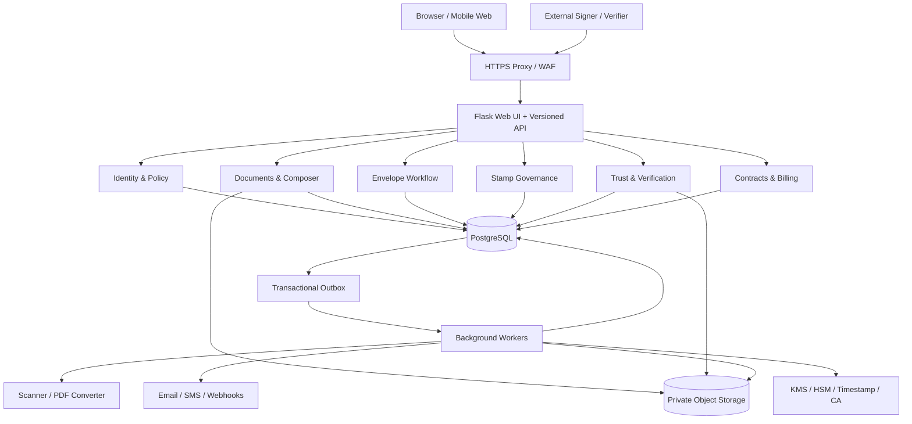

# TrustSeal

TrustSeal is a browser-first, multi-tenant document trust platform designed to help individuals and organisations prepare, approve, sign, stamp, share, verify, and archive electronic records.

The product vision combines document management with controlled authority, tamper-evident evidence, and independent verification. A signature image, stamp graphic, or QR code is never treated as proof by itself; TrustSeal is designed to associate each action with an exact document version, an authorized actor, a defined workflow, and an auditable evidence record.

> [!IMPORTANT]
> This repository currently contains a **Flask prototype and implementation blueprint**, not a production-ready trust service. Several screens, models, and CRUD routes exist, but critical controls—including complete tenant isolation, secure object storage, evidence-grade finalization, independent verification, comprehensive automated tests, and production operations—remain planned. Do not represent the current prototype as legally certified, universally binding, tamper-proof, or compliant with a specific jurisdiction.

## Contents

- [Product overview](#product-overview)
- [Feature highlights](#feature-highlights)
- [Core workflows](#core-workflows)
- [Architecture](#architecture)
- [Technology stack](#technology-stack)
- [Repository status](#repository-status)
- [Getting started](#getting-started)
- [Project structure](#project-structure)
- [Security and trust model](#security-and-trust-model)
- [Testing and quality](#testing-and-quality)
- [Delivery roadmap](#delivery-roadmap)
- [Documentation](#documentation)
- [Contributing](#contributing)

## Product overview

TrustSeal is intended for:

- individuals managing personal documents and signature profiles;
- organisations controlling members, teams, permissions, templates, stamps, and contracts;
- authors and preparers creating or uploading documents;
- reviewers and approvers participating in governed workflows;
- internal and external signers completing assigned actions;
- stamp custodians approving official seal or stamp use;
- compliance teams inspecting evidence, retention, and audit history;
- clients and counterparties receiving or verifying trusted records;
- API clients integrating document and trust workflows into other systems.

The intended platform supports the complete lifecycle:

```text
Create / Upload
      -> Validate and Version
      -> Prepare Fields and Participants
      -> Review and Approve
      -> Invite and Authenticate
      -> Sign and/or Stamp
      -> Finalize and Build Evidence
      -> Verify
      -> Archive, Retain, or Supersede
```

## Feature highlights

Status legend:

- **Prototype** — code, models, routes, or UI scaffolding currently exists.
- **Partial** — some structure exists, but the documented security and workflow contract is incomplete.
- **Planned** — specified in the product documentation and implementation plan, but not yet delivered end to end.

### Identity and access management

| Capability | Status | Intended behavior |
| --- | --- | --- |
| Registration, login, and logout | Prototype | Browser and API authentication using Flask-Login and JWT-based routes. |
| Password management | Partial | Password hashing exists; verified email, secure reset lifecycle, and complete session invalidation remain to be implemented. |
| Multi-factor authentication | Planned | TOTP and/or passkeys for privileged users and higher-assurance workflows. |
| Session and device management | Planned | Session history, revocation, token-family rotation, and security-event visibility. |
| External participant access | Partial | Invitations and sharing models exist; recipient-bound, expiring, least-privilege execution access is planned. |
| SSO and provisioning | Planned | OIDC/SAML, just-in-time role mapping, and optional SCIM lifecycle management. |
| Identity assurance policies | Planned | Workflow-specific authentication and identity-proofing requirements. |

### Organisations, teams, and authorization

| Capability | Status | Intended behavior |
| --- | --- | --- |
| Organisation workspaces | Prototype | Organisation and client models with administrative views and APIs. |
| Members and invitations | Prototype | User and invitation scaffolding for organisation membership. |
| Roles and permissions | Partial | Role, permission, role-permission, and user-role models exist; complete tenant/object policy enforcement is planned. |
| Teams and departmental scope | Planned | Team membership, folder/resource scope, and ownership assignment. |
| Delegation | Planned | Time-bound, approved, scope-limited delegation with an attributable authority chain. |
| Separation of duties | Planned | Controls such as preventing a restricted-stamp requester from self-approving. |
| Tenant isolation | Planned hardening | Deny-by-default checks on every server-side read, write, file, export, and background action. |

### Document management

| Capability | Status | Intended behavior |
| --- | --- | --- |
| Document records | Prototype | Create, list, view, edit, and organize document metadata. |
| PDF, DOCX, and image ingestion | Partial | Basic upload configuration exists; scanning, structural inspection, and isolated conversion are planned. |
| Drafts and sections | Prototype | Draft and section models, forms, and route scaffolding. |
| Document types and classification | Prototype | Types, tags, ownership, organisation, and client associations. |
| Versions | Partial | Version records exist; immutable object-backed revisions and canonical digests are planned. |
| Parties and participants | Prototype | Document-party records and associated UI/API scaffolding. |
| Comments and activity | Prototype | Comment, activity, and document audit-log records. |
| Shares and reminders | Prototype | Sharing and reminder records with views and APIs. |
| Private object storage | Planned | Encrypted, non-public storage for originals, execution inputs, final documents, and evidence. |
| Safe preview pipeline | Planned | Script-free rendering, page navigation, sandboxed conversion, and authorized delivery. |
| Search and bulk operations | Planned | Tenant-scoped filtering, full-text search, bulk upload, and per-file failure recovery. |
| Retention and legal hold | Planned | Retention classes, archive, adjudicated deletion, legal hold, and secure destruction. |

### Document preparation and authoring

- Rich-text document and template composition.
- Headings, tables, clauses, numbering, and typed variables.
- Draft autosave and optimistic concurrency control.
- Signature, initials, date, text, checkbox, and stamp field placement.
- Page-accurate coordinates, scaling, rotation, and preview.
- Required/optional fields with validation and participant assignment.
- Template revision history, ownership, publication, and archival.
- Controlled clause libraries and approval policies.
- Explicit preview and confirmation before issuing a transaction.
- Optional, tenant-controlled AI suggestions with human approval and privacy safeguards.

The current repository contains document-template, draft, section, and form scaffolding. The transactional preparation experience and exact PDF-coordinate pipeline are planned.

### Electronic signatures and consent

| Capability | Status | Intended behavior |
| --- | --- | --- |
| Signature profiles | Prototype | Store user signature appearance profiles. |
| Signature requests | Prototype | Request and activity records with basic CRUD routes. |
| Drawn, typed, and uploaded appearances | Partial | Appearance data is modeled; complete policy, storage, and evidence controls are planned. |
| Secure signing invitations | Planned | Hashed, recipient-specific, expiring, revocable tokens. |
| Explicit electronic consent | Planned | Versioned consent wording, intent, time, and assurance evidence. |
| Field ownership | Planned | Signers can complete only their assigned fields. |
| Routing | Planned | Sequential, parallel, witness, quorum, and conditional workflows. |
| Exceptions | Planned | Decline, expiry, reminder, resend, cancel, withdraw, and correction/reissue. |
| Idempotent finalization | Planned | Repeated requests produce exactly one final artifact and completion record. |
| Evidence package | Planned | Document digest, invitation, authentication, consent, events, timestamps, and manifest. |
| Certificate-backed signatures | Future assurance phase | Protected-key and standards-conformant PDF signatures through approved providers. |

TrustSeal distinguishes a graphical signature appearance from a cryptographic digital signature. The interface and verification record must state the assurance actually delivered.

### Digital stamps and official seals

The intended stamp system includes:

- personal, team, organisation, and institutional stamp assets;
- circular and rectangular designs, text, logos, border weights, ink colors, and server-generated dates;
- immutable asset and design revisions;
- owners, custodians, permitted roles, validity dates, intended use, and organisation scope;
- restricted stamp requests with approve, reject, withdraw, escalate, expire, and revoke behavior;
- configurable dual control for higher-assurance or official seals;
- protected asset storage and access logs;
- page placement, scaling, rotation, and repetition across selected pages;
- impression records bound to the exact stamp revision, document digest, actor, authority chain, page coordinates, and UTC time;
- preservation of historical impressions after an asset is suspended, retired, expired, or revoked;
- explicit distinction between a visual stamp and a legally or cryptographically assured seal.

The prototype currently provides digital-stamp, stamp-template, and stamp-usage models, forms, views, and APIs. Custody, approval, immutable revisioning, and hash-bound application remain planned.

### Independent verification and evidence

Planned verification capabilities include:

- high-entropy, non-enumerable verification references;
- QR codes containing safe references rather than credentials or personal data;
- a public verification page with configurable minimal disclosure;
- uploaded-file hashing and comparison with the issued canonical record;
- distinct `valid`, `mismatch`, `expired`, `revoked`, `replaced`, `unknown`, and `unverifiable` outcomes;
- issuer, issue time, current status, and accurate assurance claims;
- privacy previews controlling which fields are publicly displayed;
- rate limiting, abuse monitoring, and privacy-minimized verification logs;
- authenticated access to detailed evidence and completion certificates;
- machine-readable manifests and optional signed attestations;
- certificate chain, timestamp, and revocation checks for supported higher-assurance documents.

Independent verification is a target capability and is not complete in the current prototype.

### Contract lifecycle management

Planned contract features include:

- contract creation from uploads or governed templates;
- parties, owners, type, value, effective date, duration, and status;
- draft, review, approval, execution, active, expired, and terminated states;
- review comments, decisions, negotiation history, and tracked versions;
- approval thresholds and delegation of authority;
- obligations, milestones, owners, deadlines, and reminders;
- renewal, termination, amendment, and supersession lineage;
- search by party, owner, date, value, stage, and renewal;
- structured clause extraction and risk tagging with page-level provenance;
- an optional controlled counterparty negotiation portal.

### Collaboration and notifications

- Role-specific invitations for reviewers, approvers, signers, viewers, and stamp custodians.
- Internal comments, mentions, and tasks restricted to authorized participants.
- Configurable email and SMS providers behind replaceable adapters.
- Queued delivery with retry, backoff, and dead-letter recovery.
- Reminder schedules with frequency caps.
- Delivery, open, viewed, approved, signed, and failed states.
- Branded notification templates and clear sender identity.
- Policy controls for external links, previews, and downloads.

Basic comments, shares, reminders, activities, and invitations are scaffolded. Durable delivery processing is planned.

### Plans, subscriptions, and billing

The intended commercial layer supports:

- configurable Free, Pro, Business, and Enterprise plans without hard-coded prices;
- server-side feature entitlements and quotas;
- seats, storage, document allowance, signing/stamping usage, and billing periods;
- trials, upgrades, downgrades, grace periods, suspension, and cancellation;
- hosted or tokenized payment collection so TrustSeal does not store raw card data;
- invoices, receipts, tax profiles, payment history, and reconciliation;
- an auditable, deduplicated usage ledger;
- preservation and policy-controlled read access for completed evidence after downgrade;
- annual contracts, custom limits, purchase orders, and manual enterprise entitlements.

Subscription-plan and subscription models and routes exist in the prototype. Provider integration, metering, reconciliation, and complete entitlement enforcement remain planned.

### Administration, audit, and operations

- Organisation branding, domains, notifications, retention, and policy configuration.
- Role-scoped tenant audit search and evidence export.
- Append-only trust and security events with correlation identifiers.
- Tamper-detection through chained hashes or durable integrity checkpoints.
- Platform health, worker status, failed jobs, integrations, and storage visibility.
- Account lock, abuse investigation, legal hold, and controlled recovery.
- Justified, time-limited, fully audited operator break-glass access.
- Alerts for repeated authentication failures, unusual stamp use, verification mismatches, and integration failures.
- Metrics, structured logs, distributed correlation, and privacy-aware support tools.
- Encrypted backups, restore rehearsals, disaster recovery, and post-recovery reconciliation.

The current project has system settings, RBAC records, and basic audit-log scaffolding. Tamper evidence and production operations are planned.

### APIs and integrations

The target API platform includes:

- versioned REST endpoints for organisations, documents, envelopes, stamps, verification, contracts, billing, and audit;
- tenant-scoped service accounts with granular scopes, rotation, and expiration;
- request validation through explicit allowlisted schemas;
- RFC 7807-style errors, cursor pagination, UTC ISO 8601 timestamps, and correlation IDs;
- idempotency keys for retryable trust-critical mutations;
- OpenAPI 3.x documentation, contract tests, schema versioning, and deprecation policy;
- signed, replay-protected webhooks with retries and delivery history;
- observable asynchronous job states and dead-letter recovery;
- replaceable object storage, email, SMS, payment, timestamp, and certificate adapters;
- optional document-suite, institutional registry, SDK, and tenant-sandbox integrations.

The prototype exposes multiple Flask JSON endpoints and an internal API client, but they should not yet be treated as a stable public API contract.

### Security, privacy, and legal assurance

The target security model includes:

- deny-by-default tenant, resource, action, and contextual authorization;
- TLS, encryption at rest, managed secrets, and protected cryptographic keys;
- file-type validation, malware scanning, and isolated document conversion;
- immutable object versions and SHA-256 manifests;
- persistent token revocation and security-sensitive session rotation;
- CSRF, XSS, SSRF, IDOR, path traversal, replay, and enumeration defenses;
- append-only or tamper-evident trust events;
- data minimization and configurable public disclosure;
- data-subject access, export, correction, and deletion-adjudication workflows;
- retention classes, legal holds, and auditable destruction;
- subprocessor, residency, incident, and cross-border processing controls;
- jurisdiction-specific consent, evidence, stamp, and signature policies.

Legal enforceability depends on the transaction, identity assurance, technical implementation, document type, and jurisdiction. Engineering controls can support legal defensibility but do not replace qualified legal review.

### Accessible flat enterprise interface

TrustSeal's documented interface standard is intentionally restrained:

- white and neutral surfaces with `#164C83` as the primary action color;
- square corners and zero-radius controls;
- no gradients, decorative glass effects, oversized shadows, or pill-style status badges;
- persistent labels, visible focus, accessible error summaries, and keyboard operation;
- status communicated through text, not color alone;
- dense, responsive tables and inline filters instead of decorative dashboard cards;
- a collapsible desktop sidebar and mobile drawer;
- a focused signing experience containing the document, assigned requirements, consent, and completion controls;
- WCAG 2.2 AA as the target for supported user journeys;
- mobile signing and verification usable at 320 CSS pixels, excluding the document canvas itself;
- localization and selectable timezones in later phases, while storing authoritative timestamps in UTC.

## Core workflows

### Document lifecycle

```text
DRAFT -> PREPARED -> IN_PROCESS -> FINAL -> ARCHIVED -> DISPOSED
```

- Drafts are mutable and use optimistic concurrency.
- Preparing freezes a candidate document version.
- An execution envelope binds an exact version and digest.
- Final document bytes cannot be silently replaced.
- Corrections create a linked successor and preserve the original evidence.
- Disposal requires an authorized retention process and must respect legal holds.

### Execution envelope lifecycle

```text
CREATED -> SENT -> ACTIVE -> COMPLETED
    |        |        |
    |        |        +-> DECLINED / EXPIRED
    |        +----------> WITHDRAWN
    +-------------------> FAILED
```

Participants have independent states such as invited, opened, authenticated, completed, and declined. Review and approval tasks are modeled separately so document state, envelope state, and participant state are not conflated.

### Governed stamp flow

```text
Prepare exact document version
    -> Request stamp revision
    -> Evaluate custody and policy
    -> Approve or reject
    -> Apply attributable impression
    -> Finalize evidence
    -> Verify status and document digest
```

### Verification flow

```text
Opaque reference or uploaded file
    -> Resolve allowed public record
    -> Calculate/compare digest when applicable
    -> Evaluate issuance, expiry, revocation, and replacement
    -> Display minimal, human-readable result
    -> Offer authorized evidence access
```

## Architecture

The recommended architecture is a modular Flask monolith with asynchronous workers and clear domain boundaries.



Key architectural choices:

- PostgreSQL is the transactional source of truth.
- Private object storage holds original, execution-input, final, preview, and evidence artifacts.
- A transactional outbox bridges committed state to asynchronous work.
- Workers execute scanning, conversion, finalization, notifications, webhooks, reconciliation, and retention jobs idempotently.
- Managed KMS/HSM services protect cryptographic private keys; keys are not stored in ordinary application tables.
- Provider integrations are adapters around stable domain interfaces.
- Microservices are deferred until operational measurements or team ownership justify the additional complexity.

## Technology stack

### Current prototype

- Python and Flask application factory
- Jinja2 server-rendered templates
- SQLAlchemy and Flask-SQLAlchemy
- Alembic and Flask-Migrate
- PostgreSQL configuration
- Flask-Login and Flask-JWT-Extended
- Flask-WTF and WTForms
- Flask-Marshmallow
- Bootstrap and AdminLTE assets
- Requests-based internal API client
- Faker-powered development seed commands

### Target platform additions

- Private S3-compatible object storage
- Redis or another approved queue/cache foundation
- Transactional outbox and idempotent workers
- Malware scanning and isolated document conversion
- PDF rendering, digest, evidence, QR, timestamp, and certificate adapters
- Structured logging, metrics, tracing, health checks, and alerting
- OpenAPI schemas and contract tests
- Docker-based local and deployment environments
- CI security, quality, migration, accessibility, and browser gates

## Repository status

| Area | Current state |
| --- | --- |
| Flask application and UI shell | Prototype |
| User and organisation management | Prototype/partial |
| RBAC data model | Prototype; enforcement incomplete |
| Document CRUD and related records | Prototype/partial |
| Signature and stamp records | Prototype; evidence workflow incomplete |
| Subscription records | Prototype; billing integration incomplete |
| Tenant isolation | Requires comprehensive hardening |
| Private document storage and scanning | Not implemented |
| Transaction outbox and workers | Not implemented |
| Evidence-grade finalization | Not implemented |
| Public verification | Not implemented |
| Automated tests and CI | Not implemented |
| Production deployment and operations | Not implemented |

See the [complete implementation plan](docs/IMPLEMENTATION_PLAN.md) for exact phases, paths, exit gates, and acceptance scenarios.

## Getting started

### Prerequisites

- Python 3.11 or newer
- PostgreSQL
- `pip` and `venv`

The repository does not yet include a pinned dependency manifest. The commands below are a provisional prototype bootstrap; Phase 0 of the implementation plan adds a reproducible `pyproject.toml` and lock strategy.

### 1. Clone the repository

```bash
git clone https://github.com/socaya/trustseal.git
cd trustseal
```

### 2. Create a virtual environment

```bash
python -m venv .venv
source .venv/bin/activate
python -m pip install --upgrade pip
```

On Windows PowerShell, activate with `.venv\Scripts\Activate.ps1`.

### 3. Install prototype dependencies

```bash
python -m pip install \
  Flask Flask-SQLAlchemy Flask-Migrate Flask-Login \
  Flask-Marshmallow Flask-JWT-Extended Flask-WTF \
  marshmallow-sqlalchemy python-dotenv requests Faker \
  psycopg2-binary
```

### 4. Configure the environment

```bash
cp .env.example .env
```

Set unique local values for at least:

- `SECRET_KEY`
- `JWT_SECRET_KEY`
- `SYSTEM_API_TOKEN`
- `DATABASE_URL`

Never commit `.env`. It is intentionally ignored.

Generate random secrets, for example:

```bash
python -c "import secrets; print(secrets.token_urlsafe(48))"
```

### 5. Create and migrate the database

Create the PostgreSQL database and user referenced by `DATABASE_URL`, then run:

```bash
flask --app main.py db upgrade
```

The existing migration chain is prototype-era and should be rehearsed against a disposable database before it is trusted with important data.

### 6. Optional development seed data

```bash
flask --app main.py seed system
flask --app main.py seed demo
```

Use development seed commands only with a disposable database. Review `flask --app main.py seed demo --help` before using destructive options.

### 7. Run the development server

```bash
flask --app main.py run --debug
```

Open `http://127.0.0.1:5000`.

> [!WARNING]
> The Flask development server, prototype configuration, and current upload paths are not suitable for production.

## Project structure

```text
trustseal/
├── app/
│   ├── blueprints/       # Auth, documents, signatures, stamps, organisations,
│   │                     # subscriptions, system administration, and users
│   ├── cli/              # Development seed commands
│   ├── decorators/       # Route access decorators
│   ├── enums/            # Permission definitions
│   ├── errors/           # Error handlers
│   ├── models/           # SQLAlchemy domain and persistence models
│   ├── services/         # Current API client; future domain services/adapters
│   ├── static/           # CSS, JavaScript, Bootstrap, and AdminLTE assets
│   ├── templates/        # Jinja pages and shared UI partials
│   ├── __init__.py       # Application factory and blueprint registration
│   └── extensions.py     # Flask extension instances
├── docs/
│   ├── IMPLEMENTATION_PLAN.md
│   ├── TrustSeal_Complete_System_Documentation_v3.0.*
│   └── TrustSeal_Master_SRS_Architecture_UX_v2.0_REGENERATED.*
├── migrations/           # Alembic configuration and revisions
├── .env.example          # Safe configuration template
├── config.py             # Prototype application configuration
└── main.py               # Development application entry point
```

The target structure adds policy, schema, repository, domain-service, integration-adapter, task, and comprehensive test packages as implementation progresses.

## Security and trust model

Security-sensitive contributors should follow these invariants:

1. Never authorize access from a client-supplied organisation or owner identifier alone.
2. Every tenant-scoped query must include tenant and resource policy.
3. Do not expose storage paths, object keys, bearer tokens, raw signature assets, or unnecessary personal data in ordinary API responses.
4. Never place an uploaded document in a public static directory in production.
5. Never mutate document bytes after they have been issued for execution.
6. Every trust action must bind an exact document version and digest.
7. Every retryable mutation must be idempotent.
8. Do not call external providers inside the originating database transaction.
9. Do not store signing private keys in the application database or source tree.
10. Preserve historic attribution and evidence after users, memberships, stamps, or credentials are deactivated.
11. Do not log passwords, tokens, document content, raw signatures, or unneeded identity evidence.
12. Do not make legal or assurance claims stronger than the implemented and independently verified controls.

Please report suspected vulnerabilities privately to the repository maintainers. A formal `SECURITY.md` and response process are planned in Phase 0.

## Testing and quality

The target test programme maps tests to the requirement IDs in the Master SRS:

- unit tests for policies, state machines, token lifetime, hashes, coordinates, and entitlements;
- integration tests for PostgreSQL, migrations, object storage, outbox, workers, scanner, converter, notifications, payments, timestamps, and certificates;
- security tests for tenant isolation, IDOR, CSRF, XSS, SSRF, replay, enumeration, unsafe uploads, and sensitive serialization;
- end-to-end tests covering prepare, approve, sign, stamp, finalize, verify, export, and archive;
- reliability tests for worker crashes, repeated callbacks, provider outages, restoration, and reconciliation;
- accessibility tests combining automation with keyboard, screen-reader, zoom, and narrow-screen review;
- performance tests for navigation, API reads, search, preview rendering, concurrency, queues, and finalization;
- independent evidence validation for digests, manifests, consent, audit sequence, timestamps, certificates, and revocation.

Current syntax check:

```bash
python -m compileall -q app config.py main.py migrations
```

The repository does not yet contain the full automated suite. A feature is not complete merely because a route or screen exists.

## Delivery roadmap

| Phase | Outcomes |
| --- | --- |
| 0. Safe baseline and decisions | Repository hygiene, reproducible dependencies, CI, traceability, threat model, canonical states, provider/legal/product decisions. |
| 1. Identity and tenancy | Verified identity, MFA, persistent sessions, memberships, policies, deny-by-default authorization, tenant isolation. |
| 2. Document foundation | Private storage, scanning, conversion, immutable versions, digests, safe previews, retention metadata. |
| 3. Audit and operations | Append-only audit, outbox, workers, retries, dead letters, observability, backup and restore. |
| 4. Signing and evidence | Envelopes, participants, fields, invitations, consent, routing, idempotent finalization, evidence packages. |
| 5. Stamps and verification | Revisioned assets, custody, dual control, impressions, QR/reference verification, tamper detection. |
| 6. Business workflows | Templates, controlled authoring, contracts, obligations, comments, tasks, and durable notifications. |
| 7. Commercial and enterprise | Billing, entitlements, usage ledger, public API, webhooks, SSO/SCIM, reporting, legal hold, break-glass. |
| 8. Higher assurance and scale | Certificate/PAdES integrations, timestamps, localization, residency, jurisdictional approval, independent validation. |

Each phase has explicit security, migration, failure, recovery, accessibility, and acceptance gates in the implementation plan.

## Documentation

- [Complete implementation plan](docs/IMPLEMENTATION_PLAN.md)
- [Master SRS, Architecture, and UX v2.0](docs/TrustSeal_Master_SRS_Architecture_UX_v2.0_REGENERATED.md)
- [Complete System Documentation v3.0](docs/TrustSeal_Complete_System_Documentation_v3.0.md)
- [Published SRS PDF](docs/TrustSeal_Master_SRS_Architecture_UX_v2.0_REGENERATED.pdf)
- [Published System Documentation PDF](docs/TrustSeal_Complete_System_Documentation_v3.0.pdf)

The Master SRS is the requirements baseline. The v3 document provides supporting product, workflow, engineering, security, and operations narrative.

## Contributing

Before implementing a feature:

1. Identify its SRS requirement IDs and dependencies.
2. Confirm unresolved product, legal, privacy, or assurance decisions.
3. Design the complete vertical slice, including policy, state, audit, failure, recovery, UI, API, and migration behavior.
4. Add success, denial, exception, concurrency, retry, and recovery tests.
5. Update requirement traceability and operational documentation.
6. Avoid breaking the verifiability or meaning of historic records.

Prefer small, reviewable changes and additive migrations. Never commit secrets, local environments, uploaded records, or generated runtime artifacts.

## License

No open-source license has been declared in this repository. Unless the owner adds one, all rights are reserved and reuse or redistribution requires explicit permission.
