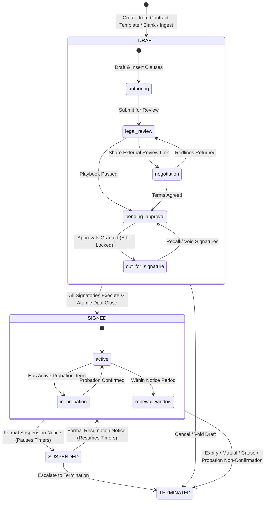
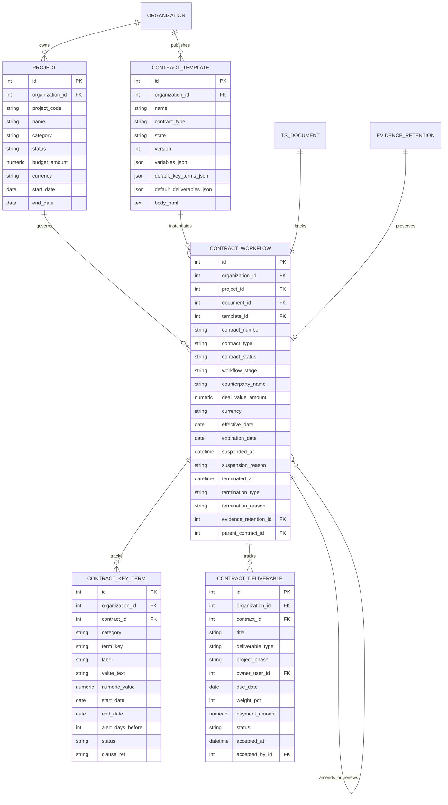

# TrustSeal Contracts Module — Comprehensive Functional & Technical Specification (v1.0)

**Status:** Implementation Specification  
**Scope:** End-to-End Contract Lifecycle Management (CLM), Project Association, Canonical Status Governance (`DRAFT`, `SIGNED`, `SUSPENDED`, `TERMINATED`), Key Terms & Probation Tracking, Project Deliverables, and Contract Templates  
**Platform Foundation:** Inherits TrustSeal Documents (`.tsd` Encrypted Vault), Clause Library, Stamp Studio, Signing Envelopes, Evidence Preservation, and Chained-Hash Audit Log.

---

## 1. Executive Summary & Design Principles

The **TrustSeal Contracts Module** is an enterprise Contract Lifecycle Management (CLM) suite built directly on top of the **TrustSeal Documents (`.tsd`)** cryptographic vault. Rather than treating contracts as static PDF attachments, every contract in TrustSeal:

1. **Belongs to a Project (`project_id`):** Every contract is anchored to a tenant-scoped **Project** (client delivery engagement, procurement program, HR onboarding cohort, corporate operations initiative, or real-estate asset) so leadership can track contract value, milestones, risk, and compliance at both the individual contract level and the portfolio/project level.
2. **Enforces Canonical Contract Statuses:** Every contract carries an authoritative primary lifecycle status — **`DRAFT`**, **`SIGNED`**, **`SUSPENDED`**, or **`TERMINATED`** — with fine-grained workflow sub-stages during drafting/execution and strict server-side transition guards.
3. **Tracks Structured Key Terms, Probation Periods & Project Deliverables:** Contracts are actively monitored after execution against structured **Key Terms** (e.g., probation period, payment terms, SLAs, liability caps, notice periods, renewal windows) and **Deliverables / Milestones** (e.g., project phases, acceptance gates, payment tranches, 30/60/90-day probation reviews).
4. **Starts from Governed Contract Templates:** Standardized, versioned **Contract Templates** bundle pre-approved legal text, typed merge variables, official letterheads, default Key Terms, and default Deliverable schedules so new contracts are compliant from day one.
5. **Preserves Cryptographic Trust & Compliance:** Every contract inherits `.tsd` AES-128+HMAC encryption, version diffing, redlining, covert `TSDStampInsertion` forensic layers, Platform PDF Sealing, `EvidenceRetention` with Legal Hold guards, and chained-hash `SecurityEvent` audit logging.

---

## 2. Canonical Contract Status Model & Lifecycle State Machine

### 2.1 Primary Contract Statuses

Every contract has one canonical `contract_status` enforced by a database check constraint:

| Status | Meaning | Document Editability | Deliverables & Timers | Allowed Next Statuses |
| :--- | :--- | :--- | :--- | :--- |
| **`DRAFT`** | Contract is being authored, reviewed, negotiated, approved, or awaiting signatures. | Editable in `authoring`/`review`/`negotiation`; edit-locked in `approval`/`signing`. | Scheduled (not yet active). | `SIGNED`, `TERMINATED` (cancelled/voided) |
| **`SIGNED`** | Executed by required signatories, cryptographically sealed, and legally in force. | **Immutable** (changes require a linked Amendment/Addendum). | **Active** — SLA, probation, renewal, and deliverable timers run. | `SUSPENDED`, `TERMINATED` |
| **`SUSPENDED`** | Temporarily paused by formal notice (e.g., force majeure, dispute, non-payment, regulatory hold, project pause). | **Immutable**. | **Paused** — deliverable due dates & SLA breach clocks are frozen with suspension duration logged. | `SIGNED` (Resumed), `TERMINATED` |
| **`TERMINATED`** | Permanently ended (expiry, mutual termination, termination for cause/convenience, or probation non-confirmation). | **Immutable** (retained in vault; archival blocked if under `EvidenceLegalHold`). | **Closed** — remaining open deliverables marked `cancelled` or moved to exit/settlement checklist. | *(Terminal — new engagement spawns a Renewal or new Draft)* |

### 2.2 Workflow Sub-Stages (Within `DRAFT` & Post-Execution)

To preserve rich operational routing without polluting the four canonical statuses:
- Inside **`DRAFT`**: `authoring` → `legal_review` → `negotiation` → `pending_approval` → `out_for_signature`.
- Inside **`SIGNED`**: `active`, `in_probation`, `renewal_window`, `amendment_in_progress`.
- Inside **`SUSPENDED`**: requires `suspension_reason`, `suspended_at`, optional `expected_resume_date`, and `suspended_by_id`.
- Inside **`TERMINATED`**: requires `termination_type` (`expiry`, `mutual`, `for_cause`, `for_convenience`, `probation_failed`, `cancelled_draft`), `termination_reason`, `terminated_at`, and `effective_termination_date`.

### 2.3 Lifecycle State Machine Diagram

### 2.4 Mapping to `TSDocument.status`
To maintain strict compatibility with `ts_documents` (`draft`, `finalized`, `archived`):
- `DRAFT` → `TSDocument.status = 'draft'`
- `SIGNED` / `SUSPENDED` → `TSDocument.status = 'finalized'`
- `TERMINATED` → `TSDocument.status = 'finalized'` (or `'archived'` once explicitly archived and no active `EvidenceLegalHold` exists)

---

## 3. Project Association Architecture

### 3.1 Core Rule: Every Contract Must Be Associated With a Project
Every contract record carries a required `project_id` foreign key referencing `projects.id` (tenant-scoped by `organization_id`).

- **Why Project Association Matters:**
  - Groups related legal instruments under one operational umbrella (e.g., **Project: Core Banking Modernization** contains 1 MSA, 3 SOWs, 2 Subcontractor Agreements, 1 DPA, and 4 Staff Probation Contracts).
  - Enables **Project-level Budget vs. Committed Contract Value** tracking.
  - Aggregates **Deliverable Completion %**, **Overdue Milestones**, **Active Probations**, and **Suspended/At-Risk Contracts** into one Project Command View.
- **Zero-Friction Creation:** Every organization automatically has a default `"General Operations"` project (or operators can create a new Project inline directly inside the `+ New Contract` drawer without leaving the Contracts module).

### 3.2 Project Domain Model (`projects`)
| Field | Type | Description |
| :--- | :--- | :--- |
| `id` | `Integer (PK)` | Unique project identifier |
| `organization_id` | `Integer (FK)` | Tenant isolation scope |
| `project_code` | `String(40)` | Unique per org (e.g., `PRJ-2026-001`) |
| `name` | `String(200)` | Human-readable project name |
| `description` | `Text` | Scope and objectives |
| `category` | `String(48)` | `client_delivery`, `procurement`, `hr_onboarding`, `real_estate`, `internal_ops`, `legal_governance` |
| `client_id` | `Integer (FK, nullable)` | Optional link to Directory `Client` |
| `owner_user_id` | `Integer (FK)` | Project Manager / Lead |
| `status` | `String(24)` | `planned`, `active`, `on_hold`, `completed`, `cancelled` |
| `budget_amount` | `Numeric(14,2)` | Optional total project budget |
| `currency` | `String(12)` | ISO currency code (`USD`, `EUR`, `GBP`, `KES`, etc.) |
| `start_date` / `end_date` | `Date` | Planned project window |
| `is_default` | `Boolean` | Marks fallback workspace project |

---

## 4. Contract Types Taxonomy & Built-In Tracking Profiles

The Contracts module supports diverse contract types, each with tailored metadata fields, default key terms, and deliverable blueprints:

| Category | Contract Type Code | Examples | Built-In Tracking Focus |
| :--- | :--- | :--- | :--- |
| **Project-Based Delivery** | `msa`, `sow`, `fixed_price`, `time_materials`, `construction`, `retainer` | Master Service Agreement, Statement of Work, EPC Delivery, Consultancy SOW | Milestone deliverables, acceptance gates, payment tranches tied to deliverables, change orders, warranty/defect liability period. |
| **Employment & Probation** | `employment_probation`, `employment_permanent`, `fixed_term_hr`, `internship`, `contractor` | Offer & Probation Contract, Executive Employment, Fixed-Term Consultant | **Probation Period** (start, end, 30/60/90-day reviews, confirmation/extension/termination actions), notice period, compensation, non-compete/IP assignment. |
| **Commercial & Vendor** | `vendor_supply`, `saas_subscription`, `licensing`, `distribution`, `commercial_lease` | Supply Agreement, Enterprise SaaS, Software License, Office Lease | SLA uptime/response targets, delivery lead times, rent/fee escalation, auto-renewal opt-out notice window, insurance/compliance certificates. |
| **Corporate & Governance** | `nda`, `dpa`, `sla`, `mou_jv`, `board_resolution` | Mutual NDA, Data Processing Agreement, Joint Venture MOU | Confidentiality survival period, breach notification SLA (e.g., 72 hrs), data deletion on termination, governing law. |
| **Lineage Derivatives** | `amendment`, `addendum`, `change_order`, `renewal` | Scope Change Order, Rate Amendment, Probation Extension Addendum | Linked `parent_contract_id`, delta to deal value/dates/deliverables, automatic update of parent lineage tree. |

---

## 5. Key Terms, Probation & Deliverables Tracking Engine

### 5.1 Structured Key Terms (`contract_key_terms`)
Key contractual terms are tracked as structured, auditable records anchored to the contract (and optionally to a specific clause heading in the `.tsd` document):

- **Supported Term Categories:**
  - `probation` — Probation start/end dates, duration (days), review cadence, confirmation outcome
  - `financial` — Total contract value, payment terms (e.g., Net 30), retention/holdback %, late-fee rate, penalty/liquidated damages
  - `sla` — Uptime %, response/resolution times, service credits
  - `schedule` — Effective date, go-live date, expiration date, defect liability / warranty period
  - `renewal_notice` — Auto-renewal flag, renewal term (months), opt-out notice deadline (days before expiry)
  - `liability_ip` — Liability cap multiplier, indemnity scope, IP ownership, confidentiality survival years
  - `compliance` — Required insurance coverage, audit rights, regulatory filings, data residency
  - `custom` — Organization-defined key term
- **Status & Alerting:** Each key term tracks `status` (`active`, `met`, `at_risk`, `breached`, `waived`, `expired`) and `alert_days_before` (default `14` or `30` days), triggering `OperatorNotification` reminders before critical deadlines.

### 5.2 First-Class Probation Period Tracking
For HR employment contracts, vendor pilot periods, or trial retainers:
1. **Automatic Probation Setup:** Selecting contract type `employment_probation` (or enabling the *Probation* key term) captures:
   - `probation_start_date`, `probation_duration_days` (default `90`, configurable `30`–`365`), computed `probation_end_date`
   - Automatic creation of **Probation Review Deliverables** (e.g., *30-Day Check-In*, *60-Day Mid-Probation Review*, *Final Probation Assessment* 10 days prior to end date).
2. **Probation Decision Actions (Recorded in Audit Chain):**
   - **Confirm Permanency / Pass Probation:** Marks probation term `met`, updates sub-stage from `in_probation` → `active`, and optionally spawns a **Confirmation Letter / Addendum** linked to the contract.
   - **Extend Probation:** Updates `probation_end_date`, requires extension reason & duration, appends a new final review deliverable, and optionally generates a **Probation Extension Addendum**.
   - **Terminate on Probation:** Transitions contract status to `TERMINATED` (`termination_type = 'probation_failed'`) with mandatory review notes and audit event.

### 5.3 Project Deliverables & Milestones (`contract_deliverables`)
Designed specifically for project-based contracts (SOWs, fixed-price deliveries, retainers, and phased engagements):

| Capability | Description |
| :--- | :--- |
| **Milestone Structure** | Title, description, `project_phase` (e.g., Phase 1: Discovery), `deliverable_type` (`milestone`, `payment_tranche`, `report`, `acceptance_gate`, `probation_review`, `compliance_cert`), `due_date`, `weight_pct` (0–100%), optional `payment_amount`. |
| **Ownership** | Assigned internal `owner_user_id` + external `counterparty_owner` name/email. |
| **Acceptance Workflow** | `not_started` → `in_progress` → `submitted` (with evidence/attachment note) → `accepted` (records `accepted_by_id`, `accepted_at`, acceptance note) or `rejected` (with rework feedback). |
| **Suspension Awareness** | When parent contract enters **`SUSPENDED`**, all non-completed deliverables automatically display a `Suspended` pause badge and stop accumulating overdue breach days until the contract is resumed. |
| **Progress Rollup** | Weighted completion % (`sum(weight_pct of accepted) / sum(weight_pct)`) rolls up automatically to the **Contract Header** and the **Project Dashboard**. |

---

## 6. Contract Templates & Playbook Engine

### 6.1 Template Architecture (`contract_templates`)
Extends TrustSeal's existing versioned `DocumentTemplate` (`app/models/documents/document_template.py`) and approved `Clause` library (`app/models/clause.py`):

- **Governed Lifecycle:** `draft` → `published` (locked snapshot) → `archived`.
- **What a Contract Template Bundles:**
  1. **Master Document Body:** Rich HTML/TSD template with typed merge variables (`{{project_name}}`, `{{project_code}}`, `{{counterparty_name}}`, `{{deal_value}}`, `{{currency}}`, `{{effective_date}}`, `{{expiration_date}}`, `{{probation_end_date}}`, `{{governing_law}}`, `{{deliverables_table}}`).
  2. **Contract Type & Branding:** `contract_type`, `default_project_category`, `default_letterhead_id`, `default_stamp_id`.
  3. **Typed Variable Schema (`variables_json`):** Defines prompt labels, input types (`text`, `number`, `date`, `select`), required flags, and default values for the creation wizard.
  4. **Default Key Terms Blueprint (`default_key_terms_json`):** Automatically instantiates `ContractKeyTerm` rows (e.g., Probation 90 days, Net 30 Payment, 30-day Termination Notice).
  5. **Default Deliverables Blueprint (`default_deliverables_json`):** Automatically instantiates relative-date `ContractDeliverable` rows (e.g., `T+15d Kickoff`, `T+45d UAT Sign-off`, `T+80d Probation Final Review`).
  6. **Governance Policy (`policy_json`):** Default signing routing (`parallel` vs `sequential`), required legal checklist items, and mandatory approval roles.

### 6.2 Template-to-Contract Instantiation Flow
1. Operator selects a **Project** and a published **Contract Template** (or Blank / Ingest DOCX-PDF).
2. Creation wizard renders the template's typed variables + commercial terms (Counterparty, Value, Dates, Probation).
3. Backend atomically:
   - Renders merge variables into sanitized HTML and creates an encrypted `TSDocument` (`.tsd`).
   - Creates the `ContractWorkflow` row linked to `project_id` and `template_id` in status **`DRAFT`**.
   - Instantiates all blueprint `ContractKeyTerm` and `ContractDeliverable` records with computed calendar dates.
   - Emits `contract.created_from_template` `SecurityEvent` and opens the Unified Contract Workspace.

---

## 7. Data Model & Entity-Relationship Architecture

### 7.1 Database Check Constraints & Indexes
- `ck_contract_status`: `contract_status IN ('DRAFT', 'SIGNED', 'SUSPENDED', 'TERMINATED')`
- `ck_project_status`: `status IN ('planned', 'active', 'on_hold', 'completed', 'cancelled')`
- `ck_key_term_status`: `status IN ('active', 'met', 'at_risk', 'breached', 'waived', 'expired')`
- `ck_deliverable_status`: `status IN ('not_started', 'in_progress', 'submitted', 'accepted', 'rejected', 'overdue', 'suspended', 'cancelled')`
- Composite tenant indexes: `(organization_id, project_id, contract_status)`, `(organization_id, contract_id, due_date)`, `(organization_id, category, end_date)`.

---

## 8. REST API Specification

All endpoints are tenant-scoped to `current_user.organization_id`, require session auth + `X-Requested-With: fetch` (or JWT), enforce RBAC, and emit chained-hash `SecurityEvent` records.

### 8.1 Projects API (`/api/projects`)
| Method | Endpoint | Purpose |
| :--- | :--- | :--- |
| `GET` | `/api/projects` | List tenant projects with rolled-up contract counts, total value, and deliverable completion %. |
| `POST` | `/api/projects` | Create a new project (`name`, `project_code`, `category`, `client_id`, `budget_amount`, `start_date`, `end_date`). |
| `GET` | `/api/projects/<id>` | Project detail dossier including all associated contracts, active probations, and overdue deliverables. |
| `PATCH` | `/api/projects/<id>` | Update project metadata or status (`active`, `on_hold`, `completed`). |

### 8.2 Contract Templates API (`/api/contract-templates`)
| Method | Endpoint | Purpose |
| :--- | :--- | :--- |
| `GET` | `/api/contract-templates` | List templates filterable by `contract_type` and `state` (`draft`, `published`, `archived`). |
| `POST` | `/api/contract-templates` | Create a new contract template with HTML body, variable schema, and default key terms/deliverables. |
| `PUT` | `/api/contract-templates/<id>` | Update a draft template (or create next version). |
| `POST` | `/api/contract-templates/<id>/publish` | Lock and publish template version for workspace-wide use. |
| `POST` | `/api/contract-templates/<id>/instantiate` | Create a new Project-associated Contract (`TSDocument` + `ContractWorkflow` + Key Terms + Deliverables) from template + variable values. |

### 8.3 Enhanced Contracts Lifecycle API (`/api/contracts`)
| Method | Endpoint | Purpose |
| :--- | :--- | :--- |
| `GET` | `/api/contracts/<doc_id>/state` | Full workspace hydration: `doc`, `project`, `workflow`, `key_terms`, `deliverables`, `versions`, `comments`, `approvals`, `lineage`. |
| `POST` | `/api/contracts/<doc_id>/suspend` | Transition `SIGNED` → `SUSPENDED` (requires `reason`, optional `expected_resume_date`); pauses active deliverable timers. |
| `POST` | `/api/contracts/<doc_id>/resume` | Transition `SUSPENDED` → `SIGNED` (requires `note`, optional `shift_due_dates_days`); resumes deliverable timers. |
| `POST` | `/api/contracts/<doc_id>/terminate` | Transition `DRAFT`/`SIGNED`/`SUSPENDED` → `TERMINATED` (requires `termination_type` & `reason`); respects Legal Hold on archival. |
| `POST/PATCH/DELETE` | `/api/contracts/<doc_id>/key-terms` | Manage structured Key Terms & Probation checkpoints (`confirm_probation`, `extend_probation`, status updates). |
| `POST/PATCH/DELETE` | `/api/contracts/<doc_id>/deliverables` | Manage project deliverables; `POST .../deliverables/<id>/accept` and `.../reject` for formal milestone sign-off. |
| `POST` | `/api/contracts/<doc_id>/close` | Atomic Deal Closing: freezes `.tsd`, renders executed PDF, mints `TSDStampInsertion` receipt, creates `EvidenceRetention`, sets status to **`SIGNED`**. |
| `GET` | `/api/contracts/<doc_id>/pdf` & `/binder` | Stream executed PDF or download Closing Binder `.zip`. |

---

## 9. UI/UX Specification (TrustSeal Calm Architectural Flat UI)

All views adhere strictly to TrustSeal's design tokens (`#f6f8fb` canvas, `#ffffff` surfaces, `#002769` brand navy, `#02982e` brand green, `0px` flat border-radius, whisper-quiet hairlines, WCAG 2.2 AA contrast).

1. **Projects Hub (`/projects` & `/projects/<id>`):**
   - Portfolio table of Projects with Contract Count, Committed Value vs. Budget bar, Deliverable Progress %, and Active Probation/Suspension alerts.
   - Project Detail page lists all contracts under that project with quick `+ New Contract in Project` action.
2. **Contracts Portfolio (`/contracts`):**
   - **Canonical Status Filter Tabs:** `All` · `DRAFT` · `SIGNED` · `SUSPENDED` · `TERMINATED`.
   - **Project Filter Dropdown** + **Contract Type Filter** + **Health Filter** (`Overdue Deliverables`, `Probation Ending Soon`, `Renewal Window`).
   - Table displays: `Ref #`, `Contract Title`, `Project`, `Type`, `Counterparty`, `Status` (color + text badge), `Deliverables %`, `Key Term Alert` (e.g., `Probation ends in 12d`), `Updated`.
3. **Unified Contract Workspace (`/contracts/<id>/workflow`):**
   - Appbar displays **Project breadcrumb chip** (`PRJ-2026-001 · Core Banking`), **Contract #**, **Canonical Status Pill** (`DRAFT` / `SIGNED` / `SUSPENDED` / `TERMINATED`), and quick governance buttons (**Suspend**, **Resume**, **Terminate**, **Preview PDF**, **Closing Binder**).
   - **Workspace Modes:**
     - **Read Contract** (Clause Outline + paginated `.tsd` paper)
     - **Author & Clauses** (Inline TSD editor + Merge Fields + Approved Clause Library)
     - **Key Terms & Probation** (Structured Key Term cards, Probation progress bar & countdown, 1-click *Confirm Permanency* / *Extend Probation* / *Terminate on Probation*)
     - **Deliverables & Milestones** (Weighted progress bar, milestone table with *Submit* / *Accept* / *Reject* workflow, payment tranche totals)
     - **Review, Redline & Diff** (Legal Playbook, Version Diff, Counterparty External Share, Comments)
     - **Sign, Stamp & Close** (Routing, Signatories, Corporate Stamp, Atomic Deal Closing & Certificate)
     - **Post-Execution & Lineage** (Amendments/Addenda/Renewals tree, Suspension/Termination history)
4. **Contract Templates Studio (`/contracts/templates`):**
   - Gallery of published Contract Templates grouped by category (Project Delivery, Employment & Probation, Commercial/Vendor, Corporate/NDA).
   - Template Builder with live merge-variable editor, Default Key Terms builder, Default Deliverables blueprint editor, and `Publish` workflow.

---

## 10. Security, Audit & Compliance Integration

- **Chained-Hash Audit Log (`/admin/audit`):** Every mutation emits a `SecurityEvent`:
  - `project.created`, `contract_template.published`, `contract.created_from_template`
  - `contract.status_changed`, `contract.suspended`, `contract.resumed`, `contract.terminated`, `contract.closed`
  - `contract.key_term_updated`, `contract.probation_confirmed`, `contract.probation_extended`
  - `contract.deliverable_submitted`, `contract.deliverable_accepted`, `contract.deliverable_rejected`
- **Webhook Outbox (`OutboxEvent`):** Dispatches `contract.signed`, `contract.suspended`, `contract.resumed`, `contract.terminated`, `contract.deliverable_accepted`, `contract.probation_due` for external ERP/HRIS/PM integrations.
- **Evidence Preservation (`/evidence/retentions`):** Closing a contract automatically registers an `EvidenceRetention` record; any active `EvidenceLegalHold` blocks archival/deletion.
- **Role-Based Access Control (RBAC):**
  - *Member / Author*: Create draft contracts in assigned projects, edit drafts, submit deliverables.
  - *Legal / Reviewer*: Review checklists, redline/diff, publish Contract Templates, approve clauses.
  - *Approver / Executive*: Grant formal approvals, execute signatures, Suspend/Resume/Terminate contracts, confirm/terminate probation.
  - *Admin / Compliance Officer*: Manage Legal Holds, view full chained Audit Log, configure org-wide retention and template governance policies.

---

## 11. Phased Implementation Plan & Acceptance Criteria

| Phase | Deliverables | Verification Gate |
| :--- | :--- | :--- |
| **Phase A: Projects & Canonical Statuses** | `Project` model & `/api/projects` + `/projects` UI; add `project_id` & canonical `contract_status` (`DRAFT`, `SIGNED`, `SUSPENDED`, `TERMINATED`) to `ContractWorkflow`; implement `/suspend`, `/resume`, `/terminate` with timer-pause semantics. | Pytest state-machine tests (`DRAFT`→`SIGNED`→`SUSPENDED`→`SIGNED`→`TERMINATED`), cross-tenant 404 tests, project rollup verification. |
| **Phase B: Key Terms & Probation Engine** | `ContractKeyTerm` model & `/key-terms` API; dedicated **Key Terms & Probation** workspace tab; Probation countdown, *Confirm Permanency*, *Extend Probation*, and *Terminate on Probation* actions + `OperatorNotification` alerts. | Pytest probation lifecycle tests + notification trigger tests + live browser inspection. |
| **Phase C: Project Deliverables & Acceptance** | `ContractDeliverable` model & `/deliverables` API; weighted progress calculation; *Submit → Accept / Reject* workflow; automatic pause badge when contract is `SUSPENDED`; Project-level deliverable rollup. | Pytest deliverable acceptance & suspension-pause tests + Project dashboard rollup check. |
| **Phase D: Contract Templates Studio** | `ContractTemplate` model & `/api/contract-templates` + `/contracts/templates` UI; built-in seed templates (Project SOW, MSA, Employment with 90-Day Probation, Vendor Supply, Mutual NDA); variable merge + auto-seeding of Key Terms & Deliverables on instantiation. | End-to-end test: publish template → instantiate into Project → verify TSD variables, Key Terms, and Deliverables auto-created. |
| **Phase E: Portfolio & Compliance Polish** | Update `/contracts` with Project column/filter, canonical status badges, deliverable % bar, and probation/renewal alert badges; full accessibility audit (`audit_html`) and live browser walkthrough at `1280×800`. | Zero console/network errors, `audit_html` passes, full `pytest` regression suite green. |
