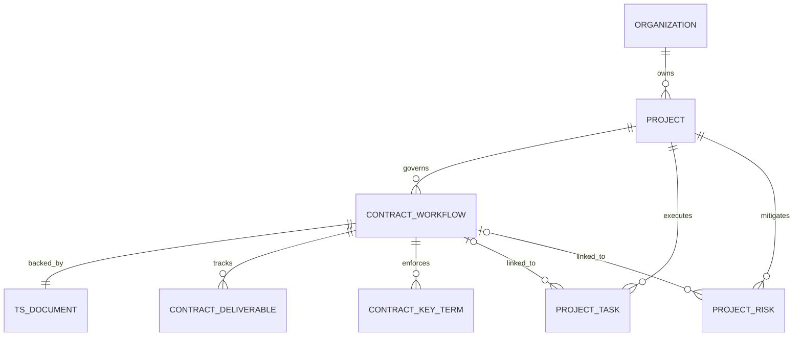

# TrustSeal Project Management Module — Technical & Operational Documentation

## 1. Executive Overview

The **TrustSeal Project Management Module** (`/projects` and `/projects/<id>`) is a full-lifecycle enterprise project governance suite natively coupled to **TrustSeal Documents (TSD) Contracts**. Unlike standalone task trackers that drift out of sync with legal agreements, every Project in TrustSeal acts as the **master governance container** for its underlying TSD Contracts (MSAs, SOWs, Vendor Agreements, Employment/Probation Contracts, NDAs, Leases, Amendments), automatically rolling up:

- **Contract Lifecycle Statuses** (`DRAFT`, `SIGNED`, `SUSPENDED`, `TERMINATED`)
- **Financial Budget vs. Committed Contract Value** (with automatic utilization percentage & overrun detection)
- **Contractual Deliverables & Milestones** (weighted acceptance progress across all project contracts)
- **Key Terms & Probation Trackers** (active legal/commercial covenants and HR probation timelines)
- **Execution Tasks & Workstreams** (optionally bound to specific TSD Contracts)
- **Risks & Issues (RAID) Register** (contractual, financial, schedule, compliance, and operational risks)
- **Automated Project Health & RAG Scoring** (`On Track` / `At Risk` / `Critical`)

---

## 2. Domain Architecture & TSD Contracts Alignment

### Alignment Rules Between Projects & TSD Contracts
1. **1-to-N Contract Governance:** Every `ContractWorkflow` belongs to a `Project` (`project_id`). Users can instantiate new TSD Contracts directly inside a Project Dossier or link any existing organization TSD Contract into a Project via `POST /api/projects/<id>/link-contract`.
2. **Real-Time Budget Rollup:** `committed_value` sums parsed `deal_value` across all non-deleted TSD Contracts linked to the Project and compares against `Project.budget_amount` to compute `budget_util_pct`.
3. **Weighted Deliverable Rollup:** `ContractDeliverable` milestones across all linked contracts aggregate automatically into Project-level `deliverables_pct`, `deliverables_accepted`, and `deliverables_total`.
4. **Automated Health (RAG) Computation:**
   - **Critical (Red):** Any open `critical` risk, OR budget utilization `> 100%`, OR any `blocked` critical task.
   - **At Risk (Amber):** Any open `high` risk, OR budget utilization `>= 85%`, OR suspended contracts present.
   - **On Track (Green):** Healthy budget, no high/critical unresolved risks, and active progression.

---

## 3. Data Model Specification

### 3.1 `projects` ([contract_workflow.py](file:///Users/stephocay/PycharmProjects/trustseal/app/models/contract_workflow.py))
| Column | Type | Description |
| :--- | :--- | :--- |
| `id` | Integer (PK) | Unique project identifier |
| `organization_id` | Integer (FK, indexed) | Tenant isolation boundary |
| `project_code` | String(40) | Human-readable code (e.g. `PRJ-2026-001`) |
| `name` | String(200) | Official project name |
| `description` | Text | Executive mandate & scope summary |
| `category` | String(48) | `client_delivery`, `procurement`, `hr_onboarding`, `real_estate`, `internal_ops`, `legal_governance` |
| `client_name` | String(200) | Client, sponsor, or counterparty organization |
| `owner_user_id` | Integer (FK) | Accountable Project Manager / Sponsor |
| `status` | String(24) | `active`, `on_hold`, `completed`, `archived` |
| `budget_amount` / `currency` | Float / String(12) | Approved financial ceiling |
| `start_date` / `end_date` | String(32) | Planned schedule window |

### 3.2 `project_tasks` ([project_management.py](file:///Users/stephocay/PycharmProjects/trustseal/app/models/project_management.py))
| Column | Type | Description |
| :--- | :--- | :--- |
| `id` | Integer (PK) | Task identifier |
| `organization_id` | Integer (FK, indexed) | Tenant isolation |
| `project_id` | Integer (FK, indexed) | Parent Project |
| `contract_id` | Integer (FK, nullable) | Optional link to a specific `ContractWorkflow` |
| `title` / `description` | String(220) / Text | Workstream task details |
| `phase` | String(64) | Delivery phase (e.g. *Initiation*, *Legal Review*, *Execution*, *Handover*) |
| `assignee_name` | String(120) | Responsible person or team |
| `priority` | String(16) | `low`, `medium`, `high`, `critical` |
| `status` | String(24) | `todo`, `in_progress`, `review`, `done`, `blocked` |
| `due_date` | String(32) | Target completion date (`YYYY-MM-DD`) |
| `progress_pct` | Integer | `0`–`100` completion |

### 3.3 `project_risks` ([project_management.py](file:///Users/stephocay/PycharmProjects/trustseal/app/models/project_management.py))
| Column | Type | Description |
| :--- | :--- | :--- |
| `id` | Integer (PK) | Risk/Issue identifier |
| `organization_id` | Integer (FK, indexed) | Tenant isolation |
| `project_id` | Integer (FK, indexed) | Parent Project |
| `contract_id` | Integer (FK, nullable) | Optional linked TSD Contract |
| `title` | String(220) | Risk or issue summary |
| `category` | String(32) | `contractual`, `financial`, `schedule`, `compliance`, `operational` |
| `severity` / `likelihood` | String(16) | `low`, `medium`, `high`, `critical` |
| `mitigation_plan` | Text | Actionable mitigation or contingency steps |
| `owner_name` | String(120) | Risk owner |
| `status` | String(24) | `open`, `mitigating`, `closed` |

---

## 4. REST API Reference (`/api/projects`)

All endpoints require authenticated session (`@login_required`), enforce strict `organization_id` tenant scoping, and require `X-Requested-With: fetch` on state-mutating calls.

| Method | Endpoint | Purpose |
| :--- | :--- | :--- |
| `GET` | `/api/projects` | List all org projects with contract counts, deliverable rollups, task & risk summaries, and health RAG |
| `POST` | `/api/projects` | Create a new project (`project_code` auto-generated if omitted) |
| `GET` | `/api/projects/<id>` | Fetch project details, linked TSD contracts, tasks, risks, and computed health |
| `PATCH` | `/api/projects/<id>` | Update project metadata, status, dates, client/sponsor, or budget |
| `POST` | `/api/projects/<id>/link-contract` | Attach an existing org TSD Contract (`document_id`) to this Project |
| `GET` | `/api/projects/<id>/tasks` | List all project tasks |
| `POST` | `/api/projects/<id>/tasks` | Create a new task (optionally linked to a contract) |
| `PATCH` | `/api/projects/<id>/tasks/<task_id>` | Update task status, priority, assignee, due date, or progress |
| `DELETE` | `/api/projects/<id>/tasks/<task_id>` | Delete a project task |
| `GET` | `/api/projects/<id>/risks` | List all project risks & issues |
| `POST` | `/api/projects/<id>/risks` | Log a new project/contract risk |
| `PATCH` | `/api/projects/<id>/risks/<risk_id>` | Update risk status (`open` → `mitigating` → `closed`), severity, or mitigation plan |
| `DELETE` | `/api/projects/<id>/risks/<risk_id>` | Remove a risk entry |

---

## 5. User Interface & Workflows

### 5.1 Project Portfolio (`/projects`)
- **Executive Portfolio KPI Strip (5 Cards):** Active Projects, Governed TSD Contracts, Portfolio Deliverables %, Open Tasks & Risks, and Portfolio Budget vs. Committed.
- **Multi-Facet Filter Bar:** Instant search (code, name, client), Category filter, Status filter, and Health filter.
- **3 Switchable Portfolio Views:**
  1. **Table View (`☰ Table`):** Dense tabular rollup with Health RAG pills, contract breakdowns, deliverable progress bars, task/risk counters, budget utilization, and direct Dossier/Contracts links.
  2. **Portfolio Cards (`▦ Portfolio Cards`):** Executive card grid with visual progress bars and quick links.
  3. **Status Board (`▤ Kanban Board`):** 4-column portfolio board (`Active`, `On Hold`, `Completed`, `Archived`) for rapid visual oversight.

### 5.2 Project Dossier (`/projects/<id>`)
- **Executive Dossier KPI Strip (5 Cards):** Project Health & RAG, Governed TSD Contracts, Task Completion, Deliverables Progress, and Budget Utilization.
- **6 Integrated Governance Tabs:**
  1. **TSD Contracts:** View all linked contracts, instantiate a new contract from template, or **Link an Existing TSD Contract** into the project.
  2. **Tasks & Workstreams:** Add, filter, transition (`To Do` → `In Progress` → `Review` → `Done`), and delete tasks tied to contract deliverables.
  3. **Deliverables Rollup:** Real-time milestone tracker aggregated from every TSD Contract in the project.
  4. **Key Terms & Probation:** Legal covenants and HR probation trackers rolled up from contracts.
  5. **Risks & Issues (RAID):** Log contractual/financial/schedule risks, assign owners, record mitigation plans, and close resolved items.
  6. **Project Settings:** Edit project status, budget, schedule, sponsor, and description inline with instant persistence.

---

## 6. Security, Multi-Tenancy & Auditability

- Every query filters strictly by `organization_id == current_user.organization_id`.
- Project creation and contract linking emit immutable security/audit events via `emit_contract_security_event`.
- All linked TSD Contracts retain their cryptographic SHA-256 integrity hashes, OTP-verified signatures, and forensic stamp receipts without interference.
