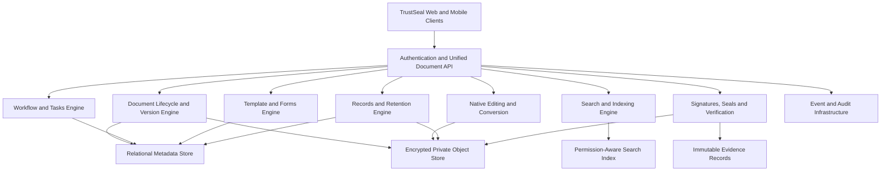

# TRUSTSEAL DOCUMENTS

## Comprehensive Features and Functional Requirements Catalogue

**Product:** TrustSeal Documents  
**Company:** Vitalworks Limited  
**Document type:** Product Feature Catalogue and Preliminary Functional Requirements  
**Version:** 1.0  
**Date:** 17 November 2026  
**Status:** Proposed product scope; implementation status must be verified against the repository

---

## 1. Product vision and scope

TrustSeal Documents shall be developed as a proprietary enterprise-grade document management, content authoring, collaboration, workflow, electronic signing, organizational sealing, verification and digital records management platform. Rather than acting as a simple file-upload service, the module shall manage the complete document lifecycle from creation and intake through controlled modification, review, approval, signing, release, preservation and authorized disposal.

The platform is intended to serve individuals, companies, institutions, government agencies, professional services, legal teams and organizations with formal document governance. TrustSeal shall own the document identity, authorization rules, lifecycle, records, verification evidence and integration boundaries. Optional external systems may extend the platform without becoming mandatory dependencies for its essential document-management capabilities.

### 1.1 Product objectives

- Establish a single authoritative document identity and consistent lifecycle across all TrustSeal capabilities.
- Support authoring, import, processing, collaboration and version management with controlled access.
- Offer configurable document workflows, approval routes, tasks and role-based governance.
- Reuse the existing TrustSeal signature, stamp, timestamp and evidence-preservation services instead of duplicating them.
- Protect finalized and signed document versions from silent modification or destructive replacement.
- Provide reliable enterprise search, retention, archival, auditability and authorized information exchange.
- Support secure deployments in private infrastructure, on-premises environments and controlled clouds.
- Maintain a clean corporate interface consistent with TrustSeal branding and accessible responsive design.

### 1.2 Core functional domains

1. Document workspaces, folders and libraries.
2. Document creation, rich editing and professional publishing.
3. Secure upload, import, conversion and preview.
4. Metadata, classifications and document identifiers.
5. Versioning and controlled change management.
6. Collaboration, comments and sharing.
7. Document review, approvals and configurable workflow.
8. Templates, clauses and automated generation.
9. Structured forms and data-driven document production.
10. Signatures, organizational seals and trust evidence.
11. PDF processing and signed-document preservation.
12. Search, retrieval and discovery.
13. Security, privacy and authorization.
14. Records, retention, legal holds and archival.
15. Correspondence and controlled document exchange.
16. Contract lifecycle management.
17. Dashboards, operational reporting and analytics.
18. Notifications, reminders and tasks.
19. System administration and organizational governance.
20. APIs, integrations and event-driven automation.
21. Intelligent processing and optional assistance.
22. Mobile, offline and low-bandwidth operations.

---

## 2. Functional requirements catalogue

**Requirement priority:** All entries are proposed product capabilities. Implementation sequence and final acceptance criteria must be established through the SRS and delivery plan. Feature IDs provide stable traceability identifiers.

### A. Document workspace and organization

| ID | Feature | Functional requirement |
|---|---|---|
| DOC-001 | Personal workspace | Provide a private area for documents created, owned, shared with, or assigned to an authenticated user. |
| DOC-002 | Organizational workspace | Provide tenant-isolated shared repositories with department, team and policy-based access. |
| DOC-003 | Folder hierarchy | Create nested folders and subfolders with inherited or explicitly controlled permissions. |
| DOC-004 | Document libraries | Maintain structured libraries for contracts, correspondence, reports, policies, applications and official records. |
| DOC-005 | Multiple workspaces | Support project, team, department, branch, client and external collaboration workspaces. |
| DOC-006 | Favorites | Allow users to bookmark important authorized documents and folders. |
| DOC-007 | Recent documents | Display recently opened, edited, reviewed, approved and signed documents. |
| DOC-008 | Document ownership | Record document owner, custodian, originating department and accountable officer. |
| DOC-009 | Bulk operations | Allow authorized batch moves, classification, export, transfer and archival actions. |
| DOC-010 | Recycle bin | Recover eligible deleted drafts and records subject to retention and legal-hold controls. |
| DOC-011 | Document shortcuts | Reference one authoritative document from multiple locations without duplicating its binary. |
| DOC-012 | Saved views | Allow personal and organizational filtered views, sorting and configurable columns. |
| DOC-013 | Cross-workspace transfer | Govern transfers between departments or custodians with explicit authorization and audit. |
| DOC-014 | Workspace quotas | Configure storage, user, file-count and activity quotas by organization or workspace. |

**Implementation rule:** A document must retain its permanent TrustSeal identifier across renames, folder moves, sharing and custody transfers.

### B. Document creation and professional editing

| ID | Feature | Functional requirement |
|---|---|---|
| DOC-015 | Blank documents | Create documents directly in the built-in editor. |
| DOC-016 | Rich-text editing | Support paragraphs, headings, styles, alignment, indentation and text spacing. |
| DOC-017 | Page formatting | Support standard paper sizes, orientation, margins, page breaks and sections. |
| DOC-018 | Tables | Support creation, cell merges, splits, alignment, borders and repeating table headings. |
| DOC-019 | Headers and footers | Insert branding, dates, references, pagination and confidentiality notices. |
| DOC-020 | Images and graphics | Insert appropriate images, diagrams, tables, charts, logos and illustrations. |
| DOC-021 | Lists and numbering | Support bullets, hierarchical lists and automatic section numbering. |
| DOC-022 | References | Support footnotes, endnotes, captions, cross-references and bibliographies. |
| DOC-023 | Table of contents | Generate and refresh a document table of contents. |
| DOC-024 | Find and replace | Search and replace text within editable content. |
| DOC-025 | Spell-checking | Provide language-aware dictionaries and proofreading controls. |
| DOC-026 | Auto-save | Save draft edits automatically with version and conflict safeguards. |
| DOC-027 | Draft recovery | Recover unsaved changes after connection or session failures. |
| DOC-028 | Page preview | Show pagination and printing layout before finalization or export. |
| DOC-029 | Print settings | Support page ranges, scale, paper format and permission-aware watermarking. |
| DOC-030 | Export | Export supported documents to PDF, DOCX, TXT and additional approved formats. |
| DOC-031 | Import | Import and convert supported DOCX, ODT, RTF, TXT and other document formats. |
| DOC-032 | Native document format | Maintain a structured internal document representation distinct from export files. |

A native editing model should be the authoritative editable source; PDFs and DOCX files should be treated as import/export representations unless formally ingested as source artifacts.

### C. Document upload, import and file processing

| ID | Feature | Functional requirement |
|---|---|---|
| DOC-033 | Drag-and-drop upload | Upload one or multiple files through intuitive drag-and-drop controls. |
| DOC-034 | Bulk import | Import permitted directory structures with hierarchy and original filenames. |
| DOC-035 | Supported file types | Handle PDF, DOCX, XLSX, PPTX, TXT, CSV, images and approved archive formats. |
| DOC-036 | File validation | Validate MIME signatures, extensions, size bounds and file structure. |
| DOC-037 | Malware inspection | Scan and quarantine potentially malicious uploads before authorized use. |
| DOC-038 | Secure previews | Generate safe non-executable previews for browser access. |
| DOC-039 | Format conversion | Convert supported files to preview and archival representations. |
| DOC-040 | Duplicate detection | Detect matching hashes and offer reference or controlled-version alternatives. |
| DOC-041 | Import metadata | Preserve available filename, author and timestamp information with source provenance. |
| DOC-042 | Processing status | Report scan, upload, conversion and extraction progress and failures. |
| DOC-043 | OCR | Extract searchable text from scans without overwriting original evidence. |
| DOC-044 | Import recovery | Resume recoverable uploads and report failed files precisely. |
| DOC-045 | Secure archive extraction | Defend against traversal, nested archive attacks and decompression bombs. |

Uploaded material must remain unavailable for routine distribution until all required screening, ownership and policy checks succeed.

### D. Metadata, classification and document identification

| ID | Feature | Functional requirement |
|---|---|---|
| DOC-046 | Document types | Configure contracts, certificates, letters, policies, reports, applications and forms. |
| DOC-047 | Custom metadata | Let administrators define typed metadata fields and validation rules. |
| DOC-048 | Reference numbering | Generate controlled references such as `VW/HR/2026/000125`. |
| DOC-049 | Classification | Support Public, Internal, Confidential, Restricted and tenant-defined classifications. |
| DOC-050 | Document status | Represent draft, review, approved, awaiting signature, signed, sealed, published and archived states. |
| DOC-051 | Tags and keywords | Maintain controlled organizational tags and optional personal labels. |
| DOC-052 | Department metadata | Capture department, project, location, client, owner and responsible officer. |
| DOC-053 | Date metadata | Record creation, effectiveness, review, expiry, approval and archival dates. |
| DOC-054 | Metadata validation | Enforce mandatory fields, allowed values and conditional dependencies. |
| DOC-055 | Inherited metadata | Apply appropriate workspace, library or folder metadata defaults. |
| DOC-056 | Reclassification | Require authorization, reasons and audit for sensitivity changes. |
| DOC-057 | Metadata templates | Provide reusable schema definitions by document category. |
| DOC-058 | Document relationships | Link annexes, amendments, references, supporting records and superseded documents. |

### E. Versioning and change management

| ID | Feature | Functional requirement |
|---|---|---|
| DOC-059 | Automatic versions | Create version records at defined save, check-in, review or release boundaries. |
| DOC-060 | Major/minor versions | Distinguish draft revisions such as 1.1 from approved releases such as 2.0. |
| DOC-061 | Version history | Show revision authors, timestamps, changes and previous authorized artifacts. |
| DOC-062 | Version comparison | Compare supported text and structured content across revisions. |
| DOC-063 | Restore version | Restore a previous revision only as a newly created draft version. |
| DOC-064 | Check-in/check-out | Optionally reserve exclusive editing for controlled document types. |
| DOC-065 | Revision comments | Capture rationale for significant changes. |
| DOC-066 | Version approval | Require approval of specific frozen versions before publication. |
| DOC-067 | Immutable final versions | Prohibit mutation of signed, issued or formally declared record versions. |
| DOC-068 | Supersession | Link replacement records without deleting historical authoritative versions. |

**Trust invariant:** A signature, organizational seal or approval must bind to the exact frozen source version and cryptographic digest.

### F. Collaboration and communication

| ID | Feature | Functional requirement |
|---|---|---|
| DOC-069 | Real-time collaboration | Permit multiple authorized users to edit the same supported draft. |
| DOC-070 | Editing presence | Indicate who is currently viewing or editing a document. |
| DOC-071 | Comments | Add general or anchored comments to document content. |
| DOC-072 | Threaded discussions | Reply, resolve, reopen and track comment conversations. |
| DOC-073 | Mentions | Notify named authorized users or teams when mentioned. |
| DOC-074 | Suggested edits | Support proposed changes that an owner can accept or reject. |
| DOC-075 | Track changes | Record content insertions, deletions and formatting revisions. |
| DOC-076 | Collaboration roles | Enforce view, comment, suggest, edit, review and approve roles. |
| DOC-077 | Internal sharing | Share documents with authorized staff, teams and departments. |
| DOC-078 | External sharing | Invite external recipients with narrowly limited access. |
| DOC-079 | Share expiry | Expire invitations and access links at a configured time. |
| DOC-080 | Download restrictions | Enforce view-only, printing and download policies where technically supported. |
| DOC-081 | Activity feed | Display chronological activity for authorized participants. |
| DOC-082 | Conflict resolution | Resolve simultaneous or offline edits without silently losing work. |

Live editing should use a concurrency-control approach such as CRDTs or operational transformation, with immutable signed versions excluded from collaborative editing.

### G. Review, approval and workflow management

| ID | Feature | Functional requirement |
|---|---|---|
| DOC-083 | Workflow designer | Create configurable document routes using an administrative visual editor. |
| DOC-084 | Sequential approval | Require reviewers to act in a prescribed order. |
| DOC-085 | Parallel approval | Allow independent reviewers to act simultaneously. |
| DOC-086 | Conditional routing | Select paths using classification, department, type, value and approved metadata. |
| DOC-087 | Approval quorum | Require a defined number or proportion of required decisions. |
| DOC-088 | Reviewer assignment | Assign people, teams, roles and departments. |
| DOC-089 | Review tasks | Present document tasks with deadlines, owners and status. |
| DOC-090 | Formal decisions | Record approve, reject and request-changes decisions with attribution. |
| DOC-091 | Delegation | Permit time-bound delegated authority with audit evidence. |
| DOC-092 | Escalation | Escalate overdue or unattended approval tasks. |
| DOC-093 | Workflow templates | Reuse approved processes for HR, procurement, contracts and governance. |
| DOC-094 | Cancellation | Withdraw eligible processes while preserving history. |
| DOC-095 | Workflow history | Record transitions, reasons, approvals and revision context. |
| DOC-096 | Separation of duties | Prevent the same actor from performing conflicting controlled roles. |
| DOC-097 | Workflow versioning | Freeze the exact workflow definition applied to each instance. |
| DOC-098 | Workflow simulation | Test routing and conditions before publishing a workflow configuration. |

**Example route:** Draft → Department Review → Legal/Compliance Review → Approval → Signature/Seal → Final Release → Archive.

### H. Templates and automated generation

| ID | Feature | Functional requirement |
|---|---|---|
| DOC-099 | Template library | Provide reusable organizational and department-specific templates. |
| DOC-100 | Template designer | Build templates through the native document editor. |
| DOC-101 | Dynamic placeholders | Insert names, references, dates, amounts and structured fields. |
| DOC-102 | Conditional content | Include or omit clauses based on validated inputs. |
| DOC-103 | Repeatable sections | Populate repeating rows, line items and other structured collections. |
| DOC-104 | Template governance | Draft, approve, publish, version, retire and archive templates. |
| DOC-105 | Template permissions | Restrict authoring, approvals and publication by role. |
| DOC-106 | Brand management | Apply authorized logos, letterheads and corporate styles. |
| DOC-107 | Batch generation | Generate permitted documents from validated datasets. |
| DOC-108 | Template forms | Build forms that populate approved document templates. |
| DOC-109 | Clause library | Reuse governed legal, commercial and organizational clauses. |
| DOC-110 | Template impact analysis | Identify generated documents associated with specific template versions. |
| DOC-111 | Generated output checks | Validate required fields, references and formatting before release. |

### I. Forms and structured document production

| ID | Feature | Functional requirement |
|---|---|---|
| DOC-112 | Form builder | Design input forms for document and application generation. |
| DOC-113 | Standard field types | Support text, number, date, email, phone, address, lists, selection, attachment and signing fields. |
| DOC-114 | Conditional logic | Show or hide questions based on previous validated answers. |
| DOC-115 | Multistep forms | Organize lengthy submissions into controlled sections and steps. |
| DOC-116 | Form validation | Check required values, patterns, calculations and field dependencies. |
| DOC-117 | Repeatable input groups | Capture multiple parties, beneficiaries, items, witnesses or attachments. |
| DOC-118 | Submission approvals | Route completed submissions through specified authorization processes. |
| DOC-119 | Form-to-document generation | Produce professional outputs from approved structured inputs. |
| DOC-120 | External forms | Offer secured public or recipient-limited submission forms. |
| DOC-121 | Submission tracking | Assign reference numbers and provide authorized progress tracking. |
| DOC-122 | Form revisioning | Preserve the exact published form version used for a submission. |
| DOC-123 | Structured export | Export authorized form data in CSV, JSON and reporting formats. |

### J. Electronic signatures, seals and trust services

| ID | Feature | Functional requirement |
|---|---|---|
| DOC-124 | Signature requests | Send an exact frozen document version to authorized signers. |
| DOC-125 | Multiple signers | Support sequential, parallel and conditional signing routes. |
| DOC-126 | Signature fields | Position authorized signature, name, role and date fields. |
| DOC-127 | Signer verification | Apply appropriate authentication and step-up verification controls. |
| DOC-128 | Signer consent | Preserve explicit signing intent and legally relevant consent evidence. |
| DOC-129 | Signer-held credentials | Support independent signing credentials where cryptographic signer attribution is required. |
| DOC-130 | Signature validation | Verify signature integrity, identities, certificate paths and available trust evidence. |
| DOC-131 | Organizational seals | Apply managed and approved organizational electronic seals and stamps. |
| DOC-132 | Seal custody | Govern custodian roles, independent approvals and stamp issuance. |
| DOC-133 | Visual seal design | Use approved logo, organization name, reference, date and stamp artwork. |
| DOC-134 | QR verification | Provide document-specific QR codes and authorized verification references. |
| DOC-135 | Trusted timestamps | Request and verify RFC 3161 timestamps from configured approved authorities. |
| DOC-136 | Evidence packages | Retain signed bytes, receipts, decisions and cryptographic provenance. |
| DOC-137 | Signing reminders | Notify signers of pending and expiring actions. |
| DOC-138 | Signing expiry | Enforce deadlines and controlled reissuance processes. |
| DOC-139 | Withdrawal/supersession | Withdraw eligible requests and supersede finalized artifacts without deleting history. |
| DOC-140 | Long-term validation evidence | Preserve DSS, certificate, OCSP, CRL and timestamp materials within supported profiles. |
| DOC-141 | Public verification | Provide limited public verification without disclosing private document contents. |
| DOC-142 | Certificate policies | Support approved certificate profiles and applicable trust-service distinctions. |
| DOC-143 | Completion report | Produce a participant, decision and evidence-completion report. |

Visual signature marks, signer-consent evidence, cryptographically valid PDF signatures and legally qualified signatures are distinct assurance categories. UI and API outputs must not confuse them.

### K. PDF management and advanced PDF tools

| ID | Feature | Functional requirement |
|---|---|---|
| DOC-144 | PDF viewer | Render multi-page PDFs with thumbnails, zoom and navigation. |
| DOC-145 | PDF annotations | Add highlights, remarks and drawings to editable PDF derivatives. |
| DOC-146 | PDF merging | Combine authorized unsigned source PDFs into new artifacts. |
| DOC-147 | PDF splitting | Extract selected pages into new controlled documents. |
| DOC-148 | Page operations | Reorder, rotate, insert and delete pages in editable drafts. |
| DOC-149 | PDF forms | Populate and validate supported AcroForm fields. |
| DOC-150 | Watermarks | Add approved draft, confidential, copy or custom watermarks. |
| DOC-151 | Secure redaction | Irreversibly remove sensitive text, hidden content and associated annotations. |
| DOC-152 | PDF optimization | Compress and optimize eligible unsigned derivatives. |
| DOC-153 | PDF/A conversion | Produce and independently validate supported archival PDF profiles. |
| DOC-154 | Accessibility | Support tagging, reading order, alternate text and accessibility review. |
| DOC-155 | Signature preservation | Prohibit signed-byte mutation and validate permitted incremental updates. |
| DOC-156 | PDF metadata inspection | Present author, dates, PDF version and signature-related metadata. |
| DOC-157 | PDF evidence verification | Inspect cryptographic signatures, certificates, fingerprints, timestamps and retained proofs. |

### L. Search and retrieval

| ID | Feature | Functional requirement |
|---|---|---|
| DOC-158 | Global search | Search only documents permitted by the current user's authorization policy. |
| DOC-159 | Full-content search | Index supported document text and permitted OCR output. |
| DOC-160 | Advanced filters | Filter by type, creator, date, department, state, classification and tags. |
| DOC-161 | Folder-scoped search | Restrict searches to specific libraries or workspace paths. |
| DOC-162 | Faceted discovery | Refine results by indexed categories and permitted metadata. |
| DOC-163 | Search snippets | Display accessible contextual snippets from results. |
| DOC-164 | Saved searches | Persist authorized personal and shared search definitions. |
| DOC-165 | Related records | Discover annexes, amendments, related documents and superseded versions. |
| DOC-166 | Indexing status | Index asynchronously with observable progress and recovery. |
| DOC-167 | Search privacy | Protect sensitive query history and enforce metadata visibility boundaries. |
| DOC-168 | Archive-aware search | Search eligible archived records under retention and legal-hold policies. |

### M. Information security and permissions

| ID | Feature | Functional requirement |
|---|---|---|
| DOC-169 | Tenant isolation | Isolate documents, metadata, search and storage between organizations. |
| DOC-170 | Role-based access control | Apply platform, organization, department, workspace and document roles. |
| DOC-171 | Attribute-based policies | Apply optional conditions based on sensitivity, department, ownership or status. |
| DOC-172 | Document ACLs | Grant explicit rights to view, edit, approve, sign, share, print and export. |
| DOC-173 | Least privilege | Deny access by default unless explicitly permitted by policy. |
| DOC-174 | Strong authentication | Require MFA or step-up authentication for sensitive operations. |
| DOC-175 | Encryption at rest | Encrypt stored objects and sensitive metadata with governed keys. |
| DOC-176 | Transport encryption | Use modern TLS between clients, APIs and services. |
| DOC-177 | Key management | Protect keys, handle rotation, separate duties and document recovery controls. |
| DOC-178 | Secure sharing | Control recipient identity, scope, expiry, revocation and access history. |
| DOC-179 | Access monitoring | Audit permitted and denied access events as appropriate. |
| DOC-180 | Malware defense | Scan, quarantine and safely process untrusted content. |
| DOC-181 | Safe previews | Prevent document-provided active content from executing in privileged browser contexts. |
| DOC-182 | Session controls | Enforce session expiry, step-up actions and device/session revocation. |
| DOC-183 | Download controls | Enforce authorized exports, watermarking and applicable printing restrictions. |
| DOC-184 | Sensitive-data safeguards | Apply classification, redaction and data-loss-prevention policy checks. |
| DOC-185 | Backup protection | Encrypt backups and periodically verify restored data and access controls. |
| DOC-186 | Tamper-evident audit | Preserve append-only security events and independently anchor evidence where required. |

### N. Records management and archival

| ID | Feature | Functional requirement |
|---|---|---|
| DOC-187 | Records declaration | Declare qualifying finalized artifacts as governed records. |
| DOC-188 | Retention schedules | Apply retention rules by category, classification and approved legal policy. |
| DOC-189 | Retention triggers | Start retention after execution, approval, closure or another governed event. |
| DOC-190 | Legal holds | Suspend disposal where litigation, investigations or regulatory orders require preservation. |
| DOC-191 | Archival classification | Apply approved filing plans and records schedules. |
| DOC-192 | Immutable records | Prevent modification of issued or declared records. |
| DOC-193 | Archival representations | Retain originals and validated PDF/A or other accepted archival copies. |
| DOC-194 | Archive retrieval | Support controlled retrieval and search of retained records. |
| DOC-195 | Authorized disposal | Require approvals, hold checks and evidence before destruction. |
| DOC-196 | Disposal certificates | Record completion of authorized destruction without preserving deleted content unnecessarily. |
| DOC-197 | Integrity monitoring | Periodically verify archival object hashes and evidence references. |
| DOC-198 | Records transfer | Log transfer of record ownership or institutional custody. |
| DOC-199 | Restoration | Preserve restoration procedures and validate recovery integrity. |
| DOC-200 | Retention analytics | Report expiring, held, overdue and pending-review records. |

Retention expiry must not cause unconditional deletion; applicable laws, unresolved holds and approved disposal decisions take precedence.

### O. Correspondence and controlled document exchange

| ID | Feature | Functional requirement |
|---|---|---|
| DOC-201 | Incoming correspondence | Register letters, notices and externally received documents. |
| DOC-202 | Outgoing correspondence | Create, approve, sign and formally dispatch organizational communication. |
| DOC-203 | Correspondence register | Record reference, sender, recipient, subject, dates and classification. |
| DOC-204 | Dispatch tracking | Track delivery attempts, acknowledgements and failures. |
| DOC-205 | Receipt acknowledgements | Preserve verified receipt and acknowledgement evidence. |
| DOC-206 | Reply linkage | Associate received correspondence with responses and follow-up obligations. |
| DOC-207 | External document portal | Provide secure submission and retrieval for partners, clients or citizens. |
| DOC-208 | Recipient verification | Verify authorized recipient identity before sensitive release. |
| DOC-209 | Delivery options | Support approved internal delivery, email, secured packages and APIs. |
| DOC-210 | Correspondence workflow | Route external and outgoing items through controlled departmental processes. |

### P. Contract lifecycle management

| ID | Feature | Functional requirement |
|---|---|---|
| DOC-211 | Contract drafting | Generate agreements from approved documents and clauses. |
| DOC-212 | Contract parties | Track organizations, representatives, contact details and contract roles. |
| DOC-213 | Negotiation and redlines | Track counterproposals, controlled edits and comment history. |
| DOC-214 | Legal clearance | Require formal approval of deviations and substantive clauses. |
| DOC-215 | Contract execution | Route contract parties through authorized signing and sealing. |
| DOC-216 | Obligation register | Assign performance obligations and responsible parties. |
| DOC-217 | Milestones | Track delivery, acceptance and payment dates. |
| DOC-218 | Renewals | Monitor renewal options, expiry, termination and key notice periods. |
| DOC-219 | Amendments and addenda | Link changes to the original executed contract without rewriting it. |
| DOC-220 | Contract reporting | Report pipeline, owners, obligations, risk and renewal exposure. |

### Q. Dashboards, reporting and analytics

| ID | Feature | Functional requirement |
|---|---|---|
| DOC-221 | Personal dashboard | Display My Documents, Tasks, Pending Approvals and Signatures. |
| DOC-222 | Organization dashboard | Show document distribution across departments, types, periods and states. |
| DOC-223 | Workflow metrics | Monitor bottlenecks, cycle times and overdue tasks. |
| DOC-224 | Signature metrics | Track pending, completed, expired and declined signing requests. |
| DOC-225 | Storage analytics | Report capacity by tenant, workspace and classification. |
| DOC-226 | Audit reports | Export authorized activity, sharing, signature and disposal summaries. |
| DOC-227 | Compliance metrics | Monitor retention, holds, classification and missing verification evidence. |
| DOC-228 | Report builder | Configure authorized columns, filters, grouping and aggregates. |
| DOC-229 | Exportable reports | Produce PDF, CSV and Excel representations with access checks. |
| DOC-230 | Scheduled reports | Deliver approved recurring reports using supported channels. |

### R. Notifications and productivity

| ID | Feature | Functional requirement |
|---|---|---|
| DOC-231 | Notifications hub | Centralize document activity and action-required alerts. |
| DOC-232 | Review alerts | Notify assigned reviewers and approvers. |
| DOC-233 | Signature alerts | Notify signers of pending requests. |
| DOC-234 | Deadline reminders | Apply configurable reminders and escalation conditions. |
| DOC-235 | Expiry notifications | Warn about important contract and document expiry dates. |
| DOC-236 | My Tasks | Provide assigned actions, urgency, owners and progress. |
| DOC-237 | Notification preferences | Allow approved channel, frequency and category choices. |
| DOC-238 | Digest messages | Generate optional daily or weekly task summaries. |
| DOC-239 | Calendar exports | Expose authorized task deadlines and milestones. |
| DOC-240 | Delivery audit | Record significant notification delivery outcomes and failures. |

### S. Administration and governance

| ID | Feature | Functional requirement |
|---|---|---|
| DOC-241 | Document settings | Configure module-wide and tenant-specific defaults. |
| DOC-242 | Classification administration | Define and enforce classification levels and permitted actions. |
| DOC-243 | Document type administration | Create, modify and retire document types. |
| DOC-244 | Metadata schemas | Define typed fields, validation and presentation rules. |
| DOC-245 | Template administration | Authorize and version approved templates and libraries. |
| DOC-246 | Workflow administration | Manage routing, escalation, decision policies and published versions. |
| DOC-247 | Storage administration | Configure object storage, quotas, encryption, backups and retention. |
| DOC-248 | Permissions management | Manage roles, groups, ACL policies and delegations. |
| DOC-249 | Branding | Apply approved letterheads, logos and styles without modifying protected assets. |
| DOC-250 | Trust-service configuration | Govern signature, seal, timestamp and certificate trust settings. |
| DOC-251 | Compliance policy | Define mandatory approvals, legal holds and policy exceptions. |
| DOC-252 | Operational health | Monitor queues, errors, processing status and storage availability. |
| DOC-253 | Import/export policy | Control file formats, size caps and permitted exports. |
| DOC-254 | Audit administration | Protect governance evidence with restricted audit-only roles. |

### T. APIs, integrations and automation

| ID | Feature | Functional requirement |
|---|---|---|
| DOC-255 | Document API | Create, list, retrieve, search, classify and update authorized drafts. |
| DOC-256 | Version API | Access version history and perform controlled version transitions. |
| DOC-257 | Template API | Generate documents from approved template revisions and structured inputs. |
| DOC-258 | Workflow API | Start workflows, retrieve tasks and submit authorized decisions. |
| DOC-259 | Signature API | Integrate the existing signature and signing-envelope services. |
| DOC-260 | Verification API | Return authenticated integrity and evidence-validation results. |
| DOC-261 | Records API | Expose authorized retention, legal-hold and archival operations. |
| DOC-262 | Webhooks | Publish signed or authenticated lifecycle events to approved subscribers. |
| DOC-263 | API identity and scopes | Use scoped service accounts and credential management. |
| DOC-264 | Idempotency | Prevent duplicate generation, signing, release and dispatch actions. |
| DOC-265 | Bulk API | Process permitted batch operations with durable job tracking. |
| DOC-266 | Event infrastructure | Use durable queues, retries, dead-letter handling and observability. |
| DOC-267 | Developer documentation | Provide versioned OpenAPI specifications and integration examples. |
| DOC-268 | Optional integrations | Connect approved email, office, identity, cloud and ERP platforms without core dependency. |

### U. Intelligent document processing (optional and governed)

| ID | Feature | Functional requirement |
|---|---|---|
| DOC-269 | Intelligent classification | Recommend categories from authorized content and metadata. |
| DOC-270 | Metadata extraction | Extract dates, names, amounts, references and related entities with review. |
| DOC-271 | Summaries | Generate reviewable document summaries for authorized users. |
| DOC-272 | Clause comparison | Compare proposed clauses with approved institutional wording. |
| DOC-273 | Consistency checking | Detect inconsistent references, missing sections and incomplete fields. |
| DOC-274 | Sensitive-data discovery | Identify candidate confidential information for review or redaction. |
| DOC-275 | Natural-language search | Query indexed authorized content using constrained contextual questions. |
| DOC-276 | Translation | Translate authorized drafts with source and translation provenance. |
| DOC-277 | Accessibility suggestions | Suggest alternate text, headings and accessible reading order. |
| DOC-278 | Workflow recommendations | Recommend existing approved routing policies without automatic commitment. |

Optional intelligent processing must not silently modify finalized records or transfer confidential content to unapproved third parties.

### V. Mobile, offline and distributed access

| ID | Feature | Functional requirement |
|---|---|---|
| DOC-279 | Responsive interface | Support desktop, tablet and mobile layouts. |
| DOC-280 | Mobile scanning | Capture documents with camera, perspective correction and rotation. |
| DOC-281 | Offline drafts | Edit locally authorized drafts with secure conflict handling. |
| DOC-282 | Offline search | Search explicitly cached, permitted metadata and content. |
| DOC-283 | Background sync | Resume upload and synchronization when connectivity returns. |
| DOC-284 | Conflict management | Prevent conflicting offline changes from overwriting authoritative versions. |
| DOC-285 | Offline encryption | Encrypt cached content and support device or access revocation policies. |
| DOC-286 | Low-bandwidth mode | Reduce transfer sizes through incremental uploads and optimized previews. |
| DOC-287 | Deferred ingestion | Queue secure uploads for later network access. |
| DOC-288 | Offline trust restrictions | Prevent unverifiable timestamps, signatures and protected approval transitions while disconnected. |

**Catalogue total: 288 proposed feature requirements (DOC-001 through DOC-288).**

---

## 3. Proposed user experience and interface structure

The TrustSeal Documents experience shall use a flat modern enterprise UI consistent with the existing TrustSeal identity. It shall avoid gradients, decorative AI-style background chips, excessive cards, unnecessary borders and exaggerated corner radii. Document density, hierarchy, navigation, typography and spacing must remain consistent across desktop and mobile.

### 3.1 Primary navigation

- Overview
- My Documents
- Shared with Me
- Team Libraries
- My Tasks
- Approvals
- Templates
- Forms
- Signed Documents
- Archives
- Recycle Bin
- Settings (role restricted)

### 3.2 Document details

Use one consistent document details interface with context-sensitive tabs:

**Overview | Preview | Versions | Activity | Comments | Workflow | Signatures | Evidence**

Hide tabs that are irrelevant or unauthorized. Avoid recreating independent screens for the same information in different modules. Show a single clear document title, reference, type, classification, owner, status and currently authoritative version.

### 3.3 Main interface components

- Workspace/library selector and breadcrumb hierarchy.
- Search bar with filter drawer and saved views.
- Clear **New Document**, **Upload** and **Create From Template** actions, subject to permissions.
- Accessible list/table and optional thumbnail views.
- Status, version, owner and last-updated columns.
- Context menus limited to permitted document operations.
- Side panel for document metadata, activity and evidence overview.
- Task and notification counters with accessible alternatives to color-only states.
- Compact but readable document forms; no horizontal scrolling at standard desktop widths.

### 3.4 Document lifecycle state model

A representative lifecycle is:

```text
Draft
  -> In Review
      -> Changes Requested -> Draft (new revision)
      -> Rejected           -> Closed / Superseded
      -> Approved
          -> Awaiting Signature
              -> Signed
                  -> Sealed (where required)
                      -> Issued / Published
                          -> Declared Record
                              -> Archived
                                  -> Disposal Review
                                      -> Authorized Disposal
```

Not all document categories require signatures, seals or archival phases. The lifecycle engine shall enforce the permitted transitions for the applicable category and retain the exact transition evidence.

---

## 4. Proposed logical architecture



These are logical service boundaries. They may begin as modules within a modular application and be independently deployed only when justified by operational needs.

### 4.1 Proposed authoritative entities

- **Document:** permanent logical identifier, tenant, ownership and business metadata.
- **DocumentVersion:** immutable version manifest, actor, parent revision, source digest and change reason.
- **DocumentBlob:** immutable binary object identity, checksum, storage key and processing status.
- **Folder / Library / Workspace:** hierarchy, tenant, membership and policies.
- **AccessGrant / Policy:** explicit permissions, policy scope, expiration and audit.
- **DocumentClassification / MetadataSchema:** controlled taxonomies and typed metadata.
- **DocumentWorkflow / WorkflowVersion / WorkflowInstance / WorkflowTask:** governed routing and decisions.
- **DocumentTemplate / TemplateVersion / ClauseVersion:** approved reusable authored content.
- **FormDefinition / FormVersion / Submission:** structured form inputs and provenance.
- **SigningEnvelope / Participant / SignatureEvidence:** exact source-version signing transactions.
- **StampCustody / StampDesign / StampAttestation:** governed organizational seal issuance.
- **EvidenceRetention / LegalHold / EvidenceCheckpoint:** preservation controls.
- **Timestamp / OCSP / CRL / ValidationDossier:** bounded cryptographic evidence.
- **DocumentRelationship:** annex, amendment, supersession and reference edges.
- **AuditEvent / OutboxEvent:** attributable lifecycle and security events.

### 4.2 Cross-cutting engineering requirements

1. Strict tenant-aware authorization on every object reference and every query, including search and preview.
2. One canonical document and version identity across all modules.
3. Separate editable source from immutable issued artifacts and cryptographic evidence.
4. Content-addressed integrity checks and opaque private storage keys.
5. Secure streamed ingestion, scan, conversion, OCR and preview pipelines.
6. Transactional state changes, idempotency keys, durable events and retry-safe workers.
7. Clear module contracts and versioned public APIs.
8. Explicit separation between signature appearance, consent evidence, PDF CMS signatures and qualified trust-service claims.
9. Retention-aware archiving, backup, legal hold and authorized disposal.
10. Compatibility tests, migration tests, security tests and interoperable verification tests.

---

## 5. Non-functional requirements

| Area | Proposed acceptance target or control |
|---|---|
| Availability | Target at least 99.9% for production service tiers, subject to deployment SLA. |
| Latency | Target p95 below 500 ms for ordinary metadata requests under a benchmarked workload. |
| Upload resilience | Support resumable uploads, bounded parsing and streaming storage. |
| Scalability | Horizontally scalable API, conversion, OCR, indexing and workflow workers. |
| Integrity | Verify frozen document content and evidence hashes at relevant trust boundaries. |
| Authorization | Enforce least privilege, isolation and negative permission tests across tenants. |
| Encryption | TLS in transit, encryption at rest and approved key-protection policies. |
| Audit | Durable, attributable, tamper-evident events and administrator separation of duties. |
| Accessibility | Target WCAG 2.2 AA for principal user journeys. |
| Usability | Consistent responsive layouts, keyboard navigation, readable tables and clear feedback. |
| Reliability | Durable job queues, retry limits, idempotence, replay recovery and failure monitoring. |
| Recoverability | Set and verify recovery point and recovery time objectives by deployment tier. |
| Portability | Support controlled on-premises, private infrastructure and cloud installations. |
| Interoperability | Support declared open formats, documented APIs and tested signature profiles. |
| Maintainability | CI regression tests, migration checks, architecture documentation and code quality gates. |
| Observability | Trace document processing, upload, conversion, workflow and evidence failures. |
| Privacy | Data minimization, restricted exports, retention schedules and disclosure review. |

These are proposed engineering requirements and service objectives, not current production performance measurements.

---

## 6. Current TrustSeal repository alignment and implementation caution

The TrustSeal repository at **https://github.com/socaya/trustseal** includes existing document-related models and API blueprints for document metadata, drafts, versions, comments, sharing, templates, sections, labels, parties and activities. It also contains signing-envelope services, managed stamps and seals, private document processing, search, signed PDF validation, timestamp, certificate status and evidence-preservation services.

Relevant existing components include:

- `app/models/documents/document.py`
- `app/blueprints/documents/api/document_api.py`
- `app/blueprints/documents/api/document_version_api.py`
- `app/models/documents/document_template.py`
- `app/services/document_search.py`
- `app/services/documents/safe_preview.py`
- `app/blueprints/documents/api/envelope_api.py`
- `app/services/validation_dossier.py`
- `app/services/pdf_dss.py`

**Important:** Source files or routes do not prove that all advertised enterprise requirements are complete. The current version API intentionally rejects generic legacy version mutation. Existing metadata search is not equivalent to complete indexed full-document search. The recent signing and long-term evidence modules should remain separate trust services rather than being rebuilt within Documents.

A rigorous gap assessment should classify each feature as **Complete / Partial / Not Implemented / Needs Verification**, link the corresponding code and test evidence, and identify security, migration and operational dependencies.

---

## 7. Recommended phased implementation roadmap

| Phase | Delivery scope | Primary outcome |
|---|---|---|
| Phase 1 — Document Core | Document identity, secure ingestion, folders, libraries, classifications, metadata, permissions, versioning and search foundations. | Governed, secure document repository. |
| Phase 2 — Authoring and Collaboration | Native document editor, import/export, comments, suggestions, revisions, concurrent drafts, templates and structured forms. | End-to-end document creation and team collaboration. |
| Phase 3 — Workflows and Business Documents | Workflow designer, tasks, approvals, correspondence, contract lifecycle, reminders and document generation. | Configurable organizational document operations. |
| Phase 4 — Trust Integration | Reuse signatures, stamps, timestamps, evidence preservation and verification across canonical document versions. | One secure and auditable signing and issuance lifecycle. |
| Phase 5 — Records and Enterprise Controls | Archival, legal holds, retention, reporting, administrative policy, backup and audit export. | Enterprise records governance and compliance operations. |
| Phase 6 — Advanced Capabilities | Offline drafts, distributed sync, intelligent assistance, advanced analytics, high-volume automation and optional integrations. | Differentiated proprietary platform. |

### 7.1 Delivery gates for every phase

- Functional requirements have acceptance criteria and automated tests.
- Security and authorization checks include cross-tenant denial cases.
- Existing finalized documents and evidence remain backward compatible.
- Database migrations are reviewed, repeatable and tested against relevant schema histories.
- Error paths, retries, concurrency and partial failure recovery are tested.
- UI is accessible, responsive and consistent with approved corporate design standards.
- API changes are documented and versioned.
- Operational monitoring, backup and rollback procedures are documented.
- Production readiness is supported by deployment evidence, not inferred from unit-test counts alone.

---

## 8. Architecture decisions to approve before full implementation

1. **Single document domain model.** Every logical document has one ID, one authoritative version lineage and linked derivative artifacts.
2. **Native editing and standards-based interchange.** TrustSeal owns the editable model, while standard formats remain supported for import/export.
3. **Unified authorization.** The same policy boundary must protect documents, search, folder listings, previews, exports, comments, tasks and evidence.
4. **Strict separation of editable and trusted records.** No finalized, signed or preserved artifact may be silently rewritten.
5. **Proprietary but modular implementation.** Vitalworks owns platform behavior, service contracts and trust logic; reusable libraries and approved adapters need not compromise ownership.
6. **Audit and integrity by design.** Every consequential state transition requires attribution, provenance and verifiable storage integrity.
7. **Trust claims match evidence.** A visual mark or partial certificate-status observation must never be presented as a legally qualified signature or complete PAdES-LT/LTA assurance.
8. **Clear operational responsibilities.** Trust roots, signing keys, retention, trusted timestamps and regulated trust-service activities require separately governed custody and oversight.

---

## 9. Recommended next requirements artifacts

The feature catalogue should be refined into a **TrustSeal Documents Master System Requirements Specification (SRS)** with these linked artifacts:

- Detailed use cases, functional rules and acceptance criteria for DOC-001–DOC-288.
- Actor catalog and role/permission matrix.
- Document lifecycle and workflow state transition specifications.
- Data model, relational diagrams, object store manifests and metadata schemas.
- Native document editor and concurrent collaboration architecture.
- OpenAPI contracts and domain-event schemas.
- UI information architecture, component library and screen-by-screen specifications.
- Security threat model, privacy requirements and tenant isolation test plan.
- Records classification, retention and disposal governance plan.
- Signature/seal and cryptographic evidence integration requirements.
- Requirements Traceability Matrix (RTM), prioritized backlog and delivery acceptance plan.

---

## 10. Final recommendation

**TrustSeal Documents should become the central document lifecycle engine of TrustSeal.** Electronic signatures, organizational stamps, verification, templates, forms, workflows, correspondence, contracts and records management should integrate with it through well-defined modules, while preserving one authoritative document identity, consistent permissions and immutable trusted evidence.

**Catalogue scope:** 288 proposed capabilities across 22 feature domains. This is a comprehensive product specification baseline; it is not a representation that all features are already implemented or that TrustSeal has attained any regulated trust-service qualification.

**Prepared for:** Vitalworks Limited — TrustSeal Documents Platform.
