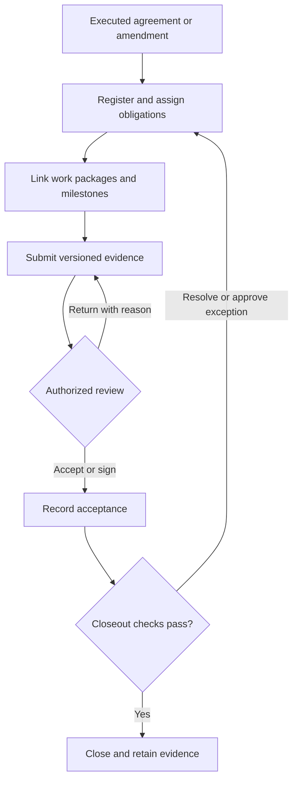

# TrustSeal Project Management Engine
## Software Requirements Specification for Features and User Interface

| Field | Value |
|---|---|
| Product | TrustSeal · Projects |
| Organization | Vitalworks Limited |
| Version | 1.0 · Proposed implementation baseline |
| Date | 27 November 2026 |
| Audience | Product, design, engineering, security, QA, implementation and support |
| Basis | TrustSeal Enterprise Project Management Module Specification v2.1, revised TrustSeal PM UI prototype and the decision to run PM natively in TrustSeal |

## 1. Purpose and scope

TrustSeal shall manage projects throughout their lifecycle and connect project delivery to the contracts that govern it. A project manager shall be able to plan work, assign people and equipment, track effort and costs, and manage delivery. A contract manager shall be able to trace each applicable obligation from the executed agreement to its owner, due date, linked work, submitted evidence, formal decision and closeout.

The SRS covers all 34 modules in the existing catalogue. Contract-linked delivery is the first release slice. Later phases deliver the remaining mandatory scope. A project may operate independently, with one contract or with several contracts. A contract may exist before it is linked to a project.

**Interpretation.** “Shall” denotes a mandatory requirement. A conditional requirement applies when its stated capability, contract rule or approved tenant policy applies. The prototype governs visual direction and navigation. Its sample records and browser-only behaviour are illustrative. Confirm existing implementation against the repository and deployed schema before assigning implementation status. The proposed service targets in §9 require operational approval.

### 1.1 Product and runtime boundaries

| ID | Requirement |
|---|---|
| ARC-01 | TrustSeal shall own and execute the entire PM lifecycle using its native application, database and approved background worker infrastructure. Core PM and contract workflows shall complete with VitalProjects network access disabled. |
| ARC-02 | The engine shall reuse TrustSeal organization identity, project and contract records, permissions, document storage and versioning, approval and signature services, notifications and audit history. |
| ARC-03 | VitalProjects may inform workflow design. Any approved interchange shall be optional, asynchronous and isolated from TrustSeal signing, verification, contract acceptance and project operations. An unavailable connector shall surface its own status and preserve local operations. |
| ARC-04 | TrustSeal configuration shall support organization-level PM entitlement and staged rollout. With PM disabled, unrelated document and contract functions shall remain available. Existing linked records and evidence shall remain accessible according to existing permissions and retention policy. |
| ARC-05 | PM scheduling, exports, recalculation and imports shall use bounded background processing. PM job failure shall preserve authoritative records and expose recovery, without blocking unrelated signing, document verification or contract operations. |
| ARC-06 | TrustSeal shall govern project costs, approved effort, commitments and invoice-support evidence. Posted accounting, payroll and payment execution remain outside this SRS except for explicitly authorized interfaces. |
| ARC-07 | Maintain compatible behaviour for existing project, contracts and document entry points, including authorized bookmarks and API consumers. Reconcile the reuse of current models, native permissions, migrations and endpoints before adding replacements. |

### 1.2 Roles and access

| Role or permission bundle | Main workspace | Default approval or data boundary |
|---|---|---|
| Executive or sponsor | Portfolio summary, investment decisions and gates | Assigned portfolios and decisions |
| PMO and programme manager | Roadmaps, cross-project dependencies, standards and exceptions | Configured programme or portfolio scope |
| Project manager and team lead | Project plan, work, resource demand, delivery and health | Assigned projects and delegated actions |
| Contributor | My Work, assigned tasks, evidence and time entry | Own work or authorized project records |
| Resource manager | Skills, demand, availability and allocation | Capacity visibility and allocation rights. Restricted rates require a separate grant. |
| Finance controller | Budgets, costs, efforts, forecasts, posting and reconciliation | Financial field permissions and configured approval thresholds |
| Procurement officer | Requisition, sourcing, evaluation, award and receipt | Designated steps with conflict-of-interest and separation-of-duties controls |
| Contract manager and authorized reviewer | Contract obligations, changes, submission and acceptance | Contract-specific authority. Signature and stamp rights are separate. |
| QA, safeguards or M&E officer | Tests, inspections, indicators, compliance and evidence | Assigned record classes, including sensitive incident restrictions |
| Client, donor or supplier | External project workspace | Explicit record and version shares, expiry and action-level grants |
| Auditor | Audit history, version evidence and reconciliation | Read-only access within grant and retention policy |
| Organization administrator | Templates, policy, integrations, access reviews and rollout | Management rights and separately granted confidential access |

### 1.3 Record ownership and traceability

| Record | Authoritative owner within TrustSeal | Key association |
|---|---|---|
| Portfolio, programme, project, work package and task | PM engine | Organization, optional programme and portfolio, stable hierarchy |
| Executed agreement, amendment, signature and document version | Contracts, Documents and Signatures | Exact source version and issuer or signer references |
| Contract obligation and contractual acceptance | Contracts workflow | Executed version, clause, SOW item or schedule reference |
| Project deliverable and internal review | PM delivery workflow | Linked requirement, milestone or work package. A binding references the existing contractual deliverable where applicable. |
| Timesheet and approved time group | PM Timesheets | Contributor, work date, project, activity and optional applicable contract |
| Budget and cost event | PM Finance | Effective baseline, currency, source, cost code, fund and posting lineage |
| Approval, waiver, decision and audit event | Relevant governed TrustSeal workflow | Actor, role, authority, subject version, effective policy, timestamp and reason |

## 2. Lifecycle, project gates and status

| Stage | Required screen and exit evidence |
|---|---|
| Intake and assessment | Intake wizard, triage queue and assessment comparison. Record the decision, sponsor, problem, estimated value and risk. |
| Authorization | Charter and governance page. Show scope, accountable manager, objectives, initial funding evidence and approval. |
| Planning | Baseline workspace. Show scope, WBS, schedule, resource plan, budget and applicable controls. Approve the required baseline versions. |
| Mobilization | Readiness checklist. Verify team and access, confirmed capacity, active agreements where applicable and compliance prerequisites. |
| Execution | Work, schedule, resources, timesheets, finance and controls. Show dependencies, delivery evidence, exceptions and remaining decisions. |
| Acceptance and handover | Deliverables, acceptance queue and handover checklist. Record the exact submitted versions, decisions, unresolved defects and receiving owner. |
| Closure | Closure review. Resolve obligations, open costs and time, resources and retention checks or record an authorized policy exception. |
| Benefits review | Benefits register. Record owner, baseline, target, actual outcome, supporting evidence and review schedule. |

- **LIF-01.** Server-side transition rules shall evaluate required evidence and permissions. Lifecycle shall support Draft, Proposed, Assessing, Authorized, Planning, Mobilizing, Executing, Handing over, Closing, Closed and Archived, with controlled On hold, Cancelled and Reopened transitions. Store an effective date and reason for exception transitions.
- **LIF-02.** The gate screen shall show each criterion, current state, evidence version, owner and next action. Gate decisions shall retain actor, authority, policy version, timestamp and rationale. Waivers shall identify the requirement, reason, authorizing role, expiry and compensating action.
- **LIF-03.** Display project lifecycle, schedule or delivery health, work state, contract state, acceptance state and financial posting state as distinct fields. Health shall show factor, source and cutoff. Unknown or stale inputs shall be explicit.
- **LIF-04.** Declined or returned proposals, baseline changes and gate decisions shall preserve history. Closed or archived records shall remain read-only except for permitted benefits tracking, governed correction, archive administration or audited reopening.
- **LIF-05.** Configure project type, lifecycle template, working calendar, required gates and thresholds within tenant policy. A template may combine stages while preserving mandatory checks and historical policy versions.

## 3. Contract-linked project delivery

### 3.1 Obligation-to-closeout workflow

| ID | Contract and delivery requirement | Observable acceptance |
|---|---|---|
| CON-01 | The contract link action shall select existing authorized contract records and confirm relationship type, applicable scope and owning project. Existing project IDs, contract links and signed history shall be preserved. | Linking twice yields one active binding for the same project, contract and scope. Opening either direction lands on the correct record. |
| CON-02 | The obligation register shall capture source contract version and clause or schedule reference, obligation type, beneficiary or responsible party, named owner, due rule and resolved date, recurrence, acceptance criteria, required evidence, approver and escalation policy. | From a row, an authorized reviewer can open the source version, identify the owner and see which obligations are due, unassigned, blocked or overdue. |
| CON-03 | The engine shall calculate due dates from explicit dates or verified trigger events using the configured contract calendar and time zone. Preserve the trigger event and calculation inputs. Recurring obligations generate distinct, uniquely identified occurrences. | Replaying a trigger creates one occurrence. A missing trigger is shown as a pending date. An overdue date reflects the intended local cutoff. |
| CON-04 | Link one obligation occurrence to one or more tasks, work packages, milestones or deliverables. Where work supports several obligations, each obligation retains its own acceptance and audit history. | The obligation shows linked work and progress. Completing all linked tasks leaves formal acceptance pending until the permitted decision succeeds. |
| CON-05 | Show contractual due date, approved project baseline date, forecast delivery date and actual submission or acceptance dates in separate fields. Show variance and the affected obligations before and after approved changes. | Forecast slippage appears even before the contractual deadline passes. Replanning leaves the executed due date intact. |
| CON-06 | The submitter shall package evidence against the required criteria and identify the exact document versions. The review screen shall show criteria outcomes, version history, attachments, comments and authorized decisions. | A returned submission retains its version and reviewer reason. Resubmission creates a new version. Replacing evidence invalidates any pending decision tied to the prior version. |
| CON-07 | Store acceptance or rejection with subject version, authority, actor, date, reason where required and relevant evidence references. If signature is required, acceptance completes only after the native signing flow verifies successful completion for that submission. | An unauthorized user cannot accept. Duplicate signing callbacks create one acceptance and one progress effect. Failed or stale signing leaves the obligation pending or failed. |
| CON-08 | Apply an authorized executed amendment through an impact review. Show obligations added, changed, superseded or cancelled and preserve effective dates, old versions and prior decisions. Apply outstanding work and baseline changes only through their applicable controls. | A draft amendment changes no enforceable dates. Previous submissions and decisions are reproducible against their applicable contract version. |
| CON-09 | Generate due-soon, overdue and escalation notifications by policy. Deduplicate by occurrence, recipient and notification window, with links that recheck access and previews that omit restricted terms. | Reprocessing the same trigger avoids duplicate notifications. Reassigning an owner updates future routing. Failure is visible to an authorized operator. |
| CON-10 | A closeout review shall reconcile unresolved obligations, open defects, asset and document transfers, financial handover, and configured warranty, renewal or post-closure obligations. Record completed, waived, transferred or continuing items with named owners and due dates. | A mandatory unresolved item blocks closeout. A permitted waiver or continuing obligation has a retained decision and accountable owner. |
| CON-11 | Project dashboards and portfolio rollups shall count a linked deliverable once per applicable metric. Preserve separate measures for progress, contractual acceptance and payment eligibility. | A project deliverable linked to a contract has one earned progress contribution. Finance can trace eligible amounts to approved supporting evidence. |
| CON-12 | Submission, acceptance, amendments, relinking and closeout shall enforce current authorization, record version and policy transactionally. Contract acceptance shall remain usable during a PM background-job failure. | Stale or concurrent actions return a recoverable conflict. Authoritative decisions persist and affected summaries catch up safely after recovery. |

### 3.2 Minimum contract workspace fields

- **Contract summary.** Agreement reference, title, counterparty, executed version, effective and expiry dates, relationship to project, next actionable date and unresolved mandatory obligations.
- **Obligations table.** Reference, source clause, obligation, owner, contractual date, forecast date, variance, work status, acceptance status and next action. Filter by contract, type, owner, period, status, overdue or upcoming, and mandatory or optional scope.
- **Obligation detail.** Overview, linked work, acceptance criteria, submission versions, decisions, amendments and activity. Use a drawer for inspection and a full page for complex submission, comparison or approval.
- **Review and handover.** Batch navigation between assigned reviews, per-criterion decisions, reason capture, evidence preview, blocking checks, exception authority and downloadable versioned evidence pack.

## 4. Main layouts and user interface

### 4.1 Navigation and layout hierarchy

| Layout | Required structure and behaviour |
|---|---|
| TrustSeal shell | Native TrustSeal product bar with organization and identity, compact workspace navigation rail, breadcrumbs and a single main content region. Keep organization and project context visible on actions involving either scope. |
| Global PM workspace | Workspace group with Home, My Work, Intake, Portfolios, Programmes and Projects. Management group with Resources, Operations, Approvals, Reports and Administration. Menus reflect permissions and enabled features. |
| Project register | Title and New project action, a compact summary strip when useful, saved view tabs, search and filter toolbar, sortable register and pagination. Default columns include project and code, programme or portfolio, project manager, lifecycle, health, target finish and progress. |
| Project workspace | Breadcrumb, project title and code, optional portfolio or programme, lifecycle and health text, project switcher and scoped actions. Primary tabs include Overview, Plan, Work, Resources, Timesheets, Finance, Procurement & Contracts and Deliverables. Group controls, governance, results and configuration under More sections. |
| Global queues | My Work, approval inbox, resource demand, overdue obligations and posting exceptions share the register pattern. Show project and accountable actor where the queue spans projects. |
| Record detail | Side panel for quick inspection and small edits. Full page for a contract obligation, schedule editing, governed submission, amendment comparison and multi-step flows. Keep source links and breadcrumbs. |
| External workspace | Shared project summary, milestones, deliverables, documents, comments, evidence and assigned acceptance. Keep navigation, search and counters within the share grant. |
| Mobile and tablet | Collapsible navigation, usable headings, compact actions and prioritized content. Provide list alternatives to dense visualizations. Mobile workflows include checking status, submitting evidence, reviewing approvals and entering time by day. |

| Project section | Required subviews |
|---|---|
| Overview | Summary, current gate, milestone lookahead, open obligations, key exceptions and recent activity |
| Plan | Charter & gates, scope & requirements, work breakdown, schedule and baselines |
| Work | List, board, calendar, task detail, backlog, sprints and releases |
| Resources | Team, directory, demand, capacity & allocations, equipment & logistics |
| Timesheets | Overview, team entries, approvals, labour posting and reports |
| Finance | Funding, budgets, cost ledger, commitments, expenses, forecast and reconciliation |
| Procurement & Contracts | Procurement pipeline, contract register, obligations, amendment impact and renewal or closeout |
| Deliverables | Register, milestones, evidence submissions, reviews and acceptance |
| Risks & quality | RAID, decisions, changes, quality, safeguards and inspections |
| Documents & approvals | Document register, controlled evidence, approvals, signing and decisions |
| Stakeholders | Stakeholders, communications, meetings, actions and client portal sharing |
| Results | Results framework, indicators, observations and benefits |
| Closure | Readiness, handover, reconciliation, closeout and post-closure follow-up |
| Settings | Project access, policies, templates, integrations, audit and retention |

### 4.2 Visual and interaction requirements

| ID | Requirement |
|---|---|
| UI-01 | Use a flat visual language with square corners, no gradients, soft neutral surfaces, minimal cards and no decorative borders. Separate content with spacing, typography, subdued backgrounds and sparse functional dividers only where needed for orientation. |
| UI-02 | Use plain text for statuses, tags, active filters, metadata and section labels. Use small semantic markers with explicit status text where helpful. Prohibit filled chips, pills, decorative badges and AI-style highlights across the workspace. Use underlines or typography for selected tabs and pages. |
| UI-03 | Restrict strong filled colour to clear primary actions and established TrustSeal shell elements. Keep cards for distinct content groups. Use the table or a simple detail list for routine records. Avoid repeated metrics unrelated to the current task. |
| UI-04 | Registers shall use semantic tables, compact rows, meaningful headers, consistent alignment, numerically aligned amounts, readable status text and a row label that opens the record. Use row shading for scanning. Provide sortable headings, explicit action controls and column selection with essential columns retained. |
| UI-05 | Provide search by name, code, owner and relevant reference. Support free text, quoted phrases and named fields where available. Advanced filters shall offer relevant status, owner, project, programme, portfolio, type, date range, due state and other register-specific fields. Show active filters as removable plain-text controls and provide Clear filters. Validate invalid queries and date ranges with field-specific feedback. |
| UI-06 | Search, filters, sorting and pagination shall execute server-side. Page controls shall show range and authorized result total where exact counting is supported, previous and next, current page and configurable page size. Use a deterministic tie-breaker. Reset page position on criteria changes. Use cursor pagination for large datasets where justified, with accessible navigation and no fabricated totals. |
| UI-07 | Preserve view state across back-navigation and record inspection. Support named personal views and permission-controlled shared views where enabled, including columns, filters, sort and grouping. URL state shall exclude confidential search values where disclosure is possible. |
| UI-08 | Bulk actions shall show authorized scope, selected count, validation failures and irreversible consequences. Offer row-level results for explicit partial-success actions. Recheck authorization and the selected records at execution. Exports shall respect the same filtered scope and field permissions and expose format, cutoff and job status. |
| UI-09 | Forms shall show required fields, units and inline errors. Preserve valid input after validation failure. On concurrent edits, show the latest record, user changes and safe retry options. Provide explicit success confirmation. Confirm destructive or consequential actions with a summary of scope and effect. |
| UI-10 | Provide distinct loading, no-records, no-match, read-only, permission-denied, degraded, stale, pending-job and error states with appropriate recovery or escalation. Avoid fabricated totals, false success and uncontrolled duplicate submissions. |
| UI-11 | Meet WCAG 2.2 AA as the accessibility target. Test keyboard navigation, screen-reader labels, visible focus, contrast, zoom, logical reading order, dialog focus restoration and announcements of validation and async results. Every drag interaction shall have a keyboard-accessible equivalent. |
| UI-12 | Test at mobile, tablet and desktop widths, including 360, 768 and 1440 CSS pixels as initial test fixtures. Prevent page-wide horizontal scrolling. Gantt, timesheet and capacity grids may scroll inside labeled regions with pinned row labels where useful. Provide a list or daily-entry alternative as applicable. |
| UI-13 | Accept textual source, date, amount, unit and state information without relying on colour. Charts and heatmaps shall provide numeric values, a legend with thresholds and a tabular alternative or accessible detail view. Use semantic cell shading for genuine quantitative data. |
| UI-14 | Display tenant-configured currency, calendar, locale and time zone. Use unambiguous dates near contract, accounting and approval cutoffs. Show the project and contract context in cross-project forms, drawers and notifications. |
| UI-15 | Every visible navigation item, button and link shall lead to a supported workflow, meaningful read-only view or context-appropriate help. Expose unavailable actions with a reason where useful. Preserve the compact, borderless approach from the revised prototype in production. |

### 4.3 Register and workspace states to design

| Screen family | Design variants required |
|---|---|
| Project register | Default, filtered, saved view, permission-limited, closed project and zero matches |
| Contract and obligations | Linked or unlinked, multiple contracts, overdue, pending trigger, amendment impact, pending evidence, returned, accepted and closeout blocked |
| Schedule and capacity | Baseline vs forecast, resource conflict, missing calendar, stale computation and alternate list view |
| Personal and project timesheets | Draft, partially approved, returned, locked, rate missing, posting failed and mobile daily entry |
| Finance and approvals | Multi-currency, missing exchange rate, restricted rate, stale decision, rejected request and queued export |
| Documents and external portal | Preview unavailable, version superseded, revoked access, evidence under hold and client submission |
| Project setup and closure | Incomplete setup, legacy data exception, draft resumed, blocked gate, authorized waiver and closure complete |

## 5. Module feature and screen requirements

Each module has separately identified functional requirements. Verify authorized persistence, state changes, audit and screen behaviour against the corresponding requirement. Detailed Timesheets and Contracts requirements appear in §6 and §3 respectively.

| Module and main screens | Feature requirements | Representative verification |
|---|---|---|
| **PM-01 · Demand and intake** · Form wizard, triage, scoring comparison | **PM-01.01** Capture objective, sponsor, value, cost, strategic alignment, dependencies and evidence. **PM-01.02** Apply weighted assessment, record approve, defer or reject with rationale and preserve criteria versions. **PM-01.03** Convert approved demand to one traceable project. | Retried conversion returns the same linked project and decision. |
| **PM-02 · Portfolio management** · Register, roadmap, scenario comparison | **PM-02.01** Organize investments by portfolio, priority, programme, strategy and funding, with drill-down. **PM-02.02** Compare scenario cost, resource demand and start or stop choices without modifying live plans until authorized publication. **PM-02.03** Aggregate once per project and show currency and cutoff. | Secondary membership does not inflate totals. Rejected scenarios leave baselines intact. |
| **PM-03 · Programme management** · Programme overview, roadmap, dependencies | **PM-03.01** Coordinate shared milestones, resources, funding and programme outcomes. **PM-03.02** Link dependencies and flag impact of upstream delay. **PM-03.03** Track benefits contribution with explicit rules for shared outcomes. | Delayed work flags downstream milestones and preserves approved dates. |
| **PM-04 · Project registry and governance** · Wizard, overview, charter, gates | **PM-04.01** Create standalone, contract-linked, template-derived or intake-derived projects, with unique code and named manager. **PM-04.02** Version charter and governance policy. **PM-04.03** Apply stage transitions and role-based gates. | Approval requires the configured charter, manager and funding evidence. |
| **PM-05 · Scope and requirements** · Register, requirement detail, traceability matrix | **PM-05.01** Track scope boundaries, requirements, priorities and verification criteria. **PM-05.02** Link each requirement to applicable work, tests, changes and deliverables. **PM-05.03** Baseline approved scope and report unlinked or untested requirements. | A scope change is traceable to a new version and approval. |
| **PM-06 · Work breakdown structure** · Tree, work package editor, rollup | **PM-06.01** Manage phases and hierarchies with stable codes, owners, estimates, budgets and measurable completion rules. **PM-06.02** Validate move, reorder, import and clone operations. **PM-06.03** Aggregate progress from eligible leaf work. | Reparenting preserves history and links. Cycles are rejected. |
| **PM-07 · Schedule** · Gantt, calendar, dependencies and baseline comparison | **PM-07.01** Track planned, forecast and actual dates, calendars, holidays, constraints, lead and lag, and dependency types FS, SS, FF and SF. **PM-07.02** Calculate critical path and float, surface infeasible constraints and preview leveling. **PM-07.03** Publish approved snapshots and compare variance. | Scheduling fixtures verify all dependency types and calendars. Failed computations preserve the approved baseline. |
| **PM-08 · Work management** · List, board, task page, My Work | **PM-08.01** Track owners, assignees, WBS binding, checklist, effort, dates, priority, recurrence, dependencies and evidence. **PM-08.02** Enforce workflow, blockers and completion criteria on every entry point. **PM-08.03** Support controlled reassignment, bulk actions and reopening. | A required evidence check applies equally to the board, API and bulk update. |
| **PM-09 · Agile and hybrid delivery** · Backlog, sprint board, releases | **PM-09.01** Manage epics, stories, defects, estimates, sprint capacity and WIP limits. **PM-09.02** Plan reviews, retrospectives and release milestones. **PM-09.03** Retain sprint scope changes, carryover and metric history. | A moved issue remains traceable to prior sprint scope. Points and hours are reported separately. |
| **PM-10 · Deliverables and milestones** · Register, timeline, submission and review | **PM-10.01** Manage weighted milestones and deliverables with required criteria and owners. **PM-10.02** Version submissions, review, return, accept and sign according to policy. **PM-10.03** Reuse linked contractual deliverables and their acceptance decisions. | Revised evidence invalidates pending review against the superseded version. |
| **PM-11 · Resource directory** · Directory, profile, skills matrix | **PM-11.01** Manage people, teams, external resources and shared assets with tenant identity links where applicable. **PM-11.02** Track skills, qualification expiry, working calendar, rates and restrictions. **PM-11.03** Flag inactive or unsuitable resources during assignment. | An expired credential is visible in assignment and rates remain permission-scoped. |
| **PM-12 · Capacity and allocation** · Demand, heatmap, allocation timeline and conflict queue | **PM-12.01** Plan demand by role, skill, unit and period. **PM-12.02** Request, reserve, approve, allocate, replace and release capacity. **PM-12.03** Calculate available, tentative, confirmed and actual load separately. Enforce concurrent booking policy. | Parallel reservations cannot silently exceed a hard limit. Approved overrides retain reason and approver. |
| **PM-13 · Timesheets and effort** · Personal grid, project tab, approvals, posting | Requirements **PM-13.01–PM-13.16** appear in §6. | Personal and project screens operate over the same entries and approval groups. |
| **PM-14 · Equipment and logistics** · Asset register, stock and booking calendar | **PM-14.01** Manage reusable assets, quantities, locations, custody and availability. **PM-14.02** Manage reservations, issue, transfer, return, maintenance and stock movements. **PM-14.03** Flag shortages, maintenance conflicts and outstanding custody at closure. | Concurrent booking prevents conflicting use of an exclusive asset. |
| **PM-15 · Budget and funding** · Budget editor, funding register and approval | **PM-15.01** Define funding source, restrictions, WBS, fiscal periods and line allocations. **PM-15.02** Version estimates, budget baselines, transfers and supplements. **PM-15.03** Require approvals for authorization, limit changes and exceptions. | Proposed changes remain separately visible until the applicable approval is effective. |
| **PM-16 · Costs and financial control** · Cost ledger, forecast, reconciliation | **PM-16.01** Distinguish forecast, commitment, accrual, actual, adjustment and reversal. **PM-16.02** Post approved expenses and labour with source references, matching and idempotency. **PM-16.03** Reconcile FX, commitments, estimate to complete and variances as of a cutoff. | Partial invoicing reduces outstanding commitment once. Posting retries do not duplicate costs. |
| **PM-17 · Procurement and suppliers** · Requisition, sourcing, evaluation, award and receipt | **PM-17.01** Link purchase requests to authorized funding, scope and procurement policy. **PM-17.02** Manage quotations, criteria, evaluation, awards and approvals. **PM-17.03** Link supplier contract, orders, receipts, partial delivery and commitments. | Unauthorized evaluators cannot award. Partial receipt remains traceable to the remaining order. |
| **PM-18 · Contracts** · Contract register, obligations, evidence and closeout | **PM-18.01** Reuse native contracts for agreement, signature, commercial terms, version, amendments and renewal. **PM-18.02** Implement **CON-01–CON-12**. **PM-18.03** Track commercial obligations, acceptance-linked payment eligibility, continuing obligations and authorized exceptions. | Trace a signed obligation to actual work, final accepted evidence and closeout. |
| **PM-19 · RAID** · Register, heatmap, issue and dependency detail | **PM-19.01** Maintain separate risks, issues, assumptions and dependencies with owner, triggers, impact and due dates. **PM-19.02** Review and escalate by policy, retain historical assessments and link realized risks to issues. **PM-19.03** Close with evidence or an authorized exception. | Escalation retries produce one alert per policy window and preserve risk history. |
| **PM-20 · Change control** · Change register, impact comparison, approval | **PM-20.01** Capture rationale, alternatives and affected scope, dates, resources, budget, quality and contract obligations. **PM-20.02** Route approvals by affected baseline and authority. **PM-20.03** Apply authorized versions, verify implementation and retain previous snapshots. | Concurrent incompatible changes are detected and rejected changes leave current baselines intact. |
| **PM-21 · Quality assurance** · Test register, inspections, defects and corrective actions | **PM-21.01** Define quality plans, inspection criteria and verification evidence. **PM-21.02** Track test runs, defects, re-tests and corrective or preventive actions. **PM-21.03** Enforce applicable acceptance and gate criteria. | A critical defect blocks the configured gate. A retest preserves the prior outcome. |
| **PM-22 · Stakeholders and communications** · Directory, calendar, meeting and decision record | **PM-22.01** Track roles, influence, communication preferences and responsibilities. **PM-22.02** Manage engagement plans, meetings and approved minutes. **PM-22.03** Link decisions and assigned follow-up actions. | Approved minutes retain the decision and assignee, with distribution limited by permissions. |
| **PM-23 · Collaboration and personal work** · My Work, notifications, comments | **PM-23.01** Show scoped assignments, reviews, deadlines, mentions and reminders. **PM-23.02** Support threaded comments, attachments, watch preferences and activity. **PM-23.03** Enforce auditable edits, notification deduplication and access checks. | A mention cannot reveal an inaccessible record through notification content or a deep link. |
| **PM-24 · Documents and knowledge** · Document library, preview and version comparison | **PM-24.01** Reuse native storage, search, controlled versions and sharing. **PM-24.02** Link exact evidence versions to requirements, reviews, tests and obligations. **PM-24.03** Generate project packs and respect classification, legal hold and retention. | Revising the source document leaves the approved version available for verification. |
| **PM-25 · Approvals and signatures** · Inbox, routing, decision detail and evidence viewer | **PM-25.01** Configure parallel, sequential or quorum routing, thresholds, delegation and expiry. **PM-25.02** Enforce separation of duties and required authentication or signing. **PM-25.03** Preserve the subject version, approval policy and decision evidence. | Self-approval is rejected where prohibited. Signature failure leaves work pending. |
| **PM-26 · Monitoring, evaluation and results** · Results framework, indicator scorecard and reporting periods | **PM-26.01** Define output and outcome hierarchy, indicator formula, unit, disaggregation, baseline, target, owner and source. **PM-26.02** Collect, validate, approve and publish versioned observations. **PM-26.03** Aggregate by indicator rule and protect restricted beneficiary data. | Missing and zero values remain distinguishable. Approved report totals are reproducible. |
| **PM-27 · Analytics and reporting** · Dashboard, variance explorer and report centre | **PM-27.01** Deliver role-specific project, programme, portfolio and resource views with drill-through. **PM-27.02** Show versioned definitions, dates, currency and freshness. **PM-27.03** Support authorized on-demand and scheduled exports with identical access rules. | A report reconciles to its approved snapshot and omits restricted fields. |
| **PM-28 · Compliance and safeguards** · Obligation calendar, permit and incident registers | **PM-28.01** Track applicable requirements, permits, inspections, incidents and evidence. **PM-28.02** Scope sensitive records and manage corrective actions and expiry. **PM-28.03** Gate affected work under configured policy. | Expired mandatory permits flag affected work. Restricted incidents are excluded from unauthorized search. |
| **PM-29 · Client and partner portal** · Shared summary, evidence and review | **PM-29.01** Grant named external actors access to explicit records and actions with expiry and revocation. **PM-29.02** Support scoped comments, submissions and formal acceptance. **PM-29.03** Audit external sharing and access and recheck current grants on every request. | Revoked reviewers cannot open an old link or accept through a previously open page. |
| **PM-30 · Handover, closure and benefits** · Handover checklist, closure review and benefits register | **PM-30.01** Record transferring and receiving owners, training, asset custody, warranty, support and open defects. **PM-30.02** Reconcile finances, time, inventory, contracts and outstanding obligations before closure. **PM-30.03** Capture lessons, continuing obligations and benefits review periods. | Closure releases eligible future allocations. Reopening preserves the original evidence trail. |
| **PM-31 · Templates and automation** · Template studio, workflow settings and automation runs | **PM-31.01** Version project templates, fields, calendars, readiness criteria and workflows. **PM-31.02** Provide bounded conditions and actions, simulation and execution history. **PM-31.03** Prevent recursion and repeated effect from the same trigger. | Changes to a template preserve the effective configuration of an existing project. |
| **PM-32 · Integration and migration** · Connections, import mapping, dry-run and error queue | **PM-32.01** Publish versioned contracts for supported imports, APIs and events. **PM-32.02** Preview mappings, validate rows, reconcile external IDs and retry recoverable errors. **PM-32.03** Disclose authority, freshness and failure by connector. | Connector outage leaves native workflows operational. Duplicate import suppresses duplicate effects. |
| **PM-33 · Administration and access** · Membership, grants, access review and configuration | **PM-33.01** Apply scoped membership, permission bundles, classification and delegated authority. **PM-33.02** Audit access changes and run access reviews. **PM-33.03** Recheck tenant, project, record, action and field access through every channel. | Revocation blocks later read, mutation, export and worker-mediated access. |
| **PM-34 · Audit and records lifecycle** · Activity, audit evidence, holds and retention | **PM-34.01** Record governed changes with actor, source, before and after references and correlation ID using the native audit service. **PM-34.02** Manage approved retention, archive, legal hold and lawful disposition. **PM-34.03** Support integrity verification, authorized audit export and recovery rehearsal. | A held record rejects destructive disposition and its approved evidence can be restored and verified. |

## 6. Timesheets and effort accounting

The consolidated personal timesheet and the Project > Timesheets tab shall operate over the same native records. Project-specific approval groups allow one period to contain work across projects with different reviewers. Calendar periods use the configured local date rules. Keep work progress, approved hours, labour cost and billable hours independently measurable.

| ID | Requirement | UI and verification |
|---|---|---|
| PM-13.01 | Configure daily, weekly, fortnightly or monthly periods, time zones, calendars, deadlines, grace periods, minimum increments and overtime policy. | Period picker shows the exact date range, deadline, lock state and applicable policy. |
| PM-13.02 | Record duration manually, through an optional timer or by authorized import. Capture project, date, activity or permitted overhead, work package, cost code, fund, billable flag, optional contract/SOW, description and permitted location metadata. | Entry form limits choices to valid assignments and eligible cost codes. Timer sessions preserve start, pause and stop states where enabled. |
| PM-13.03 | Provide a days-by-activity grid with totals, copy previous period, draft autosave, submission preview and keyboard editing. Provide mobile daily entry. | Copy includes eligible activities and identifies skipped rows. Save state is visible. Mobile entries update the same totals. |
| PM-13.04 | Provide project-specific team entries, completeness, planned vs actual, approval queue, budget impact and reports. | Filters include contributor, period, work package, contract, review state and posting state. No other project data is exposed. |
| PM-13.05 | Validate membership, assignment exceptions, date, accounting period, positive duration, increments, maximum hours, overlapping timed entries, leave, overtime and duplicate imports. | Provide cell-level and submission-level errors. Policy overrides require the authorized actor and reason. |
| PM-13.06 | Support Draft → Submitted → In review → Approved, Returned or Rejected. Approved time has a separate posting and locking state. Support policy-governed withdrawal, correction, resubmission, delegation, reminders and escalation. | Period and project-group states are distinct. Returned and rejected groups show the decision reason and next action. |
| PM-13.07 | Route mixed-project periods to separate reviewers, with finance validation or line-manager confirmation when configured. Enforce separation of duties. | Two project managers can review their own groups independently. The parent period shows partial approval accurately. |
| PM-13.08 | Preserve approved entries. Record corrections as governed adjustments or reversals with source links and reapproval. Apply period-lock and reopen policies. | History shows original, change, approval and net effect. An open period receives approved corrections where required. |
| PM-13.09 | Resolve effective cost and billing rates by work date, resource, role, contract and currency. Snapshot rate, FX and rounding provenance. | A rate change within a period uses the right rate for each date. Missing rate keeps time captured and shows the posting exception. |
| PM-13.10 | Use a unique source key so approved labour cost posts once. Surface pending, posted and failed records with controlled retry and reconciliation. | Repeated worker delivery produces one cost event. A corrective event reconciles to the approved delta or reversal. |
| PM-13.11 | Support time-and-materials, fixed-price and capped terms. Distinguish billable, approved-for-billing, invoiced and nonbillable hours. | Invoice-support export applies the relevant eligibility rule and cap and links to accepted evidence. |
| PM-13.12 | Link effort to schedule, work, capacity, funding, costs, contracts, results and reports. | Actual effort updates effort measures while completion and earned value follow their own approved rules. |
| PM-13.13 | Support client or donor certification and optional native signature on a frozen approved report. | A changed report requires a new version and applicable approval. The original remains verifiable. |
| PM-13.14 | Provide reports by person, team, project, programme, portfolio and funding source, including effort variance, utilization, billable ratio, overtime, missing submissions, approval ageing and cost variance. | Authorized PDF, CSV and XLSX exports include cutoff, filters, period, currency where applicable and reconciled totals. |
| PM-13.15 | Enforce tenant, project, role and rate visibility rules, audit changes and decisions, and apply retention. Preview imports and expose row errors, duplicate detection and recovery. | Same-tenant unrelated managers cannot see entries. Rate fields are unavailable through search, export or UI to unauthorized actors. |
| PM-13.16 | At closure, identify unsubmitted, unapproved, unposted or unreconciled time. Require resolution or a governed waiver and preserve historical access. | Closed projects reject new work entries. Authorized adjustments still follow the configured correction workflow. |

## 7. Priority screen specifications

| ID and screen | Key content | Required interaction and resulting state |
|---|---|---|
| SCR-01 · Home and My Work | Assigned work, upcoming gates, overdue obligations, time due and approval queue, with project and due date | Open source record from each item. Preserve filters when returning. Use explicit empty and stale states. |
| SCR-02 · Portfolio and programme | Name, sponsor, strategic objective, linked projects, milestone health, cost and cutoff | Switch between compact list and roadmap. Compare baseline and draft scenario. Inspect shared dependency impact. |
| SCR-03 · Project creation | Code, name, owner, sponsor, type, method, portfolio/programme, target dates, currency, calendar, optional contract and template | Start from scratch, intake or template. Save draft and resume. Show required fields and duplicate code. Display what template entities will be created and show the initial gate state. |
| SCR-04 · Project overview | Project manager, current gate, dates, progress factors, milestones, key risks, obligations and time or cost exceptions | Project switcher resolves an authorized destination. Each summary metric opens the relevant filtered register with source cutoff and reason. |
| SCR-05 · WBS and schedule | Tree and Gantt with WBS code, activity, predecessor, baseline and forecast dates, progress, float and critical path | Expand and collapse tree, filter, change zoom, inspect dependencies and compare baselines. Provide alternate list and keyboard-based edit. Preview schedule errors before publishing. |
| SCR-06 · Work list, board and task | Code, title, owner, assignees, priority, WBS, status, due date, blocker, effort and linked obligation | View switches retain filters. Move and bulk update validate workflow. Failure keeps the last committed state and identifies the rule. |
| SCR-07 · Resources and capacity | Person or asset, skills, unit, period, calendar availability, demand, tentative and confirmed load, actual and conflict | Switch between heatmap, allocation list and booking timeline. Inspect capacity numerator and denominator before requesting, confirming, swapping or releasing. |
| SCR-08 · Personal and team timesheets | Period, rows by activity, day totals, entry metadata, project group, reason, coding and posting status | Draft save, copy, review, submit and withdraw. Show approval, return, reconciliation and corrections according to actor. Use daily entry at narrow widths. |
| SCR-09 · Finance and procurement | Budget version, funding source, currency, forecast, spent, commitments, variance, procurement stage and exceptions | Drill from rollup to transactions. Preview budget requests, evaluate award and reconcile partial receipt. Missing FX is visible at both row and rollup. |
| SCR-10 · Contract obligations | Source clause, owner, current obligation, contract date, forecast date, variance, acceptance, next action | Link applicable work, review source, submit evidence, escalate, view amendment impact and check closeout. See §3 for full rules. |
| SCR-11 · Deliverables and approvals | Acceptance criteria, planned and actual submission, evidence versions, reviewer, authority, expiry and decision | Preview exact artifact version, compare with previous submission, return with reason or accept. Where signing is required, show signing status and the verified result. |
| SCR-12 · RAID, change, quality and compliance | Type, owner, severity, likelihood, impact, escalation, evidence and linked work | Filter registers, review affected records, capture mitigation, evaluate baseline change and review open corrective action or required permits. |
| SCR-13 · Documents, sharing and activity | Document title, classification, version, relation, share owner, expiry, decisions and events | Preview permitted versions and compare revisions. Manage specific shares and inspect version evidence with access rechecked. |
| SCR-14 · Results and closure | Outcome and indicator baseline/target, observations, verification, handover owners, blockers, waivers and follow-up dates | Verify observation, export approved snapshot, transfer assets, resolve checks, generate closure pack, close or reopen through authorized action. |
| SCR-15 · Administration and reports | Templates, workflows, connector health, policy versions, access reviews, audit log, report catalogue and job status | Inspect configuration impact, preview imports or automation rules, publish governed versions, export authorized evidence and retry eligible job failures. |

## 8. Business rules, data and interfaces

### 8.1 Calculations and reporting semantics

| ID | Rule |
|---|---|
| RULE-01 | Compute delivery progress from approved leaf weights or milestone acceptance rules. Deduplicate linked project and contract deliverables. Identify manual overrides with authority, reason and expiry. |
| RULE-02 | Compute available hours from the applicable resource calendar and employment fraction, net of approved leave, holidays and other commitments counted once. Allocation load equals confirmed allocated hours divided by available hours. Actual utilization uses approved actual project hours. Show tentative demand separately. Zero denominator is unavailable. |
| RULE-03 | Store integer minutes for time. Compute approved hours from approved minutes and calculate labour cost and billing eligibility separately using effective rate, FX and rounding snapshots. Show plan variance as actual less planned. Keep story points separate from time. |
| RULE-04 | Calculate available budget as approved budget less actual expenditure and outstanding unmatched commitments. Keep proposed contract exposure, procurement commitment and receivables separate. Forecast at completion is actual cost plus estimate to complete, with overlaps reconciled. |
| RULE-05 | Use decimal money, explicit original and reporting currencies, recorded FX source/date and configured rounding. Incomplete FX shall show incomplete totals and a reconciliation issue. Historical postings preserve rate snapshots. |
| RULE-06 | When earned value is enabled, use time-phased approved baseline and comparable cutoff for planned value, earned value and actual cost. Show schedule variance as EV − PV and cost variance as EV − AC. Performance ratios use defined denominators. Incomplete inputs or zero denominator yield unavailable. |
| RULE-07 | Health shall evaluate applicable schedule, cost, scope/delivery, resource, quality, risk, compliance and contract dimensions. Use versioned policy and source freshness. Explain material drivers and the lowest assessed mandatory dimension. An unknown mandatory dimension shall never be silently treated as healthy. |
| RULE-08 | Reports shall preserve filters, time zone, effective policy, snapshot versions, reporting cutoff, units and access scope. Reconcile aggregates with underlying records and avoid double counting across portfolio and programme relationships. |

### 8.2 Data and interface requirements

- **DAT-01.** Preserve stable project, document and contract identifiers. Store actor and organization references, created and updated metadata, effective dates, record versions and auditable source relationships. Use typed dates and time zone-aware instants.
- **DAT-02.** Enforce same-tenant and applicable same-project relationships server-side and through database constraints where practical. Protect confidential rows and fields in details, search, metrics, reports, exports, files, notifications and background jobs.
- **DAT-03.** Serialize conflicting allocations and protect lifecycle, approval and posting transitions with transaction boundaries, version checks and uniqueness. Archive and correction workflows preserve approved record history.
- **DAT-04.** Use additive schema migrations with rehearsal, reconciliation and an exception list for ambiguous legacy identities, invalid dates, missing currencies and orphan links. Preserve historical status and evidence. Require zero unexplained losses before switching readers.
- **INT-01.** Retain compatible existing routes and publish a versioned API contract for additive list, detail, filter, create, mutation, approval and job endpoints as applicable. Derive tenant from authenticated context. Use structured errors, correlation IDs, appropriate status codes and documented conflict recovery.
- **INT-02.** Use version checks for concurrent writes and stable idempotency for create, submit, import, acceptance and posting. Exchange only scoped references or authorized fields in optional integrations.
- **INT-03.** Record domain events in the same transaction as the underlying state change through the approved outbox mechanism. Support retry, deduplication, bounded processing, dead-letter handling and authorized replay. Include event identity, schema, aggregate version, tenant, time and correlation reference.
- **INT-04.** Emit relevant events for project stage, baseline, task completion, allocation, timesheets, cost posting, obligation due, acceptance, amendments, escalations and closure. Use events to update summaries and reminders. Governed actions read authoritative records when deciding eligibility.
- **INT-05.** Any optional VitalProjects exchange shall identify origin, stable external reference, import version, conflict policy and reconciliation status. Use one authoritative TrustSeal record after import. Connector disablement shall stop exchange while native data remains usable.

## 9. Nonfunctional and operational requirements

| ID | Requirement and verification |
|---|---|
| NFR-01 | Enforce authentication, tenant isolation, record- and field-level authorization, external-share expiry, separation of duties and scoped service identities across UI and API. Verify permitted and denied cases including same-tenant unrelated projects and job execution. |
| NFR-02 | Apply native session, request integrity, secure upload, private storage and audit controls. Validate inputs and imports, escape exports, protect sensitive fields in logs and notifications, and test revocation and evidence-version integrity. |
| NFR-03 | Use WCAG 2.2 AA acceptance as defined in **UI-11**. Record automated and manual keyboard, screen reader, contrast, zoom and responsive evidence for core workflows. |
| NFR-04 | Initial engineering benchmark is p95 under 500 ms for ordinary server reads and under 1 s for ordinary server writes under a representative load. The initial sizing fixture is 100 concurrent users, 1,000 projects, 100,000 tasks and 10,000 resources per representative large tenant. Measure signing and normal contract operations under concurrent heavy PM workloads. |
| NFR-05 | Candidate operational objectives are 99.9% monthly core availability, recovery point within 15 minutes and service recovery within four hours, subject to approval. Rehearse recovery of linked records, immutable supporting documents and audit evidence. |
| NFR-06 | Heavy jobs shall provide queued, running, succeeded, failed and cancelled states where safe, bounded retries, status freshness and operator controls. Verify project list, signing and contract acceptance during stalled or failed nonessential PM jobs. |
| NFR-07 | Monitor latency, failures, queue age, overdue notification delays, cost reconciliation, authorization denials and projection freshness. Document operational response and support paths and use correlation IDs without exposing confidential data. |
| NFR-08 | Roll out by organization with migration and rollback procedures that preserve writes and audit history. Test disabled, enabled and degraded paths and confirm existing route behaviour. |

## 10. Delivery and acceptance

### 10.1 Delivery order

| Phase | Working slice | Exit evidence |
|---|---|---|
| 0 · Baseline | Verify current repository, schema, permission rules, routes, existing data and test coverage. Reconcile the 34-module catalogue with code and UI. | Recorded baseline commit, route and data inventory, migration rehearsal plan, atomic requirement register and dependency map. |
| 1 · Contract follow-through | Project shell and registry, project link, obligation assignment, work and evidence links, submission, acceptance, amendments and closeout controls. Minimum required gates, audit and access controls. | Signed contract-to-closeout scenario and standalone project scenario verified. VitalProjects unavailable and PM failure-isolation tests pass. |
| 2 · Planning and work | Intake, strategy and programmes, scope, WBS, schedules, execution, deliverables and team collaboration. | Baseline versioning, scheduling fixtures and task transition coverage. |
| 3 · Resources and time | Resource directory, allocation, equipment, project and personal timesheets, approved labour posting and corrections. | Concurrent bookings, cross-project approvals, role visibility and exactly-once cost effect verified. |
| 4 · Controls and finance | Budgets, commitments, procurement, forecasts, risk, quality, safeguards, change control, stakeholders and workflow expansion. | Finance reconciliation, governed change and vendor/contract lineage tests pass. |
| 5 · Enterprise rollout | Results, benefits, external workspace, reporting, templates, automation, integrations, administration and retention. | All applicable requirement IDs verified and operational, migration and accessibility gates passed. |

### 10.2 End-to-end acceptance matrix

| Test ID | Scenario and pass condition | Primary trace |
|---|---|---|
| E2E-01 | Create a standalone project, approve gates and baseline, deliver, hand over and close without a contract. Verify benefits can subsequently be recorded by the authorized owner. | ARC-01, LIF-01–05, PM-04, PM-30 |
| E2E-02 | Register and assign a signed recurring obligation, link two work items, submit evidence, return it, resubmit and sign acceptance. Replayed events generate one decision and progress contribution. | CON-01–07, CON-09, CON-11, PM-10, PM-18, PM-25 |
| E2E-03 | Approve an amendment that changes a due date and retires one obligation. Inspect before/after evidence and verify old submissions and decisions remain reproducible. | CON-05, CON-08, PM-20, PM-24 |
| E2E-04 | Attempt closeout with an overdue mandatory obligation, unresolved defect and unposted time. Resolve or waive each under policy. Retain continuing warranty ownership and a versioned closure pack. | CON-10, PM-13.16, PM-21, PM-30, PM-34 |
| E2E-05 | Compare approved versus draft portfolio scenarios and run a four-dependency schedule fixture with a holiday, lead, lag and cycle. Reject the cycle and retain the prior baseline. | PM-02–03, PM-06–07 |
| E2E-06 | Two managers reserve the same constrained resource or exclusive asset concurrently. Enforce the limit or record the authorized override. Test later calendar changes and closure release. | PM-11–12, PM-14, RULE-02, DAT-03 |
| E2E-07 | Submit a multi-project timesheet. Review only assigned groups, return one entry, test date-effective rates, post approved time once, correct it with an adjustment and verify mobile and keyboard entry. | PM-13.01–PM-13.16, PM-16, RULE-03 |
| E2E-08 | Reconcile budgets with a draft sales contract, a signed supplier contract, a purchase commitment, a partial receipt and a missing FX rate. Verify open commitments, actuals and forecast reconcile. | PM-15–17, RULE-04–06 |
| E2E-09 | Verify cross-tenant and same-tenant nonmember access fails on direct links, child IDs, search, bulk actions, files, reports, exports and worker paths. Revoke an external share during review and recheck approval and evidence access. | PM-24–25, PM-29, PM-33, DAT-02, NFR-01–02 |
| E2E-10 | Apply compound query, date filters, saved view, sort and pagination. Compare export to the authorized filtered result and verify low-width, keyboard and screen reader interaction. Inspect all screen families for filled chips and decorative borders. | UI-01–15, SCR-01–15, NFR-03 |
| E2E-11 | Block VitalProjects connectivity, disable PM for a test tenant and flood bounded heavy PM jobs in a separate test. Verify expected native project and contract workflows, signatures and ordinary documents under each applicable condition. | ARC-01–05, CON-12, INT-05, NFR-04, NFR-06, NFR-08 |
| E2E-12 | Migrate legacy projects with ambiguous owners, malformed dates and contract links. Check records, evidence, URL stability, exception handling, backup restore and audit verification. | ARC-07, DAT-01–04, PM-32, PM-34, NFR-05, NFR-08 |
| E2E-13 | Validate indicators with missing values, duplicate observations and restricted evidence. Publish a report, then re-run it against the frozen snapshot after new observations arrive. | PM-26–27, RULE-08 |
| E2E-14 | Run a template-driven project with gated automation. Replay a trigger, test unauthorized or overbroad actions, compare policy versions and inspect audit history. | PM-31, PM-33–34, INT-03–04 |

### 10.3 Evidence and definition of done

For each applicable atomic requirement retain the ID, owner, release phase, screen, permission, data or interface change, test ID, outcome, evidence link and known blockers. Track **implemented** and **verified** independently. Report verified coverage as verified applicable mandatory requirements divided by all applicable mandatory requirements. Record approved scope changes and keep blocked items in the denominator. Module summaries and section cross-references shall not create duplicate counts.

A workflow is release-ready when it works through its normal TrustSeal entry points with persisted data, authorization checks, observable success or recovery states and complete audit lineage where applicable. Verify representative legacy data, concurrent operations, failures, responsive UI and regressions in existing document, signing and contract workflows. Mark incomplete requirements and environmental limits explicitly.

## 11. Configuration decisions to settle before rollout

| Decision | Required outcome |
|---|---|
| Authorizing roles | Approve separation of duties, signature authority, exception authority and delegation for each high-impact workflow. |
| Contract practices | Confirm supported due rules, business calendar, escalation windows, acceptance conventions and record handling by contract type. |
| Project accounting | Approve rate and FX sources, cost and funding codes, reporting currency, spent and committed definitions, fiscal locks and reconciliation responsibilities. |
| Legacy and interoperability | Approve legacy mapping and reconciliation criteria. Decide which optional imports or integrations are justified and assign an owner for each. |
| Service objectives | Confirm load fixtures, availability and recovery objectives with production operators. |
| Evidence and retention | Set retention by record class, minimum audit evidence, hold and disposition authority and continuing-obligation ownership. |

## 12. Source material and terminology

- [TrustSeal Enterprise Project Management Module Specification v2.1](https://chatgpt.com/library?file_id=libfile_050d774cfcc48191b80e66390ddfc703&account_id=7bf87050-8c71-4d0a-bda1-1e699833063b) · Module scope and identifiers, lifecycle, timesheets and calculation rules.
- [TrustSeal Project Management UI prototype](https://chatgpt.com/library?file_id=libfile_d4b982351f088191a71341292f4d2c6b&account_id=7bf87050-8c71-4d0a-bda1-1e699833063b) · Navigation, layout and visual direction.
- [TrustSeal project workspace documentation](https://github.com/socaya/trustseal/blob/main/docs/PROJECT_MANAGEMENT_MODULE.md) · Existing contract-oriented project entry points and relationships to reconcile at baseline.

**WBS** means work breakdown structure. **RAID** means risks, assumptions, issues and dependencies. **SOW** means statement of work. **FX** means foreign exchange. **FS, SS, FF and SF** refer to finish-to-start, start-to-start, finish-to-finish and start-to-finish dependencies. **RPO** and **RTO** refer to recovery point and recovery time objectives.
